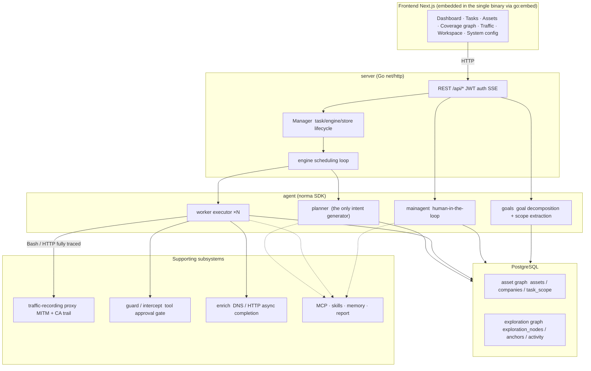
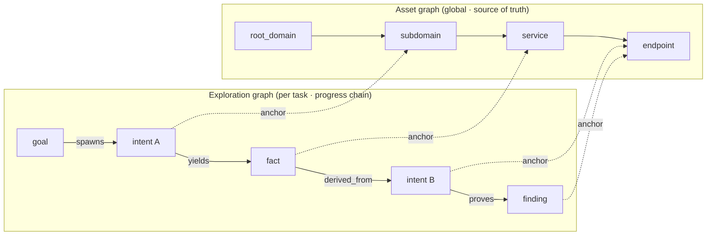
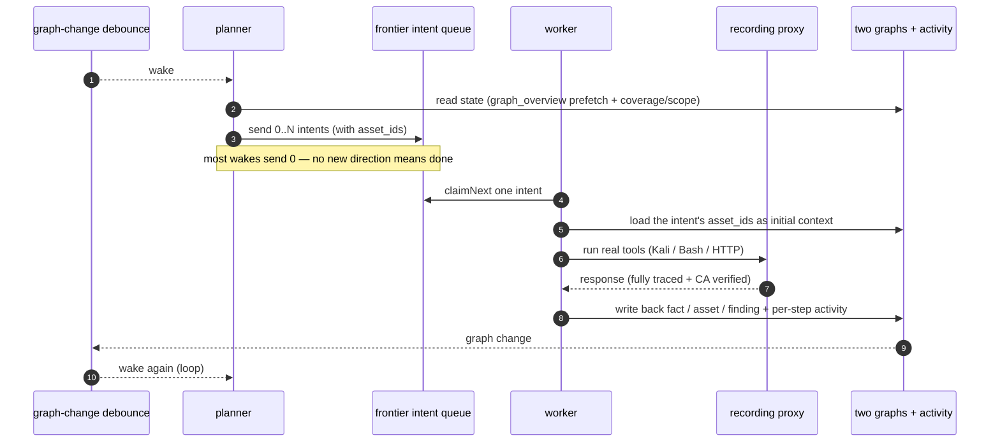
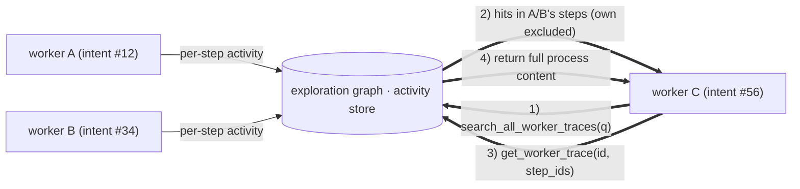
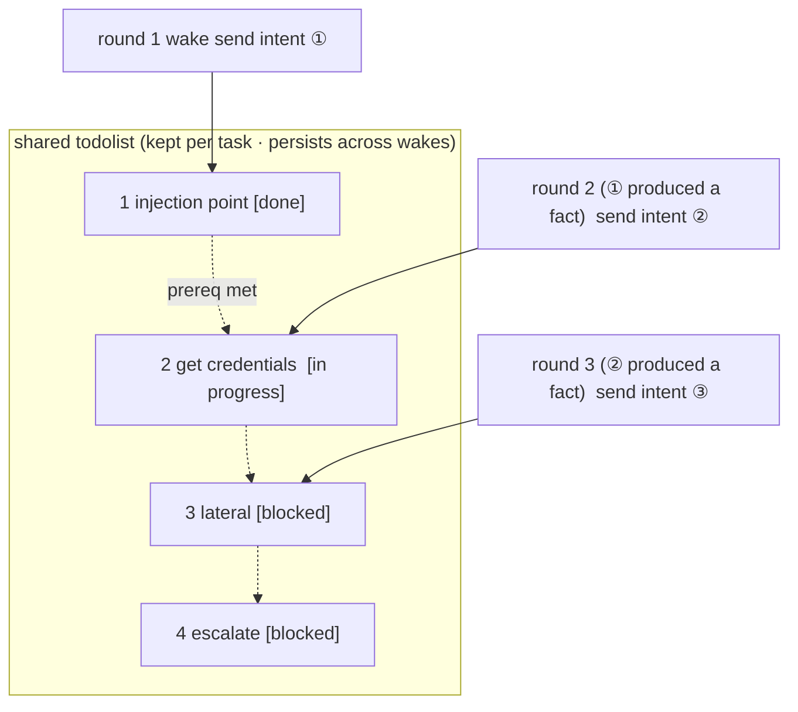

<div align="center">

# ScopeWeaver

Sistema autónomo multiagente de pruebas de penetración con LLM (backend Go + frontend Next.js)

[English](README.md) · [한국어](README.ko.md) · [简体中文](README.zh-Hans.md) · [繁體中文](README.zh-Hant.md) · [日本語](README.ja.md) · Español

</div>

---

> **Sobre este proyecto.** ScopeWeaver es una obra derivada de [Autumn-27/ARTEX](https://github.com/Autumn-27/ARTEX),
> con nueva marca y traducción al inglés y coreano. Se construyó a partir del commit original `160fe13`.

Fecha de modificación: **2026-10-02**. Consulta [procedencia y cambios](docs/es/PROVENANCE.md); no es una etiqueta de versión.

[Estado de verificación y limitaciones conocidas](docs/es/VERIFICATION.md).

> El código y la arquitectura proceden de ARTEX. Esta obra derivada independiente cambia el
> nombre del producto, la interfaz y mensajes en inglés/coreano, la documentación y los destinos de distribución. Consulta [Procedencia y cambios](#procedencia-y-cambios)
> para ver todas las diferencias con el original y [Licencia y exención de responsabilidad](#licencia-y-exención-de-responsabilidad)
> para los términos, que no cambian (AGPL-3.0).
>
> **Autorización.** Esta es una herramienta de pruebas de seguridad. Úsala solo contra sistemas propios o
> que tengas autorización explícita para probar. Las restricciones de uso originales siguen vigentes; léelas abajo.

---

## Idioma

El inglés es el idioma predeterminado. Selecciona inglés, coreano, chino simplificado (`zh-Hans`), chino tradicional
(`zh-Hant`), japonés (`ja`) o español (`es`) en la interfaz.
`zh`, `zh-CN` y `zh-SG` se resuelven a chino simplificado; las etiquetas Hans explícitas conservan su escritura incluso
con una región tradicional. `zh-TW`, `zh-HK` y `zh-MO` seleccionan chino tradicional;
las etiquetas Hant explícitas conservan su escritura incluso con una región simplificada. Las etiquetas regionales de japonés y español
se resuelven a `ja` y `es`. Los idiomas no compatibles pasan a la siguiente preferencia. Consulta la
[guía de idiomas para colaboradores](docs/es/i18n.md). El valor predeterminado persistente del servidor es
`language` en los ajustes del sistema; `SCOPEWEAVER_LANGUAGE` (o `ARTEX_LANGUAGE`) proporciona la alternativa del
entorno. `LANG` del sistema operativo no selecciona el idioma de la aplicación.

Las solicitudes priorizan `lang`, después las preferencias compatibles de `Accept-Language`, la cookie `scopeweaver_locale`
y finalmente el valor del servidor. Las tareas nuevas creadas por HTTP conservan su idioma entre colas y
reinicios; las antiguas sin idioma guardado usan el valor del servidor. Las indicaciones e instrucciones de salida de agentes integrados
usan el idioma de ejecución; las plantillas editadas por el usuario y las pruebas almacenadas permanecen intactas.
Las etiquetas de informes/CSV/ZIP usan el idioma de la solicitud de exportación. La [documentación completa](docs/es/README.md) y
las [referencias en coreano](docs/ko/README.md) incluyen indicaciones de habilidades incluidas.

Las conversaciones independientes de pruebas de penetración guardan hallazgos confirmados directamente en la página Hallazgos
bajo el grupo sin tarea asignada. Cada conversación conserva su propio historial de hallazgos entre
turnos sin iniciar una tarea. Si faltan o no son válidas las instrucciones de Auto, Pruebas de penetración, Redactor de informes
y Comprobación de hallazgos, se usan los valores predeterminados del rol; los fallos de renderizado aparecen en los registros del backend.

## Capturas de pantalla

Estas capturas muestran la interfaz inglesa de ScopeWeaver con los datos ficticios de demostración incluidos.
No representan escaneos de objetivos reales. Consulta las [capturas en coreano](README.ko.md#스크린샷)
y la [vista móvil](screenshots/en/mobile.png).

| Panel | Tareas |
| :---: | :---: |
|  |  |
| Hallazgos | Ajustes |
|  |  |

Las capturas originales en chino permanecen en [el directorio de capturas](screenshots), con atribución a
[ARTEX original](https://github.com/Autumn-27/ARTEX/tree/160fe13c243be361eeac5408c40a96e824fa842c/screenshots).

---

## Alcance de las pruebas y reglas de activos

El alcance de empresa/tarea declara el alcance de las pruebas: sirve de guía en los prompts y de filtro
para el registro de activos y la cobertura, y no constituye una barrera de red. Para bloquear llamadas
a herramientas fuera del alcance, como WebFetch o Bash, configura **reglas de intercepción**. De forma
predeterminada solo están configuradas las reglas integradas para comandos destructivos. Una barrera
de red real requiere controles de salida externos a ScopeWeaver, como un cortafuegos o un proxy de uso obligatorio.

Las reglas de permiso/bloqueo de activos limitan el registro (`insert_assets`, `add_intent` y las escrituras
de alcance del agente), no las llamadas de red. Edita las reglas de tarea en **Tarea → Resumen** y las
reglas globales de bloqueo en **Sistema → Intercepción → Activos**. Las reglas de tarea solo se aplican
dentro de una tarea; el chat independiente solo usa las reglas globales de bloqueo. El bloqueo tiene
prioridad sobre el permiso.

**Dominio (parcial)** (`fuzzy_domain`) compara etiquetas completas. Las reglas de bloqueo coinciden con
etiquetas en cualquier posición: `.gov` coincide con `x.gov` y `x.gov.uk`, pero no con `a.government.com`.
Las reglas de permiso solo coinciden con el dominio o sus subdominios: `juice-shop.internal` permite
`a.juice-shop.internal`, pero no `juice-shop.internal2` ni `juice-shop.internal.attacker.com`. Las reglas
existentes pueden rechazar inserciones de activos que antes se aceptaban. El `add_task_scope` del agente
y las adiciones automáticas de alcance del worker también deben superar las reglas de activos vigentes;
si falla la lectura de las reglas, se rechaza la escritura o se omite la adición. La edición manual del
alcance en la interfaz y las filas de alcance preexistentes no cambian.

## Registros de aprobación

La vista global «Registros de aprobación», el panel de tarea «Aprobación de intercepción» y las tarjetas de aprobación
mostradas en las conversaciones se expanden para mostrar todos los detalles. La presentación sigue el
[componente de detalles de aprobación de AegisHook](https://github.com/RuoJi6/AegisHook/blob/main/web/src/components/CallDetail.vue),
reutilizando el componente y tema originales.

## Sincronización de activos (ScopeSentry)

Puedes sincronizar datos de activos directamente desde [ScopeSentry](https://github.com/Autumn-27/ScopeSentry),
evitando recopilar dos veces los mismos datos:

- En la página **Sincronización de activos**, introduce la dirección y clave API de ScopeSentry para conectar la fuente.
- Elige qué sincronizar por **proyecto** o **tarea** y selecciona tipos de activo (dominio / subdominio /
  IP / puerto / sitio / endpoint …).
- Importa con un clic. Los activos se combinan en el alcance de activos de la empresa y pasan directamente al
  grafo de activos para que los agentes exploren.

---

## Instalación

Ejecuta solo un servidor ScopeWeaver activo por base de datos PostgreSQL. Su directorio de datos también debe
tener un único propietario. Detén el servidor anterior antes de iniciar uno de sustitución; no se admiten réplicas simultáneas
que compartan ninguno de los recursos. La recuperación inicial trata el trabajo de chat sin finalizar como
interrumpido y concilia archivos de transcripción sin publicar antes de reanudar las colas.

### GLM y otros proveedores de modelos

El formulario **LLM → Nuevo** incluye plantillas de GLM-5.3 para la API general de Z.ai y una
referencia Coding Plan etiquetada por separado. Añade tu clave API; elegir plantilla no guarda,
activa ni contacta al proveedor. Coding Plan está restringido a herramientas oficialmente compatibles y
ScopeWeaver no figura entre ellas. Consulta [configuración de proveedores y límites de compatibilidad](docs/es/llm-providers.md).
Para reducir tokens de nube, consulta [Controlar el uso de tokens](docs/es/llm-providers.md#controlar-el-uso-de-tokens).

El **puente OpenCode SDK** opcional admite `native` CLI/cliente **2.1.4** (predeterminado) y `legacy` SDK/CLI **1.19.4**, con token independiente y `providerID/modelID`. Norma de ScopeWeaver conserva herramientas y aprobaciones. El modo heredado mantiene JSON seguro, permite normalizar espacios/escapes, no conserva bytes originales y rechaza enteros inseguros. Ambos modos carecen de soporte Windows; las pruebas previas cubrieron macOS arm64 y el resultado CI alojado de Linux sigue pendiente. El modo LLM solo local lo rechaza porque el proveedor puede ser nube. Consulta [inicio, límites y preparación de degradación SDK](docs/es/llm-providers.md#opencode-sdk-bridge): los binarios anteriores no arrancan mientras existan perfiles SDK.

Los perfiles opcionales de **Ollama nativo** funcionan sin clave API. Tres plantillas cubren Ollama en el mismo
equipo, en el host desde Docker y el servicio opcional `docker compose --profile local-llm`. Elegir una consulta los modelos instalados y rellena uno, dando preferencia a la compatibilidad con herramientas declarada;
no descarga ni ejecuta modelos. Envían un contexto de 32K (`num_ctx` 32,768), una solicitud a la vez y keep-alive de 30 minutos. El ajuste opcional
**red LLM exclusivamente local** (desactivado por defecto) permite solo loopback y CIDR de inferencia de confianza explícitos; las direcciones LAN y Docker requieren ahora una entrada en la lista de permitidos. También bloquea toda búsqueda web de agentes y comprobación/descarga de actualizaciones, conservando el estado de versión local y la reversión. Las herramientas de objetivos conservan acceso de red; Ollama del host/remoto debe usar aparte `OLLAMA_NO_CLOUD=1`. Fuera del modo estricto, siguen funcionando formatos de nube, URL personalizadas y proxies. Las solicitudes nativas dan el siguiente hueco disponible a llamadas en cola del juez/agente principal/preguntas paralelas, con valor predeterminado del juez nativo de 90 segundos/preguntar y protecciones de contexto limitadas. Consulta
[Ollama nativo](docs/es/llm-providers.md#ollama-nativo-inferencia-local).

> Requiere una base de datos **PostgreSQL**. La exploración necesita un **LLM** configurado
> (`ANTHROPIC_API_KEY` u `OPENAI_API_KEY`, un perfil Ollama sin clave o configúralo en la interfaz).

### Opción 1: script de instalación con un clic (recomendado)

```bash
git clone https://github.com/cskwork/scopeweaver.git
cd scopeweaver
./install.sh
```

El script detecta (y opcionalmente instala) Docker y permite elegir **① todo en Docker** o
**② compilar y ejecutar localmente**:

- **① Todo en Docker**: introduce una contraseña Postgres (pulsa Entrar para una aleatoria) → escribe
  `.env` → `docker compose up -d`.
- **② Local**: elige una base de datos (conectar a una existente o iniciar una con Docker) →
  genera `config.json` → `go` compila un binario único con frontend integrado → inicia.

Una vez iniciado, abre **http://localhost:8787** (la primera visita lleva a `/setup` para establecer la contraseña
de administrador).

> Las indicaciones de los scripts usan inglés por defecto. Establece `SCOPEWEAVER_LANGUAGE` (o `ARTEX_LANGUAGE`) en
> `en`, `ko`, `zh-Hans`, `zh-Hant`, `ja` o `es`, por ejemplo `SCOPEWEAVER_LANGUAGE=ko ./install.sh`.
> Los tokens de respuesta como `y/n` y los nombres de comandos/opciones no cambian.

### Opción 2: Docker Compose (manual)

```bash
git clone https://github.com/cskwork/scopeweaver.git
cd scopeweaver
cp .env.example .env          # set POSTGRES_PASSWORD, optionally ANTHROPIC_API_KEY
docker compose up -d --build  # builds the scopeweaver image locally + postgres
# → http://localhost:8787
```

> El archivo Compose predeterminado **compila la imagen localmente** desde este código. Para usar una imagen
> publicada de `ghcr.io/cskwork/scopeweaver`, selecciona explícitamente su versión en Compose.

La imagen incluye herramientas habituales (ripgrep/curl/vim/npm/nmap…); `./skills` y `./data` se
montan como directorios del host para persistir.

Un MCP remoto puede usar `http` (Streamable HTTP) o `sse` (SSE anterior) en ajustes del sistema. Los servidores SSE anteriores
suelen abrir el flujo de eventos con `GET /sse` y reciben después solicitudes JSON-RPC en la
`/message?sessionId=...` devuelta por el servidor; establece la URL en `/sse` y la cabecera en
`Authorization=Bearer <token>`.

### Opción 3: descargar un binario precompilado (Releases)

> Descarga un archivo de plataforma desde [Releases](https://github.com/cskwork/scopeweaver/releases).
> El archivo de cada plataforma es
> `scopeweaver-<version>-<os>-<arch>.zip`, que se descomprime en `scopeweaver` + `start.sh`
> (`start.bat` en Windows) + `skills/` + `config.example.json`:

El archivo también incluye `adapters/agent/`; consulta las [instrucciones de configuración del agente](docs/es/agent-adapter.md).

```bash
cp config.example.json config.json   # fill in the database connection
./start.sh                            # → http://localhost:8787
```

> Inicia con `start.sh` / `start.bat`, no con `./scopeweaver` directamente. Es un supervisor: tras salir el
> programa, decide según el código de salida si debe relanzarlo, y la
> [actualización con un clic en la aplicación](#opción-1-actualización-con-un-clic-en-la-aplicación-recomendada) depende de él para sustituir
> la compilación. Ejecutar `./scopeweaver` directamente significa que una actualización no se relanzará.
> Para ejecutar en segundo plano: `nohup ./start.sh >scopeweaver.log 2>&1 &`.

### Opción 4: compilar un binario único desde código fuente

```bash
# 1) export the frontend as static files
cd web && npm ci && npm run build:static && cd ..
# 2) copy it into the embed directory
mkdir -p server/webui/dist
cp -R web/out/. server/webui/dist/
# 3) build (the embedui tag embeds the frontend)
CGO_ENABLED=0 go build -tags embedui -o scopeweaver ./cmd/artex
./start.sh
```

> La ruta fuente de compilación sigue siendo `./cmd/artex` y el módulo Go sigue siendo `github.com/Autumn-27/artex`
> por compatibilidad con el original. Solo el binario de salida se llama `scopeweaver`.

### Opción 5: compilar archivos de distribución multiplataforma

`build.sh` compila e integra el frontend, elimina información de depuración con el enlazador Go y comprime cada
versión. El modo de distribución compila Linux amd64/arm64, macOS amd64/arm64 y Windows amd64 por defecto:

Los archivos incluyen `THIRD_PARTY_NOTICES.txt`; las imágenes de contenedor conservan el mismo aviso en
`/app/THIRD_PARTY_NOTICES.txt` para la hoja de estilos shadcn incluida.

```bash
./build.sh --release
# output: dist/scopeweaver-0.3.3-*.zip
```

Los binarios autoextraíbles comprimidos con UPX pueden ser incompatibles con algunos kernels Linux, virtualización o políticas de
seguridad, por lo que UPX está desactivado por defecto. Configura destinos con `ARTEX_TARGETS` y pasa `--upx` explícitamente cuando hayas confirmado la compatibilidad del destino:

```bash
ARTEX_TARGETS=linux/amd64,windows/amd64 ./build.sh --release
./build.sh --target linux/amd64 --upx
```

### Despliegues con proxy inverso

Las compilaciones de producción sirven la interfaz, API y transmisiones SSE en directo desde el mismo origen.
Puedes exponer HTTPS en el puerto 443 y mantener privado el puerto del backend. Desactiva el almacenamiento en búfer del proxy
y permite conexiones duraderas para que los eventos en directo lleguen al navegador:

```nginx
location / {
    proxy_pass http://127.0.0.1:8787;
    proxy_set_header Host $host;
    proxy_set_header X-Forwarded-Proto $scheme;
    proxy_http_version 1.1;
    proxy_set_header Connection "";
    proxy_buffering off;
    proxy_cache off;
    proxy_read_timeout 3600s;
}
```

Establece `NEXT_PUBLIC_SSE_BASE` al compilar solo cuando SSE use otro origen.
Cambiarlo durante la ejecución del contenedor no cambia el frontend exportado. Durante
`next dev`, SSE sigue conectando directamente al puerto 8787 para evitar el búfer de Next.js;
un `NEXT_PUBLIC_SSE_BASE` explícitamente vacío selecciona el mismo origen.

---

## Actualización

> Las actualizaciones solo sustituyen el programa; los datos permanecen. Se conservan el volumen Postgres `pgdata`, `./data`
> (jwt.key / SQLite / …) y `./skills`. **Las migraciones de base de datos se ejecutan
> automáticamente**: `scopeweaver` vuelve a ejecutar `schema.sql` idempotentemente en cada inicio (incluidos `ADD COLUMN` /
> `CREATE INDEX IF NOT EXISTS`), por lo que «reiniciar es migrar». Aun así, haz copia de `./data` y la base de datos
> antes de actualizar.

### Opción 1: actualización con un clic en la aplicación (recomendada)

En la página **Configuración del sistema** (barra lateral «Configuración del sistema» → `/system/settings`), la
tarjeta **Versión y actualizaciones** busca e instala nuevas versiones sin entrar al servidor.

Tras pulsar «Actualizar»: descarga la versión de tu plataforma → comprueba contra el
`SHA256SUMS` de la versión → prueba el nuevo binario con `-h` → lo prepara como `scopeweaver.new` →
el programa sale y `start.sh` / `start.bat` lo relanza para completar la sustitución. La página espera a
que arranque la nueva versión y se actualiza.

- **Una actualización fallida no deja un programa roto**: si falla la verificación o la prueba básica, se descarta el archivo
  preparado y sigue ejecutándose la versión actual. Si una versión sustituida no logra iniciar
  tres veces seguidas, revierte automáticamente a `scopeweaver.old` (la fallida se conserva como
  `scopeweaver.failed` para inspección).
- **Revertir en cualquier momento**: la versión anterior se conserva como `scopeweaver.old` y la tarjeta tiene un
  botón «Volver a la versión anterior». Ten en cuenta que el esquema de la base de datos no se revierte.
- **Actualizar interrumpe las tareas en curso**: una actualización es un reinicio; hazla cuando esté inactivo.
- **Las compilaciones de desarrollo no reciben actualizaciones**: se desactiva si la versión es `dev` o una
  cadena de `git describe` con sufijo, para evitar que una versión sobrescriba un binario de depuración local.
- **En Docker solo cambia el programa, no la imagen**: las herramientas playwright / nmap de la
  imagen no se actualizan a la vez y reconstruir el contenedor con `docker compose up -d` vuelve
  a las versiones incluidas en la imagen. Para actualizar también la imagen, usa
  `docker compose pull scopeweaver && docker compose up -d scopeweaver` (cuando exista una imagen publicada;
  si no, `docker compose up -d --build scopeweaver`).
- Si necesitas un proxy para acceder a GitHub, configura el **proxy global** en la misma página y la actualización
  lo usará. Las actualizaciones solo descargan de dominios de GitHub y exigen HTTPS.

### Opción 2: script de actualización con un clic

```bash
cd scopeweaver
./update.sh
```

El script ejecuta opcionalmente `git pull` primero y permite elegir **① actualizar Docker** o
**② actualizar compilación local** (como `install.sh`):

- **① Docker**: vuelve a compilar la copia actual con `docker compose build scopeweaver` y
  recrea el servicio con `docker compose up -d scopeweaver`.
- **② Local**: vuelve a compilar la salida estática del frontend → recompila `./scopeweaver` (reinicia el proceso
  para aplicar).

### Opción 3: Docker Compose (manual)

```bash
cd scopeweaver
git pull                       # update compose / scripts (optional)
# To pin a source version, check out a reviewed tag or commit before building.
docker compose up -d --build scopeweaver   # rebuild from source and restart → auto-migrate schema
docker image prune -f          # clean up old images (optional)
```

> Cuando exista una imagen publicada y Compose la seleccione explícitamente, sustituye la compilación por
> `docker compose pull scopeweaver && docker compose up -d scopeweaver`.

### Opción 4: binario precompilado (Releases)

Descarga el nuevo `scopeweaver-<version>-<os>-<arch>.zip`, detén el proceso anterior,
sobrescribe `scopeweaver` y `skills/` (conserva `config.json` y `data/`) y reinicia:

```bash
cp -r <unpacked>/skills ./ && cp <unpacked>/scopeweaver ./
./start.sh
```

### Opción 5: compilar desde código fuente

```bash
git pull
cd web && npm ci && npm run build:static && cd ..
cp -r web/out server/webui/dist
CGO_ENABLED=0 go build -tags embedui -o scopeweaver ./cmd/artex
# restart ./start.sh
```

---

## Configuración

### Integración con agentes de programación

Claude Code, Codex y Pi pueden crear tareas y consultar progreso, cobertura y hallazgos mediante el
[adaptador de agentes](docs/es/agent-adapter.md). Claude Code/Codex usan MCP stdio local; Pi usa una extensión
nativa. Las lecturas están activadas por defecto; la creación y pausa/reanudación de tareas se activan explícitamente
mediante configuración. El adaptador usa la API autenticada existente y conserva los agentes internos
y la configuración de modelos de ScopeWeaver.

**Base de datos** (`config.json` o sustituir con la variable de entorno `ARTEX_PG_DSN`):

```json
{
  "database": {
    "host": "127.0.0.1", "port": 5432,
    "user": "artex", "password": "yourpass",
    "dbname": "artex", "sslmode": "disable"
  }
}
```

> Las claves de configuración y entorno conservan el prefijo `ARTEX_*` y los valores de base de datos `artex`
> por compatibilidad con el original. Los scripts también aceptan los alias `SCOPEWEAVER_*` donde se indica.

**LLM**: `export ANTHROPIC_API_KEY=sk-...` (u `OPENAI_API_KEY`), o configúralo en la página «Configuración
LLM» de la interfaz. Opcionales: `ARTEX_LLM_PROVIDER` / `ARTEX_LLM_MODEL` / `ARTEX_LLM_BASE_URL` /
`ARTEX_LLM_PROXY`. Cada alias `SCOPEWEAVER_LLM_*` prevalece sobre su equivalente `ARTEX_LLM_*`; Ollama
también acepta los sufijos `CONTEXT_WINDOW_K`, `MAX_CONCURRENT`, `KEEP_ALIVE` y `MAX_TOKENS`
([lista completa](docs/es/llm-providers.md#entorno-y-configuración)).

**Concurrencia**: el número de agentes de trabajo por tarea se configura en «Configuración del sistema» (3 por defecto).

**Opciones habituales**: `./start.sh -addr :8787 -proxy :8788` (`-addr` es frontend + API; `-proxy` es el
proxy de captura de tráfico). El script de inicio pasa las opciones directamente a `scopeweaver`.

---

## Desarrollo

Las contribuciones son bienvenidas. Consulta [CONTRIBUTING.md](CONTRIBUTING.es.md) para requisitos, comprobaciones y revisión e integración de solicitudes de cambio.

### Comprobación manual de vulnerabilidades

La pestaña «Volver a comprobar» de detalles de tarea pagina sus vulnerabilidades, muestra las conclusiones
y pruebas anteriores de cada una y permite iniciar una comprobación manualmente. Al iniciarla conserva la pestaña
actual y muestra un indicador y «Comprobando de nuevo»; al confirmar una corrección actualiza el estado de vulnerabilidad.

Pulsa «Volver a comprobar» en una fila de la lista de vulnerabilidades o «Iniciar comprobación» en el área
«Volver a comprobar» de detalles de vulnerabilidad y añade opcionalmente versión corregida, condiciones o límites. El sistema crea
una sesión independiente del agente de comprobación y conserva la página actual. Las vistas plana, agrupada por tarea y por activo
ofrecen esta entrada; una comprobación activa muestra un indicador y «Comprobando de nuevo» y se puede pulsar
para ver la sesión. Al terminar vuelve a «Volver a comprobar». Una comprobación no reinicia la tarea de escaneo
original. Las conclusiones son «Aún reproducible», «Corregida» o «No se puede confirmar», y cada conclusión,
sus pruebas y enlace de sesión se guardan en detalles de vulnerabilidad.

El backend más reciente crea un agente editable «Comprobación de vulnerabilidades» (`retester`) en el primer inicio;
puedes configurar instrucciones, LLM, presupuesto de ejecución y herramientas en gestión de agentes. Usa su LLM vinculado
por defecto o la configuración activa global si no tiene vínculo. Cuando una sesión de comprobación termina
correctamente con conclusión «Corregida», el sistema establece automáticamente la resolución de la vulnerabilidad
en «Corregida»; los estados en ejecución, fallidos, detenidos u otras conclusiones conservan el estado original. Las pruebas
y el informe originales siempre se conservan. También puedes establecer «Corregida» manualmente en el desplegable de estado.

El historial de esta versión se consulta mediante detalles de vulnerabilidad y sesión; aún no se incluye en
la exportación de informes ni el archivo de tareas y no se vincula automáticamente a una captura de tráfico.
El modo demostración solo produce registros simulados claramente etiquetados y no toca objetivos reales.

### Ejecución local y pruebas

```bash
./dev.sh    # backend(:8787) + traffic proxy(:8788) + frontend next dev(:5173) → http://localhost:5173
```

- Backend: `go run ./cmd/artex` (sin `-tags embedui`, el frontend no se integra)
- Frontend: `cd web && npm run dev` (`/api` se redirige al backend mediante proxy inverso, con recarga en caliente)
- Pruebas: `go test ./...`
- Vista previa simulada (sin backend): `cd web && NEXT_PUBLIC_MOCK=1 npm run dev`

---

## Arquitectura

ScopeWeaver (ARTEX internamente) es un **sistema autónomo multiagente de penetración con LLM**: un único
backend Go (con frontend Next.js integrado) más PostgreSQL. Las capacidades de agentes proceden del SDK
[`norma`](https://github.com/Autumn-27/norma) (`agentcore` / `tool` / `permission` / `harness` /
`memory` / `transcript`). El núcleo es una **arquitectura de dos grafos**, con dos mecanismos de autonomía
construidos a su alrededor: **intercambio de información entre procesos de trabajadores** y una **lista de tareas
compartida del planificador entre rondas que mantiene estable la cadena de ataque**.

### Capas



| Capa | Responsabilidad |
| --- | --- |
| **Frontend** | Exportación estática Next.js integrada en un único binario con `go:embed`; visualiza tareas/activos/exploración/cobertura y el chat con supervisión humana |
| **server** | Enrutamiento `net/http` + autenticación JWT + SSE; `Manager` gestiona el ciclo de vida de tareas, motores y almacenes de BD |
| **engine** | Un `plannerLoop` + N goroutines de trabajador por tarea; asignación de intenciones, tiempo límite/pausa/vaciado |
| **agent** | goals / planner / worker / mainagent; `ToolSet` expone los dos grafos como herramientas LLM |
| **db** | Almacenamiento Postgres (pgx) de ambos grafos; esquema integrado con `go:embed` y creado idempotentemente en cada inicio |
| **support** | Proxy MITM de grabación, control de aprobación, finalización asíncrona, MCP/habilidades/memoria/informes |

### Arquitectura de dos grafos: grafo de exploración + grafo de activos

El sistema divide «**qué es el objetivo**» y «**hasta dónde se ha probado**» en dos
grafos independientes conectados mediante anclajes:

- **Grafo de activos (global, compartido)**: fuente única de verdad de activos entre tareas. Los nodos son
  `root_domain / subdomain / ip / service / app / endpoint`, cada uno propiedad de una empresa. Las
  relaciones padre-hijo dominio→subdominio→servicio→endpoint y las claves de deduplicación las calcula
  el programa; los agentes solo envían observaciones sin procesar.
- **Grafo de exploración (por tarea)**: el «pensamiento y progreso» de una tarea. Los nodos son
  `goal / intent / fact / finding / hint`, conectados por aristas `spawns / derived_from / yields / proves`
  en una **cadena de linaje** que responde «qué dirección derivó de qué hechos y qué
  produjo».
- **Los dos grafos se conectan mediante anclajes**: `exploration_anchors(node_id, asset_id)` ancla una
  intención/hecho/hallazgo a un activo concreto, permitiendo ver qué activos sondea una dirección y,
  desde cualquier activo, consultar qué intenciones lo probaron en esta tarea y qué hechos produjeron. Esto
  también alimenta la **cobertura de pruebas de activos** y el **grafo de cobertura de activos** (activos en alcance + probados
  resaltados).



> Reparto de trabajo: el **planificador** lee el estado del grafo de exploración, evalúa el objetivo y solo
> envía una **intención** a la frontera cuando hay una dirección nueva sin cubrir; un **trabajador** se asigna
> **una intención**, ejecuta herramientas reales, registra activos/hechos/hallazgos nuevos en ambos grafos y
> se detiene. El grafo de activos contiene hechos compartidos; el de exploración es la cadena de progreso de cada tarea.

### Motor y ciclo de vida de intenciones (un bucle de exploración)

El motor es un bucle **dirigido por eventos**: un cambio del grafo activa el planificador, que envía intenciones;
un trabajador se asigna una intención, ejecuta y registra resultados, y ese registro activa la siguiente ronda,
hasta que se demuestra el objetivo (`prove_goal`).



### Intercambio de información entre procesos de trabajadores

En una exploración profunda, muchas observaciones valiosas (un error, una respuesta, un parámetro oculto) aparecen
en el **proceso de ejecución** de un trabajador sin escribirse como hecho formal. Para evitar trabajo
duplicado y permitir que los trabajadores de una cadena aprovechen los avances de otros, un trabajador puede **buscar entre los
procesos de otros trabajadores**:

- `search_all_worker_traces(q)`: buscar palabras en el **proceso de ejecución de otros trabajos de esta tarea**
  (excluye automáticamente los pasos de la propia intención); las coincidencias llevan `intent_id`.
- `list_worker_traces` / `get_worker_trace(intent_id, step_ids=[…])`: ver primero qué trabajos se ejecutaron
  y recuperar después el contenido completo de pasos concretos de un trabajo para un intercambio detallado.

Así, aunque el grafo de exploración aún no tenga un hecho coincidente, los trabajadores posteriores pueden reutilizar las
observaciones en proceso de otros: **la información fluye entre trabajadores con granularidad de «proceso de
ejecución»**, manteniendo el límite (cada trabajador sigue realizando solo la intención que se asignó).



### Lista compartida del planificador entre rondas → una cadena de ataque estable

Una cadena de ataque real suele ser una **secuencia de varios pasos con dependencias** (encontrar inyección →
obtener credenciales → moverse lateralmente → escalar). Enviarlo todo a la vez en paralelo solo
causa desorden. Por ello, el planificador mantiene una **lista de planificación por tarea compartida entre
activaciones**:

- El planificador responde a eventos: un cambio del grafo lo activa, pero **cada activación es una sesión nueva**; la
  lista compartida permite **registrar una vez una cadena de explotación secuencial** y después **enviar intenciones paso
  a paso entre rondas** según las dependencias, en lugar de desplegar de antemano toda la cadena en
  una ronda.
- Cada ronda envía una intención solo para el siguiente paso cuyos «requisitos previos están completos y hechos
  dependientes existen», y actualiza la lista al avanzar (marca completados los pasos satisfechos por hechos).



Así, la cadena de ataque **avanza de forma estable, sin repeticiones ni desorden**, incluso en un entorno «dirigido por eventos +
sesiones sin estado»: la clave de cómo el sistema recorre por sí mismo una cadena de explotación de varios
pasos.

---

## Procedencia y cambios

ScopeWeaver deriva de [Autumn-27/ARTEX](https://github.com/Autumn-27/ARTEX) en el commit original
`160fe13`. Cambios de esta obra derivada independiente:

- **Nombre del producto**: «ARTEX» → «ScopeWeaver» en documentación visible al usuario, scripts y
  distribución. El módulo Go (`github.com/Autumn-27/artex`), la ruta de compilación (`./cmd/artex`),
  las claves de configuración/entorno `ARTEX_*` y los valores de BD `artex` se **conservan** por compatibilidad.
- **Idioma de documentación**: inglés por defecto; las guías mantenidas de usuarios/colaboradores tienen ediciones en coreano,
  chino simplificado, chino tradicional, japonés y español enlazadas desde cada guía.
- **Idioma de scripts**: las indicaciones de configuración/compilación/inicio/actualización/restablecimiento de contraseña/desarrollo usan inglés por defecto;
  `SCOPEWEAVER_LANGUAGE` (también funciona `ARTEX_LANGUAGE`) selecciona `en`, `ko`, `zh-Hans`, `zh-Hant`,
  `ja` o `es`. No se usa traducción por red.
- **Distribución**: el binario de salida es `scopeweaver`, los archivos de versión son
  `scopeweaver-<version>-<os>-<arch>.zip`, el repositorio es
  `https://github.com/cskwork/scopeweaver` y las imágenes de contenedor se dirigen al GHCR de este repositorio. No se usa la
  imagen Docker Hub original (`autumn27/artex`).
- **Historial de versiones de ScopeWeaver**: las versiones independientes empiezan en `v0.1.0`, con notas en
  [log/](log/changelog-v0.1.0.md). Las etiquetas de versión activan archivos de plataforma y compilaciones de contenedor.
  Docker Compose sigue compilando localmente salvo que se seleccione explícitamente una imagen publicada.

La traducción del registro de cambios en [CHANGELOG.md](CHANGELOG.md) describe fielmente la historia del proyecto **ARTEX
original**; no atribuye esos cambios a ScopeWeaver.

### Capturas y recursos localizados

Las capturas localizadas están en `screenshots/en/` y `screenshots/ko/`. Muestran los datos de demostración
incluidos en escritorio y móvil. Las capturas originales de ARTEX en otros lugares de `screenshots/` permanecen
sin cambios y con atribución al original.

---

## Agradecimientos

- **Original**: [Autumn-27/ARTEX](https://github.com/Autumn-27/ARTEX), el proyecto del que deriva esta
  obra. El código y la arquitectura originales se atribuyen a sus autores.
- **SDK de agentes**: [`norma`](https://github.com/Autumn-27/norma).
- **Sincronización de activos**: [ScopeSentry](https://github.com/Autumn-27/ScopeSentry).
- **Interfaz de detalles de aprobación**: [AegisHook](https://github.com/RuoJi6/AegisHook).
- **Referencia**: [Cairn](https://github.com/oritera/Cairn).
- **Comunidad original**: los autores de ARTEX gestionan la cuenta pública de WeChat **SecSentry**
  (`screenshots/wx.png` es su código QR, conservado como recurso original). Es el canal del proyecto
  original, no un canal de ScopeWeaver.

---

## Licencia y exención de responsabilidad

> Esta sección conserva la licencia original y las restricciones de uso y exención de responsabilidad de sus autores,
> traducidas fielmente de ARTEX. Los términos no cambian.

### Licencia de código abierto

Este proyecto tiene licencia **GNU Affero General Public License v3.0 (AGPL-3.0)**. Los términos completos
están en el archivo [LICENSE](LICENSE) de la raíz del repositorio.

Esto significa que cualquiera puede usar, modificar y distribuir libremente el proyecto, pero **las obras derivadas también deben
publicarse como código abierto bajo AGPL-3.0**; en particular, **si modificas este proyecto y lo ofreces a
usuarios por una red (por ejemplo, como servicio alojado), debes proporcionar también a esos usuarios el
código fuente correspondiente completo.**

> ⚠️ **Importante**: una licencia de código abierto no restringe por sí misma cómo se puede usar el software.
> Las «restricciones de uso» y la «exención de responsabilidad» siguientes son condiciones adicionales y una declaración seria
> de los autores a los usuarios. Respétalas.

**ARTEX está destinado solo al estudio personal, investigación del código fuente y validación técnica local. No
debe usarse para lanzar pruebas reales contra ningún sistema o sitio web en línea.**

### Uso permitido

- Solo para **leer, estudiar e investigar el código fuente de este proyecto** y validar sus
  principios técnicos en un **entorno aislado local**.
- Adecuado para estudio personal, investigación académica, revisión de código y otros usos no ofensivos.

### Prohibiciones

- **No uses esta herramienta para escanear, sondear, explotar ni atacar ningún sitio web, servicio en línea ni
  sistema en red** (tengas o no autorización y sea o no tuyo el activo).
- No uses esta herramienta para pruebas de penetración reales, ejercicios rojo/azul ni entornos de producción.
- No uses esta herramienta para intrusión ilegal, robo de datos, extorsión, denegación de servicio ni ninguna
  actividad destructiva o delictiva.
- No uses esta herramienta para nada que infrinja las leyes y normas de tu país o región.

### Responsabilidad de cumplimiento

Los usuarios deben cumplir todas las leyes y normas sobre ciberseguridad, protección de datos y delitos informáticos
de su país o región (en China continental, incluidas entre otras la Ley de Ciberseguridad,
la Ley de Seguridad de Datos, la Ley de Protección de Información Personal y las interpretaciones judiciales
relacionadas). **Toda responsabilidad legal y consecuencias derivadas del uso de esta herramienta corresponden al
usuario.**

### Exención de responsabilidad

Este proyecto se proporciona «TAL CUAL», sin garantías expresas ni implícitas. Los autores y
colaboradores no responden por pérdidas directas o indirectas, pérdida de datos, daños al sistema ni litigios
derivados del uso de esta herramienta, tanto si fue adecuado como si no. **Al descargar,
instalar o usar este proyecto, confirmas que has leído, comprendido y aceptado todos los
términos anteriores.**
