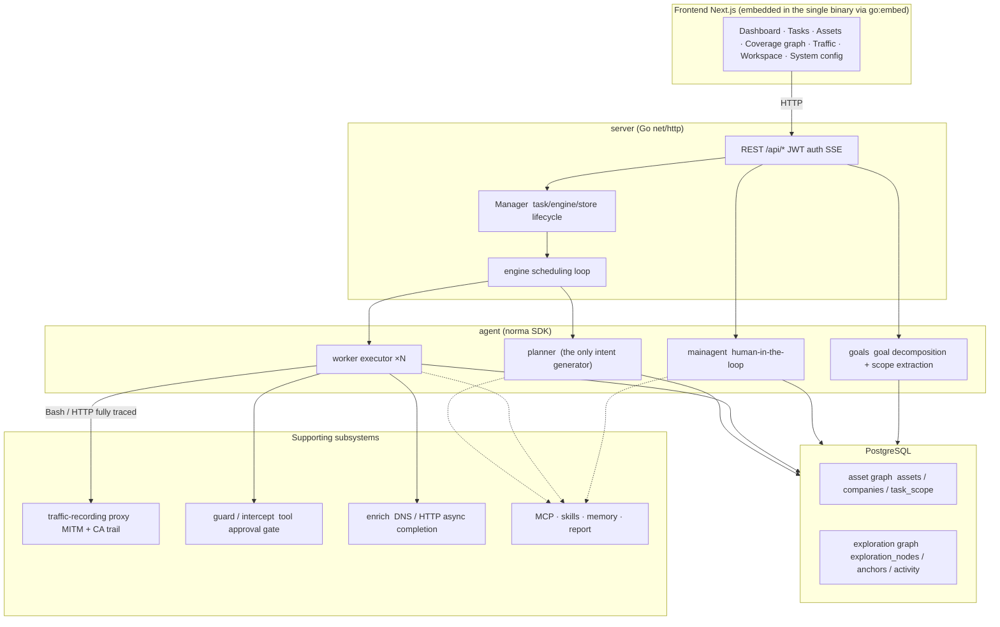
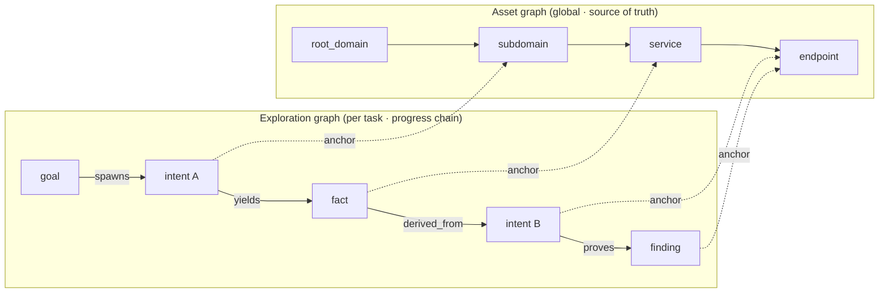
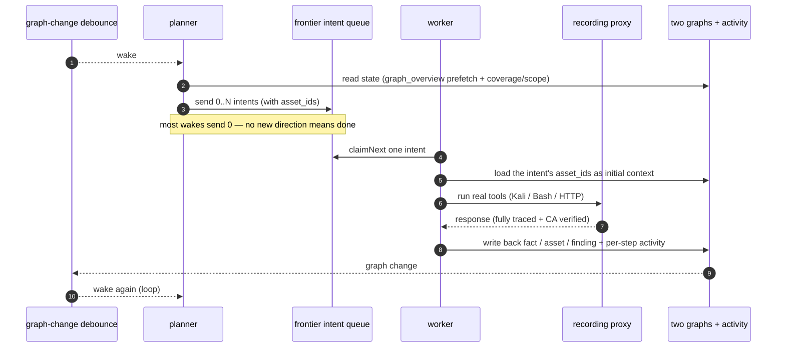
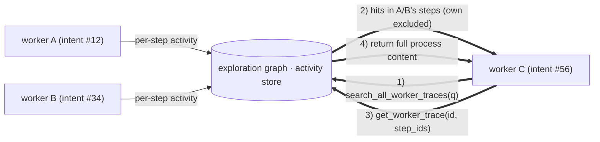
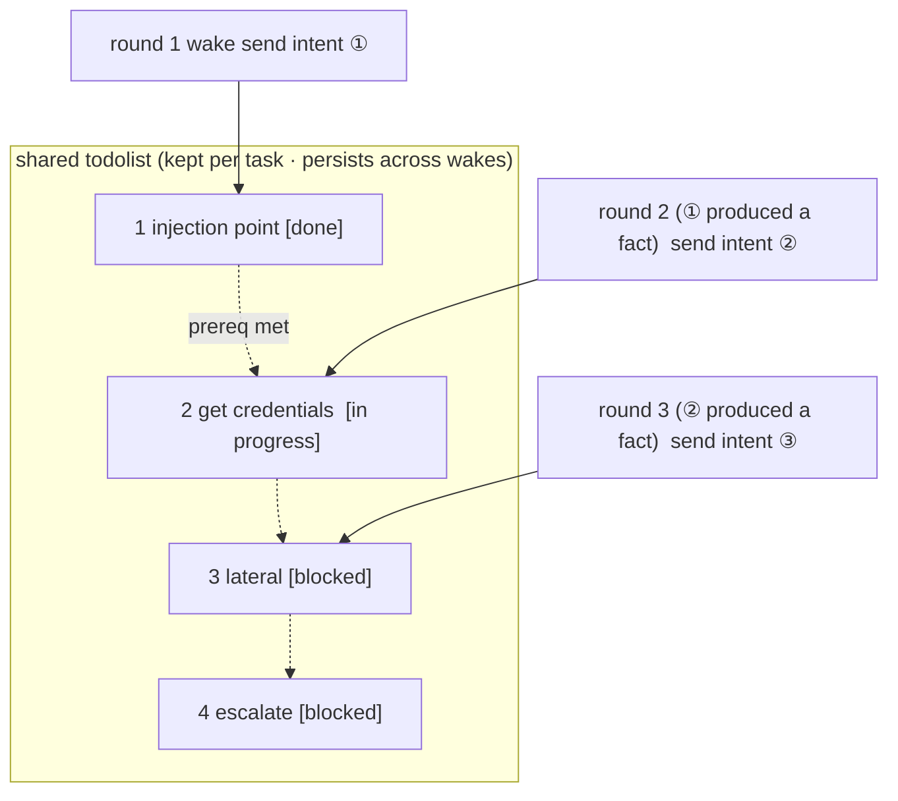

[English](README.md) | [한국어](README.ko.md) | [简体中文](README.zh-Hans.md) | [繁體中文](README.zh-Hant.md) | [日本語](README.ja.md) | [Español](README.es.md)

<div align="center">

<a id="scopeweaver"></a>
# ScopeWeaver

LLM の複数エージェントによる自律型ペネトレーションテストシステム（Go バックエンド + Next.js フロントエンド）


</div>

---

> **このプロジェクトについて。** ScopeWeaver は [Autumn-27/ARTEX](https://github.com/Autumn-27/ARTEX) の派生物で、
> 名称を変更し、英語・韓国語に翻訳しました。上流のコミット `160fe13` を基にしています。

変更日: **2026-10-02**。[出典と変更内容](docs/ja/PROVENANCE.md)を参照してください。これはリリースタグではありません。

[検証状況と既知の制限](docs/ja/VERIFICATION.md)。

> コードとアーキテクチャは ARTEX に由来します。この独立した派生物では、製品名、
> 英語・韓国語の画面とメッセージ、ドキュメント、配布先を変更しています。上流との差の全体は[出典と変更内容](#provenance-and-changes)、
> 利用条件は[ライセンスと免責事項](#license-and-disclaimer)を
> 参照してください。条件は変更していません（AGPL-3.0）。
>
> **許可。** セキュリティテスト用のツールです。自分が所有するか、
> テストを明示的に許可されたシステムにのみ使ってください。上流の使用制限も適用されます。必ず下記をお読みください。

---

<a id="language"></a>
## 言語

英語が既定です。画面で英語、韓国語、簡体字中国語（`zh-Hans`）、繁体字中国語（`zh-Hant`）、日本語（`ja`）、スペイン語（`es`）を選択できます。`zh` 単独、`zh-CN`、`zh-SG` は簡体字中国語に解決します。Hans を明示したタグは繁体字の地域でも文字体系を保持します。`zh-TW`、`zh-HK`、`zh-MO` は繁体字中国語を選び、Hant を明示したタグは簡体字の地域でも文字体系を保持します。日本語・スペイン語の地域タグは `ja`・`es` に解決します。未対応の言語は次の設定に進みます。[貢献者向けロケールガイド](docs/ja/i18n.md)を参照してください。サーバーの永続的な既定値はシステム設定の `language` で、`SCOPEWEAVER_LANGUAGE`（または `ARTEX_LANGUAGE`）が環境側のフォールバックです。OS の `LANG` はアプリケーションの言語を選択しません。

リクエストは `lang`、対応する `Accept-Language`、`scopeweaver_locale` Cookie、サーバーの既定値の順に優先します。HTTP で新規作成したタスクは、キューや再起動を越えて言語を保持し、言語未保存の古いタスクはサーバーの既定値を使います。組み込みエージェントの指針と出力指示は実行言語を使い、ユーザーが編集したテンプレートと保存済みの証拠は保持します。レポート・CSV・ZIP のラベルは、エクスポート要求の言語を使います。[全ドキュメント](docs/ja/README.md)と[韓国語の参照資料](docs/ko/README.md)には、同梱スキルのガイドも含まれます。

独立したペネトレーションテストの会話は、確認済みの検出事項を、タスク未割り当てのグループとして検出事項ページに直接保存します。各会話はタスクを始めずにターンをまたいで独自の検出履歴を保持します。Auto、ペネトレーションテスト、レポート作成、検出事項の再テストのプロンプトが欠落・無効なら、それぞれの役割の既定値に戻り、描画失敗はバックエンドのログに残ります。

<a id="screenshots"></a>
## スクリーンショット

同梱の架空のデモデータを使った英語画面です。実際の対象のスキャン結果ではありません。[韓国語の画面](README.ko.md#스크린샷)と[モバイル表示](screenshots/en/mobile.png)も参照してください。

| ダッシュボード | タスク |
| :---: | :---: |
|  |  |
| 検出事項 | 設定 |
|  |  |

元の中国語の画面は[スクリーンショットのディレクトリ](screenshots)に保持し、[上流 ARTEX](https://github.com/Autumn-27/ARTEX/tree/160fe13c243be361eeac5408c40a96e824fa842c/screenshots)に帰属します。

---

<a id="test-scope-and-asset-rules"></a>
## テスト範囲と資産ルール

企業/タスクの範囲は、宣言されたテスト範囲です。プロンプトによる指針と資産記録・カバレッジの
フィルターであり、ネットワークの境界ではありません。WebFetch や Bash などの範囲外へのツール呼び出しを
ブロックするには、**インターセプトルール**を設定してください。組み込みの破壊的コマンド用ルール以外は、
既定では設定されていません。実際のネットワーク境界には、ファイアウォールや利用を強制するプロキシなど、
ScopeWeaver 外部での送信制御が必要です。

資産の許可/ブロックルールは、記録（`insert_assets`、`add_intent`、エージェントによる範囲の書き込み）を
制限します。ネットワーク呼び出しはブロックしません。タスクルールは**タスク → 概要**、全体のブロックルールは
**システム → インターセプト → 資産**で編集します。タスクルールはタスク内だけに適用され、独立したチャットには
全体のブロックルールだけが適用されます。ブロックは許可より優先されます。

**ドメイン（部分一致）**（`fuzzy_domain`）は、ラベル全体で照合します。ブロックルールは位置を問わず
ラベルに一致します。`.gov` は `x.gov` と `x.gov.uk` に一致し、`a.government.com` には一致しません。
許可ルールはドメイン自体とそのサブドメインだけに一致します。`juice-shop.internal` は
`a.juice-shop.internal` を許可しますが、`juice-shop.internal2` と `juice-shop.internal.attacker.com` は
許可しません。既存のルールでも、以前は通過した資産の挿入が拒否される場合があります。
エージェントの `add_task_scope` と worker による範囲の自動追加も、現在の資産ルールを通過する必要があります。
ルールの読み取りに失敗すると、書き込みを拒否するか追加をスキップします。UI での手動の範囲編集と既存の範囲行は変わりません。

<a id="approval-records"></a>
## 承認記録

全体の「承認記録」、タスク内の「インターセプトの承認」、会話内の承認カードは、すべて展開して全詳細を表示できます。表示は [AegisHook の承認詳細コンポーネント](https://github.com/RuoJi6/AegisHook/blob/main/web/src/components/CallDetail.vue)に従い、上流のコンポーネントとテーマを再利用しています。

<a id="asset-sync-scopesentry"></a>
## 資産の同期（ScopeSentry）

[ScopeSentry](https://github.com/Autumn-27/ScopeSentry) から資産データを直接同期し、同じデータの二重収集を避けられます:

- **資産の同期**ページで ScopeSentry のアドレスと API キーを入力し、データソースに接続します。
- **プロジェクト**または**タスク**で同期対象を選び、資産の種類（ドメイン / サブドメイン /
  IP / ポート / サイト / エンドポイント …）を選択します。
- ワンクリックで取り込みます。資産は企業の資産スコープに統合され、
  そのまま資産グラフに入り、エージェントが探索できます。

---

<a id="installation"></a>
## インストール

PostgreSQL のデータベース 1 つにつき、実行中の ScopeWeaver サーバーは 1 つにしてください。データディレクトリの所有も単一である必要があります。置き換え先を起動する前に前のサーバーを停止してください。どちらかを共有する同時レプリカは未対応です。起動時の復旧は、未完了のチャットを中断として扱い、未公開の会話記録ファイルを整合させてからキューを再開します。

<a id="glm-and-other-model-providers"></a>
### GLM とその他のモデルプロバイダー

**LLM → 新規**フォームには、Z.ai General API 用の GLM-5.3 設定テンプレートと、明確に区別した Coding Plan の参考設定があります。自分の API キーを追加してください。テンプレートの選択では、保存、有効化、プロバイダーへの通信は行いません。Coding Plan は公式対応ツールのみに制限され、ScopeWeaver は一覧にありません。[プロバイダーの設定と対応範囲](docs/ja/llm-providers.md)を参照してください。クラウドのトークン使用量を抑える方法は[トークン使用量の管理](docs/ja/llm-providers.md#controlling-token-use)にあります。

任意の **OpenCode SDK ブリッジ**は固定 `native` CLI／クライアント **2.1.4**（既定）と `legacy` SDK／CLI **1.19.4** に対応し、独立したブリッジトークンと `providerID/modelID` を使います。ホストツールと承認は ScopeWeaver の Norma が管理します。旧版は安全な JSON 構造を保持しますが、空白／エスケープを正規化でき、生バイトを保証せず、危険な整数を拒否します。両方とも Windows 非対応。過去の実行テストは macOS arm64、Linux のホステッド CI 結果は未確認です。下流がクラウドの場合があるためローカル専用 LLM では拒否します。[SDK 設定・制限・ダウングレード準備](docs/ja/llm-providers.md#opencode-sdk-bridge)を参照してください。SDK プロファイルが残ると旧バイナリは起動できません。

任意の**ネイティブ Ollama** プロファイルは、API キーなしで動作します。同じマシン、Docker からホスト、任意の `docker compose --profile local-llm` サービスの 3 テンプレートがあります。選択時はインストール済みモデルを読み、ツール対応を宣言したものを優先して設定しますが、ダウンロードや実行はしません。32K のコンテキスト（`num_ctx` 32,768）、同時リクエスト 1 件、キープアライブ 30 分を送ります。任意の**LLM のローカル限定ネットワーク**（既定で無効）は、ループバックと明示的に信頼した推論用 CIDR のみを許可し、LAN/Docker のアドレスにも許可リスト登録が必要です。すべてのエージェントのウェブ検索と更新の確認・ダウンロードもブロックし、ローカルのバージョン表示とロールバックは利用できます。対象用ツールのネットワーク接続は維持します。ホスト・リモートの Ollama では、別途 `OLLAMA_NO_CLOUD=1` が必要です。厳密モード以外では、クラウド形式、独自 URL、プロキシは引き続き動作します。ネイティブ要求は、待機中の判定・メインエージェント・補足の質問を次の空き枠に優先し、ネイティブ判定は 90 秒・ask の既定値と、上限付きのコンテキスト保護を持ちます。[ネイティブ Ollama](docs/ja/llm-providers.md#native-ollama-local-inference)を参照してください。

> **PostgreSQL** が必要です。探索には **LLM** の設定が必要です
> （`ANTHROPIC_API_KEY`、`OPENAI_API_KEY`、キー不要の Ollama プロファイル、または UI で設定）。

<a id="option-1-one-click-install-script-recommended"></a>
### 方法 1: ワンクリックのインストールスクリプト（推奨）

```bash
git clone https://github.com/cskwork/scopeweaver.git
cd scopeweaver
./install.sh
```

スクリプトは Docker を検出し（任意でインストール）、**① すべて Docker 内**か**② ローカルでビルド・実行**を選べます:

- **① すべて Docker 内**: Postgres パスワードを 1 つ入力（Enter でランダム生成）→
  `.env` を作成 → `docker compose up -d`。
- **② ローカル**: DB を選択（既存に接続、または Docker で起動）→
  `config.json` を生成 → `go` がフロントエンド埋め込みの単一バイナリを作成 → 起動。

起動したら **http://localhost:8787** を開いてください（初回は `/setup` で管理者パスワードを設定）。

> スクリプトの既定言語は英語です。`SCOPEWEAVER_LANGUAGE`（または `ARTEX_LANGUAGE`）を
> `en`、`ko`、`zh-Hans`、`zh-Hant`、`ja`、`es` に設定できます。例: `SCOPEWEAVER_LANGUAGE=ko ./install.sh`。
> `y/n` などの応答トークンやコマンド・フラグ名は変更しません。

<a id="option-2-docker-compose-manual"></a>
### 方法 2: Docker Compose（手動）

```bash
git clone https://github.com/cskwork/scopeweaver.git
cd scopeweaver
cp .env.example .env          # set POSTGRES_PASSWORD, optionally ANTHROPIC_API_KEY
docker compose up -d --build  # builds the scopeweaver image locally + postgres
# → http://localhost:8787
```

> 既定の compose ファイルは、このソースから**ローカルでイメージをビルド**します。公開済みの
> `ghcr.io/cskwork/scopeweaver` リリースイメージを使うには、compose で明示的にバージョンを選択してください。

イメージには一般的なツール（ripgrep/curl/vim/npm/nmap…）を同梱し、`./skills` と `./data` はバインドマウントして永続化します。

リモート MCP では、システム設定で `http`（Streamable HTTP）か `sse`（従来の SSE）を使えます。旧方式の SSE サーバーは通常、`GET /sse` でイベントストリームを開き、返された `/message?sessionId=...` で JSON-RPC を受け取ります。URL は `/sse`、ヘッダーは `Authorization=Bearer <token>` にしてください。

<a id="option-3-download-a-prebuilt-binary-releases"></a>
### 方法 3: ビルド済みバイナリをダウンロード（Releases）

> [Releases](https://github.com/cskwork/scopeweaver/releases) からプラットフォームのアーカイブを取得します。
> 各プラットフォームのアーカイブは
> `scopeweaver-<version>-<os>-<arch>.zip` で、展開すると `scopeweaver` + `start.sh`
> （Windows は `start.bat`）+ `skills/` + `config.example.json` になります:

アーカイブには `adapters/agent/` も含みます。[エージェントの設定手順](docs/ja/agent-adapter.md)を参照してください。

```bash
cp config.example.json config.json   # fill in the database connection
./start.sh                            # → http://localhost:8787
```

> `./scopeweaver` の直接実行ではなく、`start.sh` / `start.bat` で起動してください。これは監視スクリプトで、
> プログラムの終了コードから再起動の要否を判断します。
> [アプリ内のワンクリック更新](#option-1-in-app-one-click-update-recommended)は、
> 新しいビルドへの置換にこれを利用します。`./scopeweaver` を直接実行すると、更新後に再起動しません。
> バックグラウンド実行: `nohup ./start.sh >scopeweaver.log 2>&1 &`。

<a id="option-4-build-a-single-binary-from-source"></a>
### 方法 4: ソースから単一バイナリをビルド

```bash
# 1) export the frontend as static files
cd web && npm ci && npm run build:static && cd ..
# 2) copy it into the embed directory
mkdir -p server/webui/dist
cp -R web/out/. server/webui/dist/
# 3) build (the embedui tag embeds the frontend)
CGO_ENABLED=0 go build -tags embedui -o scopeweaver ./cmd/artex
./start.sh
```

> 上流との互換性のため、ビルド元は `./cmd/artex`、Go モジュールは `github.com/Autumn-27/artex`
> のままです。出力バイナリの名前のみ `scopeweaver` にします。

<a id="option-5-build-cross-platform-release-archives"></a>
### 方法 5: 複数プラットフォームのリリースアーカイブを作成

`build.sh` はフロントエンドをビルドして埋め込み、Go リンカーでデバッグ情報を削除し、各リリースを ZIP にします。リリースモードは、既定で Linux amd64/arm64、macOS amd64/arm64、Windows amd64 をビルドします:

アーカイブは `THIRD_PARTY_NOTICES.txt` を含み、コンテナーも、同梱の shadcn スタイルシート用に `/app/THIRD_PARTY_NOTICES.txt` に同じ告知を保持します。

```bash
./build.sh --release
# output: dist/scopeweaver-0.3.3-*.zip
```

UPX の自己展開バイナリは、一部の Linux カーネル、仮想化、安全方針と衝突する場合があるため、既定で無効です。`ARTEX_TARGETS` で対象を指定し、互換性を確認した場合のみ `--upx` を明示してください:

```bash
ARTEX_TARGETS=linux/amd64,windows/amd64 ./build.sh --release
./build.sh --target linux/amd64 --upx
```

<a id="reverse-proxy-deployments"></a>
### リバースプロキシでの配置

本番ビルドは、UI、API、ライブ SSE を同じオリジンから配信します。HTTPS のポート 443 を公開し、バックエンドのポートを非公開にできます。ライブイベントがブラウザーに届くよう、プロキシのバッファーを無効にし、長時間の接続を許可してください:

```nginx
location / {
    proxy_pass http://127.0.0.1:8787;
    proxy_set_header Host $host;
    proxy_set_header X-Forwarded-Proto $scheme;
    proxy_http_version 1.1;
    proxy_set_header Connection "";
    proxy_buffering off;
    proxy_cache off;
    proxy_read_timeout 3600s;
}
```

`NEXT_PUBLIC_SSE_BASE` は、SSE を別オリジンにする場合のみビルド時に設定します。コンテナーの実行時に変えても、エクスポート済みフロントエンドは変わりません。`next dev` 中は Next.js のバッファーを避けるためポート 8787 に直接接続し、明示的に空の `NEXT_PUBLIC_SSE_BASE` を指定すると同じオリジンを選びます。

---

<a id="updating"></a>
## 更新

> 更新はプログラムのみを置き換え、データは保持します。Postgres の `pgdata`、`./data`
> （jwt.key / SQLite / …）、`./skills` はすべて保持されます。**DB の移行は自動で実行**し、
> `scopeweaver` は起動ごとに `schema.sql` を冪等に再実行します（`ADD COLUMN` /
> `CREATE INDEX IF NOT EXISTS` を含む）。つまり「再起動は移行」です。それでも、更新前に
> `./data` と DB をバックアップしてください。

<a id="option-1-in-app-one-click-update-recommended"></a>
### 方法 1: アプリ内のワンクリック更新（推奨）

**システム設定**ページ（サイドバーの「システム設定」→ `/system/settings`）の**バージョンと更新**カードから、サーバーにログインせず新しいバージョンを確認・インストールできます。

「更新」をクリックすると、対応プラットフォームのリリースをダウンロード → `SHA256SUMS` と照合 → `-h` で新バイナリのスモークテスト → `scopeweaver.new` として準備 → プログラムが終了し、`start.sh` / `start.bat` が再起動して置換を完了します。ページは新バージョンの起動を待って更新します。

- **更新に失敗しても壊れたプログラムは残さない**: 検証やスモークテストに失敗すると準備した
  ファイルを破棄し、現在のバージョンを実行し続けます。置換した新バージョンが 3 回連続で起動しなければ、`scopeweaver.old` に自動復帰します（失敗版は調査用に `scopeweaver.failed` として保持）。
- **いつでもロールバック**: 以前のバージョンを `scopeweaver.old` に保持し、カードの
  「以前のバージョンに戻す」で戻せます。ただし、DB スキーマは巻き戻りません。
- **更新は実行中のタスクを中断**します。更新は再起動なので、待機時に行ってください。
- **開発ビルドは更新しません**: バージョンが `dev` または
末尾付きの `git describe` 文字列の場合は無効にし、公開リリースがローカルのデバッグバイナリを上書きしないようにします。
- **Docker 内ではプログラムだけが変わり、イメージは変わりません**: 同梱の playwright / nmap などは
  同時には更新されず、`docker compose up -d` でコンテナーを作り直すとイメージ内の版に戻ります。イメージも更新するには `docker compose pull scopeweaver && docker compose up -d scopeweaver` を使います（公開イメージがある場合。それ以外は `docker compose up -d --build scopeweaver`）。
- GitHub への接続にプロキシが必要なら、同じページの**全体プロキシ**を設定してください。更新処理も
  これを使います。ダウンロード先は GitHub ドメインのみで、HTTPS を強制します。

<a id="option-2-one-click-update-script"></a>
### 方法 2: ワンクリックの更新スクリプト

```bash
cd scopeweaver
./update.sh
```

必要に応じて先に `git pull` を実行し、**① Docker 更新**か**② ローカルのビルド更新**を選べます（`install.sh` に対応）:

- **① Docker**: `docker compose build scopeweaver` で現在のチェックアウトを再ビルドし、
  `docker compose up -d scopeweaver` でサービスを作り直します。
- **② ローカル**: フロントエンドの静的出力を再ビルド → `./scopeweaver` を再コンパイル
  （適用にはプロセスを再起動）。

<a id="option-3-docker-compose-manual"></a>
### 方法 3: Docker Compose（手動）

```bash
cd scopeweaver
git pull                       # update compose / scripts (optional)
# To pin a source version, check out a reviewed tag or commit before building.
docker compose up -d --build scopeweaver   # rebuild from source and restart → auto-migrate schema
docker image prune -f          # clean up old images (optional)
```

> 公開イメージがあり、compose で明示的に選択している場合、ビルド手順を
> `docker compose pull scopeweaver && docker compose up -d scopeweaver` に置き換えます。

<a id="option-4-prebuilt-binary-releases"></a>
### 方法 4: ビルド済みバイナリ（Releases）

新しい `scopeweaver-<version>-<os>-<arch>.zip` を取得し、古いプロセスを停止して `scopeweaver` と `skills/` を上書きし（`config.json` と `data/` は保持）、再起動します:

```bash
cp -r <unpacked>/skills ./ && cp <unpacked>/scopeweaver ./
./start.sh
```

<a id="option-5-build-from-source"></a>
### 方法 5: ソースからビルド

```bash
git pull
cd web && npm ci && npm run build:static && cd ..
cp -r web/out server/webui/dist
CGO_ENABLED=0 go build -tags embedui -o scopeweaver ./cmd/artex
# restart ./start.sh
```

---

<a id="configuration"></a>
## 設定

<a id="coding-agent-integration"></a>
### コーディングエージェントとの連携

Claude Code、Codex、Pi は[エージェントアダプター](docs/ja/agent-adapter.md)で、タスク作成、進捗・カバレッジ・検出事項の取得ができます。Claude Code/Codex はローカルの stdio MCP、Pi はネイティブ拡張を使います。読み取りは既定で有効、タスク作成と一時停止・再開は設定で明示的に有効にします。既存の認証付き API を使い、ScopeWeaver 内部のエージェントとモデル設定は維持します。

**データベース**（`config.json`、または環境変数 `ARTEX_PG_DSN` で上書き）:

```json
{
  "database": {
    "host": "127.0.0.1", "port": 5432,
    "user": "artex", "password": "yourpass",
    "dbname": "artex", "sslmode": "disable"
  }
}
```

> 上流との互換性のため、設定と環境変数のキーは `ARTEX_*` の接頭辞と `artex` の DB 既定値を
> 保持します。明記された箇所では、スクリプトは `SCOPEWEAVER_*` の別名も受け付けます。

**LLM**: `export ANTHROPIC_API_KEY=sk-...`（または `OPENAI_API_KEY`）、あるいは UI の「LLM 設定」で指定します。任意: `ARTEX_LLM_PROVIDER` / `ARTEX_LLM_MODEL` / `ARTEX_LLM_BASE_URL` / `ARTEX_LLM_PROXY`。各 `SCOPEWEAVER_LLM_*` は対応する `ARTEX_LLM_*` より優先し、Ollama は `CONTEXT_WINDOW_K`、`MAX_CONCURRENT`、`KEEP_ALIVE`、`MAX_TOKENS` の接尾辞も受け付けます（[全一覧](docs/ja/llm-providers.md#environment-and-configuration)）。

**同時実行数**: タスクごとのワークエージェント数は「システム設定」で指定します（既定 3）。

**主なフラグ**: `./start.sh -addr :8787 -proxy :8788`（`-addr` はフロントエンド + API、`-proxy` は通信記録プロキシ）。起動スクリプトはフラグをそのまま `scopeweaver` に渡します。

---

<a id="development"></a>
## 開発

貢献を歓迎します。要件、検査、PR のレビュー・マージ方法は [CONTRIBUTING.md](CONTRIBUTING.ja.md) を参照してください。

<a id="manual-vulnerability-retest"></a>
### 手動での脆弱性再テスト

タスク詳細の「再テスト」タブは、タスクの脆弱性をページごとに表示し、過去の結論と証拠の確認、手動の再テスト開始ができます。開始後も現在のタブを保持し、スピナーと「再テスト中」を表示し、修正を確認すると脆弱性の状態を更新します。

脆弱性一覧の行の「再テスト」、または詳細の「再テスト」欄の「再テストを開始」をクリックし、任意で修正バージョン、条件、制限を入力します。別の再テストエージェントセッションを作成し、現在のページは保持します。通常一覧、タスク別のグループ、資産別の表示のすべてに入口があります。実行中はスピナーと「再テスト中」が表示され、クリックでセッションを開けます。終了後は「再テスト」に戻ります。元のスキャンタスクは再起動しません。結論は「引き続き再現可能」「修正済み」「確認できない」で、結論、証拠、セッションリンクを脆弱性の詳細に保存します。

新しいバックエンドは、初回起動時に編集可能な「脆弱性再テスト」（`retester`）エージェントを作成します。エージェント管理でプロンプト、LLM、実行予算、ツールを設定できます。既定では紐付けた LLM、なければ全体で有効な設定を使います。再テストの会話が「修正済み」の結論で正常完了すると、システムが脆弱性の処置状態を自動で「修正済み」にします。実行中、失敗、停止、その他の結論では元の状態を保持し、元の証拠とレポートは常に残します。状態のドロップダウンから手動で修正済みにすることもできます。

この版の履歴は脆弱性の詳細とセッションで確認でき、まだ脆弱性レポートのエクスポートやタスクのアーカイブには含まず、通信記録にも自動では紐付けません。デモモードは明確に模擬と示した記録のみを作り、実際の対象には触れません。

<a id="local-run-and-tests"></a>
### ローカル実行とテスト

```bash
./dev.sh    # backend(:8787) + traffic proxy(:8788) + frontend next dev(:5173) → http://localhost:5173
```

- バックエンド: `go run ./cmd/artex`（`-tags embedui` なしではフロントエンドは埋め込まれない）
- フロントエンド: `cd web && npm run dev`（`/api` はバックエンドへリバースプロキシし、ホットリロード対応）
- テスト: `go test ./...`
- モックプレビュー（バックエンド不要）: `cd web && NEXT_PUBLIC_MOCK=1 npm run dev`

---

<a id="architecture"></a>
## アーキテクチャ

ScopeWeaver（内部は ARTEX）は **LLM の複数エージェントによる自律型ペネトレーションテストシステム**で、Next.js フロントエンドを埋め込んだ単一の Go バックエンドと PostgreSQL から構成されます。エージェントの機能は [`norma`](https://github.com/Autumn-27/norma) SDK（`agentcore` / `tool` / `permission` / `harness` / `memory` / `transcript`）を使います。中核は**2 グラフのアーキテクチャ**で、**ワーカー間の実行過程の情報交換**と、**攻撃の連鎖を安定させるプランナーの複数ラウンド共有やることリスト**という 2 つの自律機構を周囲に持ちます。

<a id="layers"></a>
### 層



| 層 | 責務 |
| --- | --- |
| **フロントエンド** | Next.js の静的エクスポートを `go:embed` で単一バイナリに埋め込み、タスク・資産・探索・カバレッジと人間が介入するチャットを可視化 |
| **server** | `net/http` のルーティング + JWT 認証 + SSE。`Manager` がタスク、エンジン、DB ストアのライフサイクルを所有 |
| **engine** | タスクごとに 1 つの `plannerLoop` + N 個のワーカー goroutine。探索方針の取得、タイムアウト・一時停止・排出 |
| **agent** | goals / planner / worker / mainagent。`ToolSet` が 2 グラフを LLM ツールとして公開 |
| **db** | 両グラフを Postgres（pgx）に保存。スキーマを `go:embed` で埋め込み、起動ごとに冪等に作成 |
| **support** | 記録用 MITM プロキシ、承認ゲート、非同期完了、MCP/skills/memory/report |

<a id="two-graph-architecture-exploration-graph--asset-graph"></a>
### 2 グラフのアーキテクチャ: 探索グラフ + 資産グラフ

システムは「**対象は何か**」と「**どこまでテストしたか**」を、アンカーで接続する 2 つの独立したグラフに分けます:

- **資産グラフ（全体で共有）**: タスクを横断した資産の唯一の正です。ノードは
  `root_domain / subdomain / ip / service / app / endpoint` で、それぞれ企業に属します。ドメイン→サブドメイン→サービス→エンドポイントの親子関係と重複排除のキーはプログラムが計算し、エージェントは生の観測だけを送信します。
- **探索グラフ（タスク別）**: 1 タスクの「思考と進捗」です。ノードは
  `goal / intent / fact / finding / hint`。`spawns / derived_from / yields / proves` の辺で**系譜の連鎖**を作り、「どの事実からどの方向が派生し、何を生んだか」を示します。
- **2 グラフはアンカーで接続**: `exploration_anchors(node_id, asset_id)` が探索方針・事実・検出事項を
  特定の資産に固定します。方向がどの資産を調べるかを見たり、資産からこのタスクのどの探索方針がテストし、どの事実を生んだかを振り返れます。**資産のテストカバレッジ**と**資産カバレッジグラフ**（スコープ内資産とテスト済みの強調表示）もこれを使います。



> 分担: **プランナー**は探索グラフの状態を読み、目標を判断し、未対応の新しい方向がある場合のみ
> **探索方針**を未探索領域に追加します。**ワーカー**は
> **探索方針を 1 つ**取得し、実際のツールを実行して新しい資産・事実・検出事項を両グラフに書き戻し、
> 停止します。資産グラフは共有の事実、探索グラフは各タスクの進捗の連鎖です。

<a id="engine-and-intent-lifecycle-one-exploration-loop"></a>
### エンジンと探索方針のライフサイクル（1 つの探索ループ）

エンジンは**イベント駆動**です。グラフの変更がプランナーを起こし、探索方針を割り当て、ワーカーが取得・実行・書き戻しを行い、その書き戻しが次のラウンドを起動します。目標が証明される（`prove_goal`）まで繰り返します。



<a id="process-level-information-exchange-between-workers"></a>
### ワーカー間での実行過程の情報交換

深い探索では、価値ある観測（エラー、応答、隠れたパラメーター）が、正式な事実として保存されず、ワーカーの**実行過程**にだけ現れる場合があります。重複作業を避け、同じ連鎖の後続ワーカーが成果を再利用できるよう、**他のワーカーの実行過程を横断検索**できます:

- `search_all_worker_traces(q)`: **このタスクの他の作業の実行過程**をキーワード検索し、
  自分の探索方針のステップは自動で除外します。一致項目には `intent_id` が付きます。
- `list_worker_traces` / `get_worker_trace(intent_id, step_ids=[…])`: まず実行済みの作業を確認し、
  特定のステップの全内容を取得して、詳細を交換します。

探索グラフに一致する事実がまだなくても、後続ワーカーは他の実行中の観測を再利用できます。**情報は「実行過程」の粒度でワーカー間を流れ**、各ワーカーは取得した 1 探索方針だけを行う境界を維持します。



<a id="the-planners-shared-multi-round-todolist--a-stable-attack-chain"></a>
### プランナーの複数ラウンド共有やることリスト → 安定した攻撃の連鎖

実際の攻撃の連鎖は、**依存する複数ステップの順序**（インジェクション箇所を探す → 認証情報を得る → 横展開 → 昇格）であることが多く、一度に並列で割り当てると混乱します。そのため、プランナーは**タスクごとに保持し、起動をまたいで共有する計画用やることリスト**を持ちます:

- プランナーはイベント駆動で、グラフの変更で起動しますが、**起動ごとに新しいセッション**です。
  共有リストにより、**逐次的な悪用の連鎖を 1 回記録**し、依存関係に応じて**複数ラウンドで 1 ステップずつ割り当て**られます。最初の 1 ラウンドですべてを並べる必要はありません。
- 各ラウンドは「前提が完了し、依存する事実が存在する」次のステップにのみ探索方針を割り当て、
  進行に合わせてリストを更新します（事実で満たしたステップを完了にする）。



「イベント駆動 + 状態を持たないセッション」でも、攻撃の連鎖が**重複や順序の乱れなく着実に進む**ようにします。これが、複数ステップの連鎖を自律的にたどる仕組みの要点です。

---

<a id="provenance-and-changes"></a>
## 出典と変更内容

ScopeWeaver は、[Autumn-27/ARTEX](https://github.com/Autumn-27/ARTEX) の上流コミット `160fe13` を基にしています。この独立した派生物の変更:

- **製品名**: ユーザーに見えるドキュメント、スクリプト、配布物で「ARTEX」を「ScopeWeaver」に
  変更しました。Go モジュール（`github.com/Autumn-27/artex`）、ビルド元（`./cmd/artex`）、`ARTEX_*` の設定・環境変数、`artex` のデータベース既定値は、互換性のため**保持**します。
- **ドキュメントの言語**: 英語が既定です。保守する利用者・貢献者向けガイドには、韓国語、
  簡体字中国語、繁体字中国語、日本語、スペイン語の対応版を用意し、各ガイドからリンクします。
- **スクリプトの言語**: 初期設定・ビルド・起動・更新・パスワードリセット・開発のプロンプトは英語が既定です。
  `SCOPEWEAVER_LANGUAGE`（`ARTEX_LANGUAGE` も可）で `en`、`ko`、`zh-Hans`、`zh-Hant`、`ja`、`es` を選択します。ネットワーク翻訳は使いません。
- **配布**: 出力バイナリは `scopeweaver`、リリースアーカイブは
  `scopeweaver-<version>-<os>-<arch>.zip`、リポジトリは `https://github.com/cskwork/scopeweaver`、コンテナーイメージはこのリポジトリの GHCR を対象にします。上流の Docker Hub イメージ（`autumn27/artex`）は使いません。
- **ScopeWeaver のリリース履歴**: 独立したリリースは `v0.1.0` から始まり、記録は
  [log/](log/changelog-v0.1.0.md) にあります。バージョンタグでプラットフォームのアーカイブとコンテナーをビルドします。Docker Compose は、公開イメージを明示選択しない限り、ローカルでビルドします。

[CHANGELOG.md](CHANGELOG.md) の変更履歴の翻訳は、**上流 ARTEX** の歴史を忠実に記述したもので、それらの変更を ScopeWeaver の成果とはしません。

<a id="screenshots-and-localized-assets"></a>
### スクリーンショットと言語別のアセット

言語別の画面は `screenshots/en/` と `screenshots/ko/` にあり、同梱のデモデータをデスクトップ・モバイルで表示しています。`screenshots/` 内の他の元の ARTEX 画面は変更せず、上流に帰属させます。

---

<a id="credits"></a>
## 謝辞

- **上流**: [Autumn-27/ARTEX](https://github.com/Autumn-27/ARTEX) — この派生物の元となる
  プロジェクトです。元のコードとアーキテクチャは、その作者の成果です。
- **エージェント SDK**: [`norma`](https://github.com/Autumn-27/norma)。
- **資産の同期**: [ScopeSentry](https://github.com/Autumn-27/ScopeSentry)。
- **承認詳細 UI**: [AegisHook](https://github.com/RuoJi6/AegisHook)。
- **参照**: [Cairn](https://github.com/oritera/Cairn)。
- **上流のコミュニティ**: ARTEX の作者は WeChat の公開アカウント **SecSentry** を運営しています
  （`screenshots/wx.png` はその QR コードで、上流のアセットとして保持）。ScopeWeaver ではなく、上流プロジェクトの窓口です。

---

<a id="license-and-disclaimer"></a>
## ライセンスと免責事項

> この節は、上流のライセンスと作者の使用制限・免責事項を保持し、
> ARTEX から忠実に翻訳しています。条件は変更していません。

<a id="open-source-license"></a>
### オープンソースライセンス

本プロジェクトは **GNU Affero General Public License v3.0（AGPL-3.0）** の下で提供します。全文はリポジトリ直下の [LICENSE](LICENSE) を参照してください。

誰でも本プロジェクトを自由に利用・変更・配布できますが、**派生物も AGPL-3.0 の下でソースを公開する必要があります**。特に、**変更した本プロジェクトをネットワーク経由で利用者に提供する場合（ホスト型サービスなど）、完全な対応ソースコードもその利用者に提供する必要があります。**

> ⚠️ **重要**: オープンソースライセンス自体は、ソフトウェアの利用方法を制限しません。
> 下記の「使用制限」と「免責事項」は、追加の条件であり、作者から利用者への重大な声明です。
> 必ず遵守してください。

**ARTEX は、個人的な学習、ソースコードの研究、ローカルの技術検証のみを目的とします。オンラインのシステムやウェブサイトに実際のテストを行うために使用してはなりません。**

<a id="permitted-use"></a>
### 許可される利用

- **本プロジェクトのソースコードを読む・学ぶ・研究すること**と、**ローカルの隔離環境**で
  技術的原理を検証することに限ります。
- 個人的な学習、学術研究、コードレビュー、その他の攻撃を伴わない用途に適しています。

<a id="prohibited"></a>
### 禁止事項

- **ウェブサイト、オンラインサービス、ネットワーク接続されたシステムに対し、このツールでスキャン、検査、悪用、攻撃を
  行ってはなりません**（許可の有無、資産が自分の所有かどうかを問いません）。
- 実際のペネトレーションテスト、レッド・ブルーチーム演習、本番環境に使用してはなりません。
- 不正侵入、データ窃取、恐喝、サービス拒否、その他の破壊行為・犯罪行為に
  使用してはなりません。
- 利用者の国または地域の法律・規則に違反する用途に使用してはなりません。

<a id="compliance-responsibility"></a>
### 法令遵守の責任

利用者は、自国・地域のサイバーセキュリティ、データ保護、コンピューター犯罪に関するすべての法令を遵守する必要があります（中国本土では、サイバーセキュリティ法、データセキュリティ法、個人情報保護法、関連する司法解釈など）。**このツールの使用から生じるすべての法的責任と結果は、利用者が負担します。**

<a id="disclaimer"></a>
### 免責事項

本プロジェクトは「現状有姿」で提供され、明示・黙示の保証はありません。作者と貢献者は、適切な利用かどうかを問わず、このツールの使用による直接・間接の損失、データ消失、システム損傷、法的紛争に責任を負いません。**ダウンロード、インストール、利用により、上記のすべての条件を読み、理解し、同意したことを確認したものとみなされます。**
