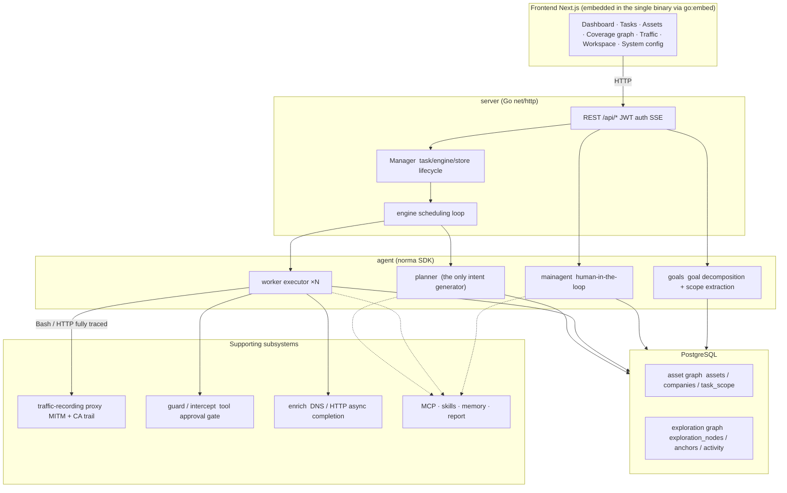
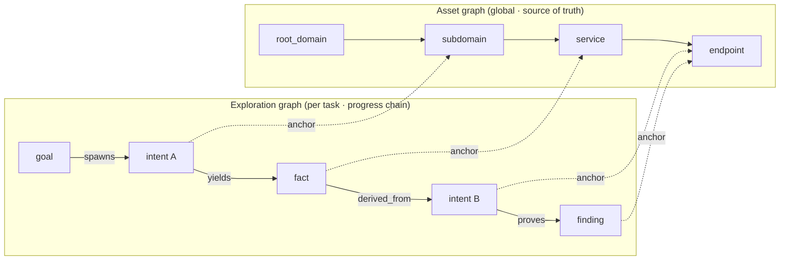
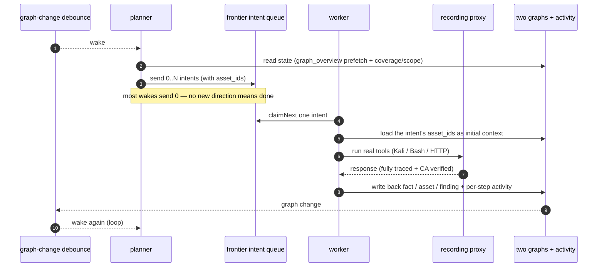
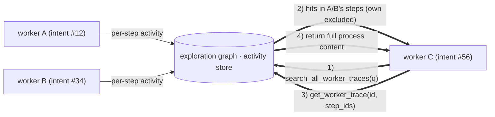
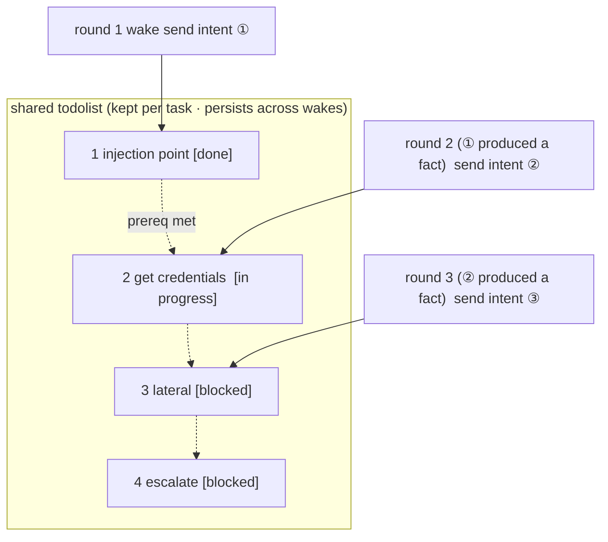

<div align="center">

# ScopeWeaver

由 LLM 驱动的多智能体自主渗透测试系统（Go 后端 + Next.js 前端）

[English](README.md) · [한국어](README.ko.md) · 简体中文 · [繁體中文](README.zh-Hant.md) · [日本語](README.ja.md) · [Español](README.es.md)

</div>

---

> **关于本专案。** ScopeWeaver 衍生自 [Autumn-27/ARTEX](https://github.com/Autumn-27/ARTEX)，更换品牌并提供六种语言。其基础为上游提交 `160fe13`。

修改日期：**2026-10-02**。请参阅[来源与变更](docs/zh-Hans/PROVENANCE.md)；此日期并非版本标签。

[验证状态与已知限制](docs/zh-Hans/VERIFICATION.md)。

> 代码与架构源自 ARTEX。此独立衍生专案变更了产品名称、六种语言的界面与消息、文件及发行目标。完整差异请参阅[来源与变更](#provenance-and-changes)；授权条款仍为 AGPL-3.0，详见[授权与免责声明](#license-and-disclaimer)。
>
> **授权。** 这是安全测试工具。仅得测试您拥有或获得明确测试授权的系统。上游使用限制仍然适用，请阅读下文。

---

<a id="language"></a>

## 语言

默认语言为英文。界面可选择英文、韩文、简体中文（`zh-Hans`）、繁体中文（`zh-Hant`）、日文（`ja`）与西班牙文（`es`）。`zh`、`zh-CN`、`zh-SG` 对应简体中文；`zh-TW`、`zh-HK`、`zh-MO` 对应繁体中文。明确指定 Hans 或 Hant 时，文字系统优先于冲突的地区，因此 Hans 搭配繁体地区仍选简体，Hant 搭配简体地区仍选繁体。日文与西班牙文地区标签分别对应 `ja` 与 `es`。不支持的语言会改试下一个偏好。详见[贡献者语言区域指南](docs/zh-Hans/i18n.md)。服务器持久默认值为系统配置的 `language`；`SCOPEWEAVER_LANGUAGE`（或 `ARTEX_LANGUAGE`）提供环境回退值。操作系统的 `LANG` 不会决定应用程序语言。

请求依序采用 `lang`、支持的 `Accept-Language` 偏好、`scopeweaver_locale` cookie，最后采用服务器默认值。通过 HTTP 创建的新任务在队列与重启后仍保留语言；未保存语言的旧任务使用服务器默认值。内建智能体指引与输出指示采用本次运行的语言；用户编辑的模板与已保存证据维持原文。报告、CSV、ZIP 的标签采用导出请求的语言。[完整文档](docs/zh-Hans/README.md)包括随附的技能指南。

独立渗透测试对话会将已确认的发现直接保存至「发现」页面的未指派任务群组。每个对话无须启动任务，即可跨回合保留自己的发现历史。「自动」、「渗透测试」、「报告撰写」与「发现复测」的提示词若缺少或无效，会回复至角色默认值；渲染失败会记录在后端记录中。

<a id="screenshots"></a>

## 截图

下列画面使用内附的虚构示范数据，展示 ScopeWeaver 英文界面，并非对真实目标的扫描结果。另见[韩文画面](README.ko.md#스크린샷)与[移动版](screenshots/en/mobile.png)。

| 仪表板 | 任务 |
| :---: | :---: |
|  |  |
| 发现 | 配置 |
|  |  |

原始中文画面保留在[画面目录](screenshots)，著作归属于[上游 ARTEX](https://github.com/Autumn-27/ARTEX/tree/160fe13c243be361eeac5408c40a96e824fa842c/screenshots)。

---

<a id="test-scope-and-asset-rules"></a>
## 测试范围与资产规则

公司/任务范围是声明的测试范围：用于提示词指导、资产记录和覆盖度筛选，并非网络边界。
要阻止 WebFetch、Bash 等范围外的工具调用，必须配置**拦截规则**。除内置的破坏性命令规则外，
默认没有其他规则。真正的网络边界需要 ScopeWeaver 外部的出站控制，例如防火墙或强制使用的代理。

资产允许/阻止规则仅限制记录（`insert_assets`、`add_intent` 和代理范围写入），不阻止网络调用。
任务规则在**任务 → 概览**中编辑，全局阻止规则在**系统 → 拦截 → 资产**中编辑。
任务规则仅在任务内生效；独立聊天仅使用全局阻止规则。阻止规则优先于允许规则。

**域名（部分匹配）**（`fuzzy_domain`）按完整标签匹配。阻止规则可匹配任意位置的标签：
`.gov` 匹配 `x.gov` 和 `x.gov.uk`，不匹配 `a.government.com`。允许规则仅匹配域名本身及其子域名：
`juice-shop.internal` 允许 `a.juice-shop.internal`，不允许 `juice-shop.internal2` 或
`juice-shop.internal.attacker.com`。现有规则可能会拒绝此前可通过的资产插入。
代理的 `add_task_scope` 和 worker 自动添加范围也必须通过当前资产规则；读取规则失败时，
会拒绝写入或跳过添加。UI 中的手动范围编辑和已有范围行保持不变。

<a id="approval-records"></a>

## 审批记录

全域「审批记录」、任务内「拦截审批」面板，以及对话中的审批卡片，都可展开完整详情。呈现方式沿用 [AegisHook 的审批详情元件](https://github.com/RuoJi6/AegisHook/blob/main/web/src/components/CallDetail.vue)，重用其上游元件与布景主题。

<a id="asset-sync-scopesentry"></a>

## 资产同步（ScopeSentry）

可直接从 [ScopeSentry](https://github.com/Autumn-27/ScopeSentry) 同步资产数据，避免重复搜集：

- 在「资产同步」页面输入 ScopeSentry 地址与 API 密钥，连接数据来源。
- 依**专案**或**任务**选择同步内容，并挑选资产类型（网域／子网域／IP／连接埠／网站／端点等）。
- 一键导入。资产会合并至公司资产范围，直接进入资产图供智能体探索。

---

<a id="installation"></a>

## 安装

每个 PostgreSQL 数据库只能有一个运行中的 ScopeWeaver 服务器；数据目录也只能由一个服务器拥有。启动替代服务器前，请先停止旧服务器。不支持多个副本同时共用任一资源。启动回滚会将未完成的对话工作标记为中断，并在恢复队列前核对尚未发布的对话记录档。

<a id="glm-and-other-model-providers"></a>

### GLM 与其他模型供应商

「LLM → 新增」表单提供 Z.ai General API 的 GLM-5.3 配置模板，以及另行标示的 Coding Plan 参考配置。请自行加入 API 密钥；选取模板不会保存、启用或联络供应商。Coding Plan 仅限官方支持的工具使用，ScopeWeaver 不在清单内。详见[供应商配置与支持限制](docs/zh-Hans/llm-providers.md)。若要减少云端 token 用量，请参阅[控制 token 用量](docs/zh-Hans/llm-providers.md#controlling-token-use)。

可选的 **OpenCode SDK 桥接器**支持固定的 `native` CLI／客户端 **2.1.4**（默认）与 `legacy` SDK／CLI **1.19.4**，使用独立桥接令牌及 `providerID/modelID`。宿主工具和审批仍由 ScopeWeaver 的 Norma 管理。旧版保留安全 JSON 结构，但可规范化空白／转义，不保留原始字节，并拒绝不安全整数。两个运行时均不支持 Windows；先前运行测试范围为 macOS arm64，Linux 托管 CI 结果尚待验证。下游可能是云端，因此仅本地 LLM 模式拒绝桥接器。见 [SDK 设置、限制与降级准备](docs/zh-Hans/llm-providers.md#opencode-sdk-bridge)；SDK 配置仍存在时，旧二进制无法启动。

可选的**原生 Ollama** 配置不需要 API 密钥。三种模板分别适用于同一台电脑、从 Docker 存取主机，以及选择性启用的 `docker compose --profile local-llm` 服务。选取模板会读取已安装模型并预填一个模型，优先选择声明支持工具的模型；不会下载或运行模型。默认传送 32K 上下文（`num_ctx` 32,768）、每次一个请求，以及 30 分钟的 keep-alive。选择性启用的**仅限本地 LLM 网络**配置默认关闭，仅允许环回地址与明确信任的推论 CIDR；LAN 与 Docker 地址必须加入允许清单。此配置也会封锁所有智能体网页搜寻与更新检查／下载，但仍可查看本地版本与回滚。目标工具仍可存取网络；主机／远程 Ollama 必须另设 `OLLAMA_NO_CLOUD=1`。非严格模式仍可使用云端格式、自定义 URL 与代理服务器。原生请求会将下一个可用名额优先提供给排队中的裁决／主要智能体／侧问请求；原生裁决默认为 90 秒／ask，并有上下文边界保护。详见[原生 Ollama](docs/zh-Hans/llm-providers.md#native-ollama-local-inference)。

> 需要 **PostgreSQL** 数据库。探索需要已配置的 **LLM**（`ANTHROPIC_API_KEY`、`OPENAI_API_KEY`、免密钥 Ollama 配置，或在界面中配置）。

<a id="option-1-one-click-install-script-recommended"></a>

### 方式 1：一键安装脚本（建议）


```bash
git clone https://github.com/cskwork/scopeweaver.git
cd scopeweaver
./install.sh
```


脚本会侦测 Docker，并可选择安装，接著让您选择 **① 全部使用 Docker** 或 **② 在本地构建与运行**：

- **① 全部使用 Docker**：输入一组 Postgres 密码（按 Enter 随机产生）→ 写入 `.env` → `docker compose up -d`。
- **② 本地**：选择数据库（连接既有数据库或以 Docker 启动）→ 产生 `config.json` → `go` 编译内嵌前端的单一可执行文件 → 启动。

启动后开启 **http://localhost:8787**；首次造访会进入 `/setup`，配置管理员密码。

> 脚本提示默认为英文。请将 `SCOPEWEAVER_LANGUAGE`（或 `ARTEX_LANGUAGE`）设为 `en`、`ko`、`zh-Hans`、`zh-Hant`、`ja` 或 `es`，例如 `SCOPEWEAVER_LANGUAGE=ko ./install.sh`。`y/n` 等响应及命令与旗标名称维持不变。

<a id="option-2-docker-compose-manual"></a>

### 方式 2：Docker Compose（手动）


```bash
git clone https://github.com/cskwork/scopeweaver.git
cd scopeweaver
cp .env.example .env          # set POSTGRES_PASSWORD, optionally ANTHROPIC_API_KEY
docker compose up -d --build  # builds the scopeweaver image locally + postgres
# → http://localhost:8787
```


> 默认 compose 文件会从本源代码**在本地构建镜像**。若要使用 `ghcr.io/cskwork/scopeweaver` 已发布的版本镜像，请在 compose 中明确指定版本。

镜像内含常用工具（ripgrep/curl/vim/npm/nmap 等）；`./skills` 与 `./data` 以 bind mount 挂载以保留数据。

远程 MCP 可在系统配置中使用 `http`（Streamable HTTP）或 `sse`（旧版 SSE）。旧版 SSE 服务器通常先以 `GET /sse` 开启事件流式，再通过返回的 `/message?sessionId=...` 接收 JSON-RPC 请求；URL 设为 `/sse`，头部设为 `Authorization=Bearer <token>`。

<a id="option-3-download-a-prebuilt-binary-releases"></a>

### 方式 3：下载预先构建的可执行文件（Releases）

> 从 [Releases](https://github.com/cskwork/scopeweaver/releases) 下载平台封存档。每个平台的档名为 `scopeweaver-<version>-<os>-<arch>.zip`，解压缩后包含 `scopeweaver`、`start.sh`（Windows 为 `start.bat`）、`skills/` 与 `config.example.json`。

封存档亦包含 `adapters/agent/`；请参阅[智能体配置说明](docs/zh-Hans/agent-adapter.md)。


```bash
cp config.example.json config.json   # fill in the database connection
./start.sh                            # → http://localhost:8787
```


> 请以 `start.sh`／`start.bat` 启动，勿直接运行 `./scopeweaver`。启动脚本会在程序结束后，根据结束码判断是否重启；[应用程序内一键更新](#option-1-in-app-one-click-update-recommended) 依靠它置换新版本。直接运行 `./scopeweaver` 时，更新后不会自动重启。背景运行方式：`nohup ./start.sh >scopeweaver.log 2>&1 &`。

<a id="option-4-build-a-single-binary-from-source"></a>

### 方式 4：从源代码构建单一可执行文件


```bash
# 1) export the frontend as static files
cd web && npm ci && npm run build:static && cd ..
# 2) copy it into the embed directory
mkdir -p server/webui/dist
cp -R web/out/. server/webui/dist/
# 3) build (the embedui tag embeds the frontend)
CGO_ENABLED=0 go build -tags embedui -o scopeweaver ./cmd/artex
./start.sh
```


> 为兼容上游，构建来源路径保留为 `./cmd/artex`，Go 模组保留为 `github.com/Autumn-27/artex`。只有输出可执行文件命名为 `scopeweaver`。

<a id="option-5-build-cross-platform-release-archives"></a>

### 方式 5：构建跨平台发行封存档

`build.sh` 会构建并内嵌前端，以 Go 链接器移除侦错信息，再将各版本封装成 zip。发行模式默认构建 Linux amd64/arm64、macOS amd64/arm64 与 Windows amd64：

封存档包含 `THIRD_PARTY_NOTICES.txt`；容器镜像在 `/app/THIRD_PARTY_NOTICES.txt` 保留相同声明，供随附的 shadcn 样式表使用。


```bash
./build.sh --release
# output: dist/scopeweaver-0.3.3-*.zip
```


UPX 封装的自解压缩可执行文件可能与部分 Linux 核心、虚拟化或安全政策冲突，因此默认停用 UPX。使用 `ARTEX_TARGETS` 指定目标，并仅在确认目标兼容后明确加入 `--upx`：


```bash
ARTEX_TARGETS=linux/amd64,windows/amd64 ./build.sh --release
./build.sh --target linux/amd64 --upx
```


<a id="reverse-proxy-deployments"></a>

### 反向代理部署

正式构建会从同一来源提供界面、API 与即时 SSE 流式。可在 443 连接埠提供 HTTPS，并保持后端连接埠不对外开放。请停用代理缓冲并允许长连接，确保即时事件能送达浏览器：


```nginx
location / {
    proxy_pass http://127.0.0.1:8787;
    proxy_set_header Host $host;
    proxy_set_header X-Forwarded-Proto $scheme;
    proxy_http_version 1.1;
    proxy_set_header Connection "";
    proxy_buffering off;
    proxy_cache off;
    proxy_read_timeout 3600s;
}
```


只有 SSE 采用不同来源时，才在构建时配置 `NEXT_PUBLIC_SSE_BASE`。在容器运行时变更此值不会改变导出的前端。`next dev` 期间 SSE 仍直接连至 8787 连接埠，以略过 Next.js 缓冲；将 `NEXT_PUBLIC_SSE_BASE` 明确设为空字串可使用相同来源。

---

<a id="updating"></a>

## 更新

> 更新只置换程序，数据会保留。Postgres 磁碟区 `pgdata`、`./data`（jwt.key／SQLite 等）及 `./skills` 都不会移除。**数据库迁移会自动运行**：`scopeweaver` 每次启动都会幂等地重新运行 `schema.sql`（包括 `ADD COLUMN`／`CREATE INDEX IF NOT EXISTS`），因此「重启即迁移」。升级前仍请备份 `./data` 与数据库。

<a id="option-1-in-app-one-click-update-recommended"></a>

### 方式 1：应用程序内一键更新（建议）

「系统配置」页面（侧边栏「系统配置」→ `/system/settings`）的「版本与更新」卡片，可直接检查并安装新版本，无须登录服务器。

按下「更新」后：下载符合平台的版本 → 依该版本的 `SHA256SUMS` 验证 → 以 `-h` 对新可执行文件运行基本测试 → 暂存为 `scopeweaver.new` → 程序结束，由 `start.sh`／`start.bat` 重启以完成置换。页面会等待新版本启动后刷新。

- **更新失败不会留下损坏的程序**：若验证或基本测试失败，会丢弃暂存档并继续运行目前版本。置换后的新版本连续三次无法启动时，会自动回滚至 `scopeweaver.old`（失败版本保留为 `scopeweaver.failed` 以供检查）。
- **随时回滚**：旧版本保留为 `scopeweaver.old`，卡片提供「回滚至前一版本」按钮。数据库结构不会回滚。
- **更新会中断运行中的任务**：更新等同重启，请在闲置时进行。
- **开发构建不接收更新**：版本为 `dev` 或带有后缀的 `git describe` 字串时会停用更新，避免发行版覆盖本地侦错可执行文件。
- **Docker 中只更新程序，不更新镜像**：playwright／nmap 工具链不会一并升级；`docker compose up -d` 重建容器时，会回到镜像内的版本。若也要升级镜像，已发布镜像时可运行 `docker compose pull scopeweaver && docker compose up -d scopeweaver`；否则使用 `docker compose up -d --build scopeweaver`。
- 若连至 GitHub 需要代理，请在同一页配置**全域代理**。更新只从 GitHub 网域下载，并强制使用 HTTPS。

<a id="option-2-one-click-update-script"></a>

### 方式 2：一键更新脚本


```bash
cd scopeweaver
./update.sh
```


脚本可先选择运行 `git pull`，再选择 **① Docker 更新** 或 **② 本地构建更新**（与 `install.sh` 一致）：

- **① Docker**：以 `docker compose build scopeweaver` 重新构建目前签出版本，再以 `docker compose up -d scopeweaver` 重新创建服务。
- **② 本地**：重新构建前端静态输出 → 重新编译 `./scopeweaver`（需重启进程才会应用）。

<a id="option-3-docker-compose-manual"></a>

### 方式 3：Docker Compose（手动）


```bash
cd scopeweaver
git pull                       # update compose / scripts (optional)
# To pin a source version, check out a reviewed tag or commit before building.
docker compose up -d --build scopeweaver   # rebuild from source and restart → auto-migrate schema
docker image prune -f          # clean up old images (optional)
```


> 若已有发布的镜像，且 compose 明确指定该镜像，可将构建步骤改为 `docker compose pull scopeweaver && docker compose up -d scopeweaver`。

<a id="option-4-prebuilt-binary-releases"></a>

### 方式 4：预先构建的可执行文件（Releases）

下载新的 `scopeweaver-<version>-<os>-<arch>.zip`，停止旧进程，覆盖 `scopeweaver` 与 `skills/`（保留 `config.json` 和 `data/`），然后重启：


```bash
cp -r <unpacked>/skills ./ && cp <unpacked>/scopeweaver ./
./start.sh
```


<a id="option-5-build-from-source"></a>

### 方式 5：从源代码构建


```bash
git pull
cd web && npm ci && npm run build:static && cd ..
cp -r web/out server/webui/dist
CGO_ENABLED=0 go build -tags embedui -o scopeweaver ./cmd/artex
# restart ./start.sh
```


---

<a id="configuration"></a>

## 配置

<a id="coding-agent-integration"></a>

### 编程智能体整合

Claude Code、Codex 与 Pi 可通过[智能体适配器](docs/zh-Hans/agent-adapter.md)创建任务，读取进度、覆盖率与发现。Claude Code／Codex 使用本地 stdio MCP；Pi 使用原生扩展功能。默认允许读取；创建任务及暂停／继续需通过配置明确启用。适配器使用既有的已验证 API，不会改变 ScopeWeaver 内部智能体与模型配置。

**数据库**（`config.json`，或以环境变量 `ARTEX_PG_DSN` 覆写）：


```json
{
  "database": {
    "host": "127.0.0.1", "port": 5432,
    "user": "artex", "password": "yourpass",
    "dbname": "artex", "sslmode": "disable"
  }
}
```


> 为兼容上游，配置与环境变量保留 `ARTEX_*` 前缀及 `artex` 数据库默认值。脚本在注明处也接受 `SCOPEWEAVER_*` 别名。

**LLM**：`export ANTHROPIC_API_KEY=sk-...`（或 `OPENAI_API_KEY`），或在界面的「LLM 配置」页配置。选用值为 `ARTEX_LLM_PROVIDER`／`ARTEX_LLM_MODEL`／`ARTEX_LLM_BASE_URL`／`ARTEX_LLM_PROXY`。各 `SCOPEWEAVER_LLM_*` 别名优先于对应的 `ARTEX_LLM_*`。Ollama 也接受 `CONTEXT_WINDOW_K`、`MAX_CONCURRENT`、`KEEP_ALIVE` 与 `MAX_TOKENS` 后缀（[完整清单](docs/zh-Hans/llm-providers.md#environment-and-configuration)）。

**并行数**：每个任务的工作智能体数量在「系统配置」配置，默认为 3。

**常用旗标**：`./start.sh -addr :8787 -proxy :8788`（`-addr` 为前端 + API，`-proxy` 为流量捕获代理）。启动脚本会将旗标直接传给 `scopeweaver`。

---

<a id="development"></a>

## 开发

欢迎贡献。要求、检查与 PR 审查合并流程请见 [CONTRIBUTING.md](CONTRIBUTING.zh-Hans.md)。

<a id="manual-vulnerability-retest"></a>

### 手动漏洞复测

任务详情的「复测」分页会分页显示漏洞、历次结论与证据，并可手动启动复测。启动后保留目前分页，显示加载图示与「复测中」；确认修正后更新漏洞状态。

在漏洞清单列按「复测」，或在漏洞详情的「复测」区按「开始复测」，可选填修正版本、测试条件与限制。系统会创建独立的复测智能体会话，并保留目前页面。平面、依任务分组及资产检视皆提供此入口；运行中显示加载图示与「复测中」，可点入查看会话，结束后恢复为「复测」。复测不会重启原扫描任务。结论分为「仍可重现」、「已修正」及「无法确认」；每次结论、证据与会话链接皆保存在漏洞详情。

新版后端首次启动时会预先创建可编辑的「漏洞复测」（`retester`）智能体。可在智能体管理配置提示词、LLM、运行预算与工具。默认使用绑定的 LLM，未绑定则使用全域启用配置。复测会话成功完成且结论为「已修正」时，系统自动将漏洞处置状态设为「已修正」；运行中、失败、停止或其他结论会保留原状态。原始证据与报告一律保留。也可手动从状态下拉选单设为「已修正」。

此版本的历史通过漏洞详情与会话查看，尚未纳入漏洞报告导出或任务封存，也不会自动链接至流量捕获。示范模式只产生明确标示的模拟记录，不会接触真实目标。

<a id="local-run-and-tests"></a>

### 本地运行与测试


```bash
./dev.sh    # backend(:8787) + traffic proxy(:8788) + frontend next dev(:5173) → http://localhost:5173
```


- 后端：`go run ./cmd/artex`（不加 `-tags embedui` 时不会内嵌前端）
- 前端：`cd web && npm run dev`（`/api` 反向代理至后端，支持热重新加载）
- 测试：`go test ./...`
- 模拟预览（无后端）：`cd web && NEXT_PUBLIC_MOCK=1 npm run dev`

---

<a id="architecture"></a>

## 架构

ScopeWeaver（底层为 ARTEX）是 **LLM 多智能体自主渗透系统**：单一 Go 后端（内嵌 Next.js 前端）加上 PostgreSQL。智能体能力来自 [`norma`](https://github.com/Autumn-27/norma) SDK（`agentcore`／`tool`／`permission`／`harness`／`memory`／`transcript`）。核心采用**双图架构**，并以**工作智能体间的运行过程信息交换**及**规划器跨回合共用待办清单**两种自主机制，维持稳定的攻击链。

<a id="layers"></a>

### 分层





| 层级 | 职责 |
| --- | --- |
| **前端** | Next.js 静态导出，以 `go:embed` 内嵌至单一可执行文件；呈现任务／资产／探索／覆盖率及有人员参与的对话 |
| **server** | `net/http` 路由、JWT 验证与 SSE；`Manager` 管理任务、引擎及数据库保存区的生命周期 |
| **engine** | 每个任务一个 `plannerLoop` 加 N 个 worker goroutine；负责意图领取、逾时／暂停／排空 |
| **agent** | goals／planner／worker／mainagent；`ToolSet` 将双图公开为 LLM 工具 |
| **db** | 两张图皆以 Postgres（pgx）保存；结构通过 `go:embed` 内嵌，每次启动都幂等创建 |
| **支持** | MITM 流量记录代理、审批关卡、异步补全、MCP／技能／记忆／报告 |

<a id="two-graph-architecture-exploration-graph--asset-graph"></a>

### 双图架构：探索图 + 资产图

系统将「**目标是什么**」与「**已测试到哪里**」分为两张独立的图，再通过锚点相连：

- **资产图（全域共用）**：跨任务的资产唯一事实来源。节点为 `root_domain / subdomain / ip / service / app / endpoint`，各自归属公司。网域→子网域→服务→端点的父子关系与去重键均由程序计算；智能体仅提交原始观察。
- **探索图（每个任务）**：单一任务的思考与进度。节点为 `goal / intent / fact / finding / hint`，以 `spawns / derived_from / yields / proves` 边组成**衍生链**，回答「某方向源自哪些事实，产生什么成果」。
- **双图通过锚点相连**：`exploration_anchors(node_id, asset_id)` 将意图／事实／发现锚定至特定资产，可查看某方向正在探测哪些资产，也能从资产回查本任务测试过它的意图及所得事实。这亦驱动**资产测试覆盖率**及**资产覆盖图**（范围内资产与已测试的醒目标示）。





> 分工：**规划器**读取探索图状态并判断目标，只有存在尚未覆盖的新方向时才将**意图**送入待探索队列；**工作智能体**领取**一个意图**，运行真实工具，将新资产／事实／发现写回两张图，然后停止。资产图为共用事实，探索图为各任务的进度链。

<a id="engine-and-intent-lifecycle-one-exploration-loop"></a>

### 引擎与意图生命周期（一次探索循环）

引擎采用**事件驱动**循环：图变更唤醒规划器，规划器派发意图，工作智能体领取并运行、写回；写回触发下一回合，直到目标获得证明（`prove_goal`）。





<a id="process-level-information-exchange-between-workers"></a>

### 工作智能体间的运行过程信息交换

深度探索时，许多有价值的观察（错误、响应、隐藏参数）出现在工作智能体的**运行过程**，却未写成正式事实。为避免重复工作并让攻击链上的智能体接续前人成果，工作智能体可以**搜寻其他智能体的运行过程**：

- `search_all_worker_traces(q)`：以关键字搜寻**本任务其他工作的运行过程**（自动排除本意图自己的步骤）；结果附带 `intent_id`。
- `list_worker_traces`／`get_worker_trace(intent_id, step_ids=[…])`：先查看已运行的工作，再捕获特定工作的指定步骤完整内容，进行深入交换。

即使探索图尚无对应事实，后续工作智能体仍可重用其他智能体运行中的观察；**信息以运行过程为粒度流动**，同时保留边界：每个智能体仍只运行所领取的一个意图。





<a id="the-planners-shared-multi-round-todolist--a-stable-attack-chain"></a>

### 规划器跨回合共用待办清单 → 稳定攻击链

真实攻击链常是**具有依赖关系的多步骤序列**（找到注入点 → 取得凭证 → 横向移动 → 提权）。一次全部平行派发只会造成混乱，因此规划器维护**按任务保存、跨唤醒共用的规划待办清单**：

- 规划器由图变更唤醒，**每次唤醒都是新的会话**。共用清单让它能**一次记录循序利用链**，之后依依赖关系**跨回合逐步派发意图**，无须第一回合就派发整条链。
- 每回合只对「前置步骤完成且依赖事实存在」的下一步派发意图，并持续更新清单，将事实已满足的步骤标记完成。





因此即使采用「事件驱动 + 无状态会话」，攻击链仍能**稳定前进，不重复、不乱序**。这是系统自主完成多步骤利用链的关键。

---

<a id="provenance-and-changes"></a>

## 来源与变更

ScopeWeaver 衍生自 [Autumn-27/ARTEX](https://github.com/Autumn-27/ARTEX) 上游提交 `160fe13`。此独立衍生专案的变更包括：

- **产品名称**：用户可见的文件、脚本与发行品由 ARTEX 改为 ScopeWeaver。Go 模组（`github.com/Autumn-27/artex`）、构建来源路径（`./cmd/artex`）、`ARTEX_*` 配置／环境键与 `artex` 数据库默认值均**保留**以兼容上游。
- **文件语言**：默认英文，并提供韩文、简体中文、繁体中文、日文与西班牙文对应文件，请见上方语言导览及[文档索引](docs/zh-Hans/README.md)。
- **脚本语言**：配置／构建／启动／更新／重设密码／开发提示默认为英文，可通过 `SCOPEWEAVER_LANGUAGE`（亦接受 `ARTEX_LANGUAGE`）选择 `en`、`ko`、`zh-Hans`、`zh-Hant`、`ja` 或 `es`。不使用网络翻译。
- **发行**：输出可执行文件为 `scopeweaver`，封存档为 `scopeweaver-<version>-<os>-<arch>.zip`，仓库为 `https://github.com/cskwork/scopeweaver`，容器镜像使用此仓库的 GHCR，不使用上游 Docker Hub 镜像 `autumn27/artex`。
- **ScopeWeaver 发行历史**：独立版本由 `v0.1.0` 起算，说明存于 [log/](log/changelog-v0.1.0.md)。版本标签触发各平台封存档与容器构建。Docker Compose 仍默认本地构建，除非明确选择已发布镜像。

[CHANGELOG.md](CHANGELOG.md) 忠实翻译**上游 ARTEX** 的历史，不会将那些变更归属于 ScopeWeaver。

<a id="screenshots-and-localized-assets"></a>

### 截图与本地化素材

本地化画面位于 `screenshots/en/` 与 `screenshots/ko/`，展示内附的桌面与移动版示范数据。`screenshots/` 其他位置的 ARTEX 原始画面保持原样，并注明上游归属。

---

<a id="credits"></a>

## 致谢

- **上游**：[Autumn-27/ARTEX](https://github.com/Autumn-27/ARTEX)，本专案衍生来源；原始代码与架构归功于其作者。
- **智能体 SDK**：[`norma`](https://github.com/Autumn-27/norma)。
- **资产同步**：[ScopeSentry](https://github.com/Autumn-27/ScopeSentry)。
- **审批详情界面**：[AegisHook](https://github.com/RuoJi6/AegisHook)。
- **参考**：[Cairn](https://github.com/oritera/Cairn)。
- **上游社群**：ARTEX 作者经营微信公众号 **SecSentry**（`screenshots/wx.png` 为保留的上游 QR code 素材）。此为上游专案频道，并非 ScopeWeaver 频道。

---

<a id="license-and-disclaimer"></a>

## 授权与免责声明

> 本节忠实翻译 ARTEX 上游授权、作者使用限制与免责声明，条款未变更。

<a id="open-source-license"></a>

### 开放源代码授权

本专案依 **GNU Affero General Public License v3.0（AGPL-3.0）** 授权。完整条款见仓库根目录的 [LICENSE](LICENSE)。

任何人都可自由使用、修改与散布本专案，但**衍生作品亦必须依 AGPL-3.0 开放源代码**。尤其**若您修改本专案并通过网络提供用户使用（例如托管服务），必须向这些用户提供对应的完整源代码。**

> ⚠️ **重要**：开放源代码授权本身不限制软件用途。下列「使用限制」与「免责声明」为作者对用户提出的额外条件及严正声明，请务必遵守。

**ARTEX 仅供个人学习、源代码研究及本地技术验证。不得用于对任何线上系统或网站发起实际测试。**

<a id="permitted-use"></a>

### 允许用途

- 仅供**阅读、学习与研究本专案源代码**，以及在**本地隔离环境**验证技术原理。
- 适用于个人学习、学术研究、代码审查及其他不具攻击性的用途。

<a id="prohibited"></a>

### 禁止事项

- **不得使用本工具扫描、探测、利用或攻击任何网站、线上服务或连网系统**，无论是否获得授权，亦无论是否为自有资产。
- 不得用于任何真实渗透测试、红蓝演练或正式环境。
- 不得用于非法入侵、窃取数据、勒索、阻断服务或任何破坏、犯罪活动。
- 不得用于违反所在国家或地区法律与规范的用途。

<a id="compliance-responsibility"></a>

### 合规责任

用户必须遵守所在国家或地区关于网络安全、数据保护与电脑犯罪的所有法律与规范；在中国大陆包括但不限于《网络安全法》、《数据安全法》、《个人信息保护法》及相关司法解释。**因使用本工具产生的全部法律责任与后果，均由用户自行承担。**

<a id="disclaimer"></a>

### 免责声明

本专案依「现状」（AS IS）提供，不作任何明示或默示保证。作者与贡献者对使用本工具造成的任何直接或间接损失、数据遗失、系统损坏或法律争议均不负责，无论使用是否适当。**下载、安装或使用本专案，即表示您已阅读、理解并同意上述全部条款。**
