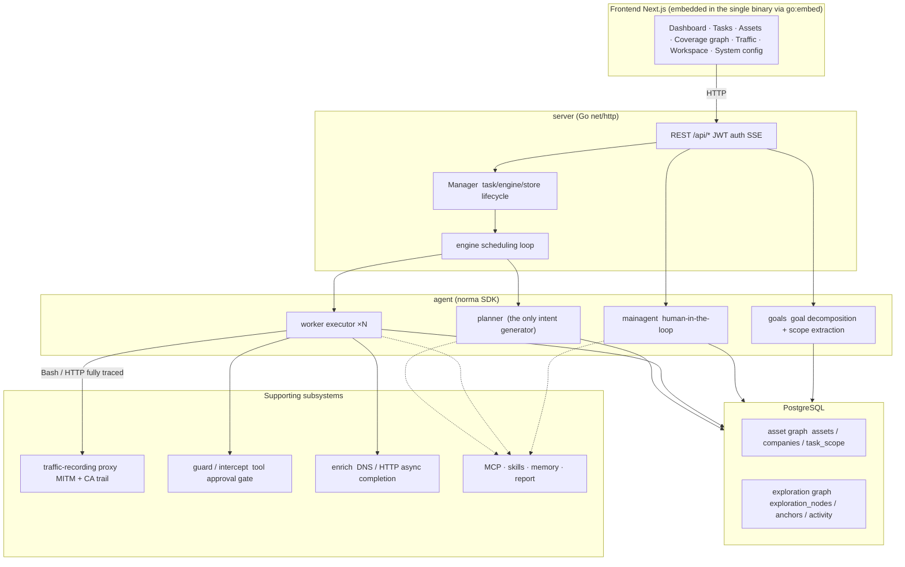
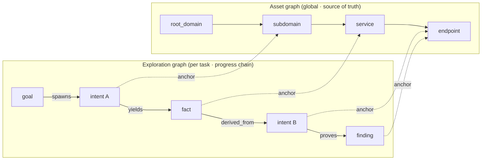
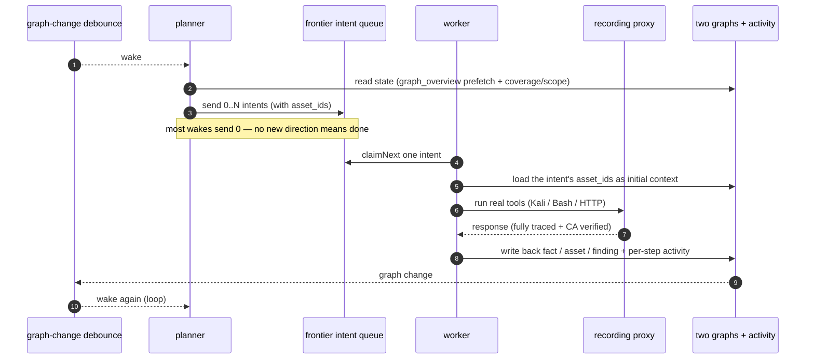
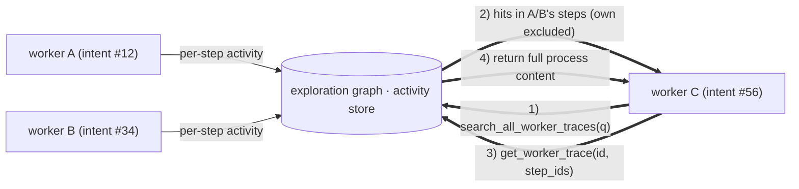
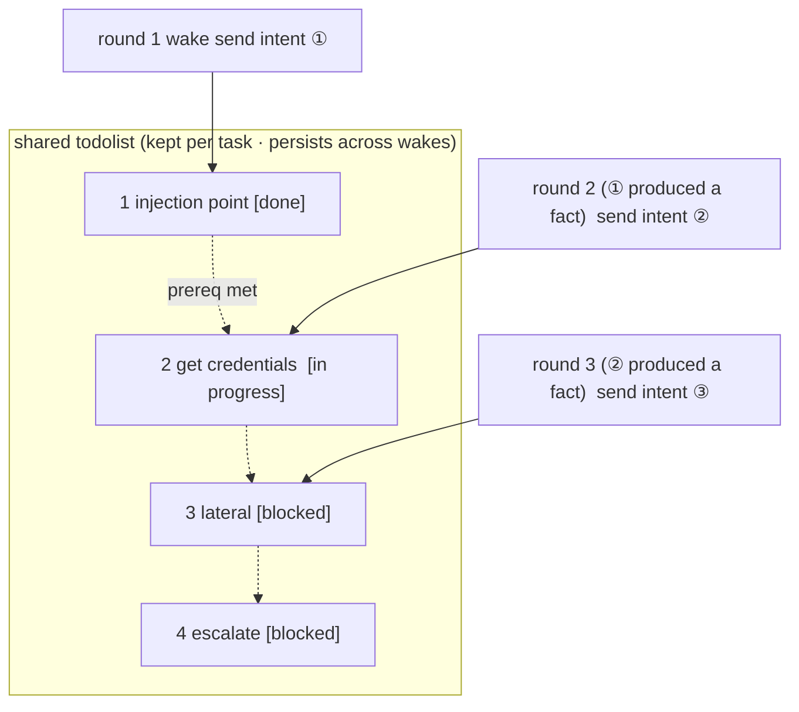

<div align="center">

# ScopeWeaver

由 LLM 驅動的多代理程式自主滲透測試系統（Go 後端 + Next.js 前端）

[English](README.md) · [한국어](README.ko.md) · [简体中文](README.zh-Hans.md) · 繁體中文 · [日本語](README.ja.md) · [Español](README.es.md)

</div>

---

> **關於本專案。** ScopeWeaver 衍生自 [Autumn-27/ARTEX](https://github.com/Autumn-27/ARTEX)，更換品牌並提供六種語言。其基礎為上游提交 `160fe13`。

修改日期：**2026-10-02**。請參閱[來源與變更](docs/zh-Hant/PROVENANCE.md)；此日期並非版本標籤。

[驗證狀態與已知限制](docs/zh-Hant/VERIFICATION.md)。

> 程式碼與架構源自 ARTEX。此獨立衍生專案變更了產品名稱、六種語言的介面與訊息、文件及發行目標。完整差異請參閱[來源與變更](#provenance-and-changes)；授權條款仍為 AGPL-3.0，詳見[授權與免責聲明](#license-and-disclaimer)。
>
> **授權。** 這是安全測試工具。僅得測試您擁有或獲得明確測試授權的系統。上游使用限制仍然適用，請閱讀下文。

---

<a id="language"></a>

## 語言

預設語言為英文。介面可選擇英文、韓文、簡體中文（`zh-Hans`）、繁體中文（`zh-Hant`）、日文（`ja`）與西班牙文（`es`）。`zh`、`zh-CN`、`zh-SG` 對應簡體中文；`zh-TW`、`zh-HK`、`zh-MO` 對應繁體中文。明確指定 Hans 或 Hant 時，文字系統優先於衝突的地區，因此 Hans 搭配繁體地區仍選簡體，Hant 搭配簡體地區仍選繁體。日文與西班牙文地區標籤分別對應 `ja` 與 `es`。不支援的語言會改試下一個偏好。詳見[貢獻者語系指南](docs/zh-Hant/i18n.md)。伺服器持久預設值為系統設定的 `language`；`SCOPEWEAVER_LANGUAGE`（或 `ARTEX_LANGUAGE`）提供環境備援值。作業系統的 `LANG` 不會決定應用程式語言。

請求依序採用 `lang`、支援的 `Accept-Language` 偏好、`scopeweaver_locale` cookie，最後採用伺服器預設值。透過 HTTP 建立的新任務在佇列與重新啟動後仍保留語言；未儲存語言的舊任務使用伺服器預設值。內建代理程式指引與輸出指示採用本次執行的語言；使用者編輯的範本與已儲存證據維持原文。報告、CSV、ZIP 的標籤採用匯出請求的語言。[完整文件](docs/zh-Hant/README.md)包括隨附的技能指南。

獨立滲透測試對話會將已確認的發現直接儲存至「發現」頁面的未指派任務群組。每個對話無須啟動任務，即可跨回合保留自己的發現歷史。「自動」、「滲透測試」、「報告撰寫」與「發現複測」的提示詞若缺少或無效，會回復至角色預設值；轉譯失敗會記錄在後端記錄中。

<a id="screenshots"></a>

## 螢幕擷取畫面

下列畫面使用內附的虛構示範資料，展示 ScopeWeaver 英文介面，並非對真實目標的掃描結果。另見[韓文畫面](README.ko.md#스크린샷)與[行動版](screenshots/en/mobile.png)。

| 儀表板 | 任務 |
| :---: | :---: |
|  |  |
| 發現 | 設定 |
|  |  |

原始中文畫面保留在[畫面目錄](screenshots)，著作歸屬於[上游 ARTEX](https://github.com/Autumn-27/ARTEX/tree/160fe13c243be361eeac5408c40a96e824fa842c/screenshots)。

---

<a id="test-scope-and-asset-rules"></a>
## 測試範圍與資產規則

公司/任務範圍是宣告的測試範圍：用於提示詞指引、資產記錄和涵蓋率篩選，並非網路邊界。
要阻止 WebFetch、Bash 等範圍外的工具呼叫，必須設定**攔截規則**。除內建的破壞性命令規則外，
預設沒有其他規則。真正的網路邊界需要 ScopeWeaver 外部的對外連線控制，例如防火牆或強制使用的代理伺服器。

資產允許/封鎖規則僅限制記錄（`insert_assets`、`add_intent` 和代理程式範圍寫入），不阻止網路呼叫。
任務規則在**任務 → 概覽**中編輯，全域封鎖規則在**系統 → 攔截 → 資產**中編輯。
任務規則僅在任務內生效；獨立聊天僅使用全域封鎖規則。封鎖規則優先於允許規則。

**網域（部分比對）**（`fuzzy_domain`）以完整標籤比對。封鎖規則可比對任意位置的標籤：
`.gov` 符合 `x.gov` 和 `x.gov.uk`，不符合 `a.government.com`。允許規則僅比對網域本身及其子網域：
`juice-shop.internal` 允許 `a.juice-shop.internal`，不允許 `juice-shop.internal2` 或
`juice-shop.internal.attacker.com`。現有規則可能會拒絕先前可通過的資產新增。
代理程式的 `add_task_scope` 和 worker 自動新增範圍也必須通過目前的資產規則；讀取規則失敗時，
會拒絕寫入或略過新增。UI 中的手動範圍編輯和既有範圍資料列維持不變。

<a id="approval-records"></a>

## 核准記錄

全域「核准記錄」、任務內「攔截核准」面板，以及對話中的核准卡片，都可展開完整詳情。呈現方式沿用 [AegisHook 的核准詳情元件](https://github.com/RuoJi6/AegisHook/blob/main/web/src/components/CallDetail.vue)，重用其上游元件與佈景主題。

<a id="asset-sync-scopesentry"></a>

## 資產同步（ScopeSentry）

可直接從 [ScopeSentry](https://github.com/Autumn-27/ScopeSentry) 同步資產資料，避免重複蒐集：

- 在「資產同步」頁面輸入 ScopeSentry 位址與 API 金鑰，連接資料來源。
- 依**專案**或**任務**選擇同步內容，並挑選資產類型（網域／子網域／IP／連接埠／網站／端點等）。
- 一鍵匯入。資產會合併至公司資產範圍，直接進入資產圖供代理程式探索。

---

<a id="installation"></a>

## 安裝

每個 PostgreSQL 資料庫只能有一個執行中的 ScopeWeaver 伺服器；資料目錄也只能由一個伺服器擁有。啟動替代伺服器前，請先停止舊伺服器。不支援多個副本同時共用任一資源。啟動復原會將未完成的對話工作標記為中斷，並在恢復佇列前核對尚未發布的對話記錄檔。

<a id="glm-and-other-model-providers"></a>

### GLM 與其他模型供應商

「LLM → 新增」表單提供 Z.ai General API 的 GLM-5.3 設定範本，以及另行標示的 Coding Plan 參考設定。請自行加入 API 金鑰；選取範本不會儲存、啟用或聯絡供應商。Coding Plan 僅限官方支援的工具使用，ScopeWeaver 不在清單內。詳見[供應商設定與支援限制](docs/zh-Hant/llm-providers.md)。若要減少雲端 token 用量，請參閱[控制 token 用量](docs/zh-Hant/llm-providers.md#controlling-token-use)。

選用的 **OpenCode SDK 橋接器**支援固定的 `native` CLI／用戶端 **2.1.4**（預設）與 `legacy` SDK／CLI **1.19.4**，使用獨立橋接權杖及 `providerID/modelID`。主機工具與核准仍由 ScopeWeaver 的 Norma 管理。舊版保留安全 JSON 結構，但可正規化空白／跳脫，不保留原始位元組，並拒絕不安全整數。兩個執行環境皆不支援 Windows；先前測試範圍為 macOS arm64，Linux 託管 CI 結果尚待驗證。下游可能是雲端，因此僅本機 LLM 模式拒絕橋接器。請見 [SDK 設定、限制與降級準備](docs/zh-Hant/llm-providers.md#opencode-sdk-bridge)；SDK 設定檔仍存在時，舊二進位檔無法啟動。

可選的**原生 Ollama** 設定檔不需要 API 金鑰。三種範本分別適用於同一台電腦、從 Docker 存取主機，以及選擇性啟用的 `docker compose --profile local-llm` 服務。選取範本會讀取已安裝模型並預填一個模型，優先選擇宣告支援工具的模型；不會下載或執行模型。預設傳送 32K 上下文（`num_ctx` 32,768）、每次一個請求，以及 30 分鐘的 keep-alive。選擇性啟用的**僅限本機 LLM 網路**設定預設關閉，僅允許回送位址與明確信任的推論 CIDR；LAN 與 Docker 位址必須加入允許清單。此設定也會封鎖所有代理程式網頁搜尋與更新檢查／下載，但仍可查看本機版本與復原。目標工具仍可存取網路；主機／遠端 Ollama 必須另設 `OLLAMA_NO_CLOUD=1`。非嚴格模式仍可使用雲端格式、自訂 URL 與代理伺服器。原生請求會將下一個可用名額優先提供給排隊中的裁決／主要代理程式／側問請求；原生裁決預設為 90 秒／ask，並有上下文邊界保護。詳見[原生 Ollama](docs/zh-Hant/llm-providers.md#native-ollama-local-inference)。

> 需要 **PostgreSQL** 資料庫。探索需要已設定的 **LLM**（`ANTHROPIC_API_KEY`、`OPENAI_API_KEY`、免金鑰 Ollama 設定檔，或在介面中設定）。

<a id="option-1-one-click-install-script-recommended"></a>

### 方式 1：一鍵安裝指令碼（建議）


```bash
git clone https://github.com/cskwork/scopeweaver.git
cd scopeweaver
./install.sh
```


指令碼會偵測 Docker，並可選擇安裝，接著讓您選擇 **① 全部使用 Docker** 或 **② 在本機建置與執行**：

- **① 全部使用 Docker**：輸入一組 Postgres 密碼（按 Enter 隨機產生）→ 寫入 `.env` → `docker compose up -d`。
- **② 本機**：選擇資料庫（連接既有資料庫或以 Docker 啟動）→ 產生 `config.json` → `go` 編譯內嵌前端的單一執行檔 → 啟動。

啟動後開啟 **http://localhost:8787**；首次造訪會進入 `/setup`，設定管理員密碼。

> 指令碼提示預設為英文。請將 `SCOPEWEAVER_LANGUAGE`（或 `ARTEX_LANGUAGE`）設為 `en`、`ko`、`zh-Hans`、`zh-Hant`、`ja` 或 `es`，例如 `SCOPEWEAVER_LANGUAGE=ko ./install.sh`。`y/n` 等回應及指令與旗標名稱維持不變。

<a id="option-2-docker-compose-manual"></a>

### 方式 2：Docker Compose（手動）


```bash
git clone https://github.com/cskwork/scopeweaver.git
cd scopeweaver
cp .env.example .env          # set POSTGRES_PASSWORD, optionally ANTHROPIC_API_KEY
docker compose up -d --build  # builds the scopeweaver image locally + postgres
# → http://localhost:8787
```


> 預設 compose 檔案會從本原始碼**在本機建置映像檔**。若要使用 `ghcr.io/cskwork/scopeweaver` 已發布的版本映像檔，請在 compose 中明確指定版本。

映像檔內含常用工具（ripgrep/curl/vim/npm/nmap 等）；`./skills` 與 `./data` 以 bind mount 掛載以保留資料。

遠端 MCP 可在系統設定中使用 `http`（Streamable HTTP）或 `sse`（舊版 SSE）。舊版 SSE 伺服器通常先以 `GET /sse` 開啟事件串流，再透過回傳的 `/message?sessionId=...` 接收 JSON-RPC 請求；URL 設為 `/sse`，標頭設為 `Authorization=Bearer <token>`。

<a id="option-3-download-a-prebuilt-binary-releases"></a>

### 方式 3：下載預先建置的執行檔（Releases）

> 從 [Releases](https://github.com/cskwork/scopeweaver/releases) 下載平台封存檔。每個平台的檔名為 `scopeweaver-<version>-<os>-<arch>.zip`，解壓縮後包含 `scopeweaver`、`start.sh`（Windows 為 `start.bat`）、`skills/` 與 `config.example.json`。

封存檔亦包含 `adapters/agent/`；請參閱[代理程式設定說明](docs/zh-Hant/agent-adapter.md)。


```bash
cp config.example.json config.json   # fill in the database connection
./start.sh                            # → http://localhost:8787
```


> 請以 `start.sh`／`start.bat` 啟動，勿直接執行 `./scopeweaver`。啟動指令碼會在程式結束後，根據結束碼判斷是否重新啟動；[應用程式內一鍵更新](#option-1-in-app-one-click-update-recommended) 依靠它置換新版本。直接執行 `./scopeweaver` 時，更新後不會自動重啟。背景執行方式：`nohup ./start.sh >scopeweaver.log 2>&1 &`。

<a id="option-4-build-a-single-binary-from-source"></a>

### 方式 4：從原始碼建置單一執行檔


```bash
# 1) export the frontend as static files
cd web && npm ci && npm run build:static && cd ..
# 2) copy it into the embed directory
mkdir -p server/webui/dist
cp -R web/out/. server/webui/dist/
# 3) build (the embedui tag embeds the frontend)
CGO_ENABLED=0 go build -tags embedui -o scopeweaver ./cmd/artex
./start.sh
```


> 為相容上游，建置來源路徑保留為 `./cmd/artex`，Go 模組保留為 `github.com/Autumn-27/artex`。只有輸出執行檔命名為 `scopeweaver`。

<a id="option-5-build-cross-platform-release-archives"></a>

### 方式 5：建置跨平台發行封存檔

`build.sh` 會建置並內嵌前端，以 Go 連結器移除偵錯資訊，再將各版本封裝成 zip。發行模式預設建置 Linux amd64/arm64、macOS amd64/arm64 與 Windows amd64：

封存檔包含 `THIRD_PARTY_NOTICES.txt`；容器映像檔在 `/app/THIRD_PARTY_NOTICES.txt` 保留相同聲明，供隨附的 shadcn 樣式表使用。


```bash
./build.sh --release
# output: dist/scopeweaver-0.3.3-*.zip
```


UPX 封裝的自解壓縮執行檔可能與部分 Linux 核心、虛擬化或安全政策衝突，因此預設停用 UPX。使用 `ARTEX_TARGETS` 指定目標，並僅在確認目標相容後明確加入 `--upx`：


```bash
ARTEX_TARGETS=linux/amd64,windows/amd64 ./build.sh --release
./build.sh --target linux/amd64 --upx
```


<a id="reverse-proxy-deployments"></a>

### 反向代理部署

正式建置會從同一來源提供介面、API 與即時 SSE 串流。可在 443 連接埠提供 HTTPS，並保持後端連接埠不對外開放。請停用代理緩衝並允許長連線，確保即時事件能送達瀏覽器：


```nginx
location / {
    proxy_pass http://127.0.0.1:8787;
    proxy_set_header Host $host;
    proxy_set_header X-Forwarded-Proto $scheme;
    proxy_http_version 1.1;
    proxy_set_header Connection "";
    proxy_buffering off;
    proxy_cache off;
    proxy_read_timeout 3600s;
}
```


只有 SSE 採用不同來源時，才在建置時設定 `NEXT_PUBLIC_SSE_BASE`。在容器執行時變更此值不會改變匯出的前端。`next dev` 期間 SSE 仍直接連至 8787 連接埠，以略過 Next.js 緩衝；將 `NEXT_PUBLIC_SSE_BASE` 明確設為空字串可使用相同來源。

---

<a id="updating"></a>

## 更新

> 更新只置換程式，資料會保留。Postgres 磁碟區 `pgdata`、`./data`（jwt.key／SQLite 等）及 `./skills` 都不會移除。**資料庫遷移會自動執行**：`scopeweaver` 每次啟動都會冪等地重新執行 `schema.sql`（包括 `ADD COLUMN`／`CREATE INDEX IF NOT EXISTS`），因此「重新啟動即遷移」。升級前仍請備份 `./data` 與資料庫。

<a id="option-1-in-app-one-click-update-recommended"></a>

### 方式 1：應用程式內一鍵更新（建議）

「系統設定」頁面（側邊欄「系統設定」→ `/system/settings`）的「版本與更新」卡片，可直接檢查並安裝新版本，無須登入伺服器。

按下「更新」後：下載符合平台的版本 → 依該版本的 `SHA256SUMS` 驗證 → 以 `-h` 對新執行檔執行基本測試 → 暫存為 `scopeweaver.new` → 程式結束，由 `start.sh`／`start.bat` 重新啟動以完成置換。頁面會等待新版本啟動後重新整理。

- **更新失敗不會留下損壞的程式**：若驗證或基本測試失敗，會丟棄暫存檔並繼續執行目前版本。置換後的新版本連續三次無法啟動時，會自動復原至 `scopeweaver.old`（失敗版本保留為 `scopeweaver.failed` 以供檢查）。
- **隨時復原**：舊版本保留為 `scopeweaver.old`，卡片提供「復原至前一版本」按鈕。資料庫結構不會復原。
- **更新會中斷執行中的任務**：更新等同重新啟動，請在閒置時進行。
- **開發建置不接收更新**：版本為 `dev` 或帶有後綴的 `git describe` 字串時會停用更新，避免發行版覆蓋本機偵錯執行檔。
- **Docker 中只更新程式，不更新映像檔**：playwright／nmap 工具鏈不會一併升級；`docker compose up -d` 重建容器時，會回到映像檔內的版本。若也要升級映像檔，已發布映像檔時可執行 `docker compose pull scopeweaver && docker compose up -d scopeweaver`；否則使用 `docker compose up -d --build scopeweaver`。
- 若連至 GitHub 需要代理，請在同一頁設定**全域代理**。更新只從 GitHub 網域下載，並強制使用 HTTPS。

<a id="option-2-one-click-update-script"></a>

### 方式 2：一鍵更新指令碼


```bash
cd scopeweaver
./update.sh
```


指令碼可先選擇執行 `git pull`，再選擇 **① Docker 更新** 或 **② 本機建置更新**（與 `install.sh` 一致）：

- **① Docker**：以 `docker compose build scopeweaver` 重新建置目前簽出版本，再以 `docker compose up -d scopeweaver` 重新建立服務。
- **② 本機**：重新建置前端靜態輸出 → 重新編譯 `./scopeweaver`（需重新啟動處理程序才會套用）。

<a id="option-3-docker-compose-manual"></a>

### 方式 3：Docker Compose（手動）


```bash
cd scopeweaver
git pull                       # update compose / scripts (optional)
# To pin a source version, check out a reviewed tag or commit before building.
docker compose up -d --build scopeweaver   # rebuild from source and restart → auto-migrate schema
docker image prune -f          # clean up old images (optional)
```


> 若已有發布的映像檔，且 compose 明確指定該映像檔，可將建置步驟改為 `docker compose pull scopeweaver && docker compose up -d scopeweaver`。

<a id="option-4-prebuilt-binary-releases"></a>

### 方式 4：預先建置的執行檔（Releases）

下載新的 `scopeweaver-<version>-<os>-<arch>.zip`，停止舊處理程序，覆蓋 `scopeweaver` 與 `skills/`（保留 `config.json` 和 `data/`），然後重新啟動：


```bash
cp -r <unpacked>/skills ./ && cp <unpacked>/scopeweaver ./
./start.sh
```


<a id="option-5-build-from-source"></a>

### 方式 5：從原始碼建置


```bash
git pull
cd web && npm ci && npm run build:static && cd ..
cp -r web/out server/webui/dist
CGO_ENABLED=0 go build -tags embedui -o scopeweaver ./cmd/artex
# restart ./start.sh
```


---

<a id="configuration"></a>

## 設定

<a id="coding-agent-integration"></a>

### 程式開發代理程式整合

Claude Code、Codex 與 Pi 可透過[代理程式配接器](docs/zh-Hant/agent-adapter.md)建立任務，讀取進度、覆蓋率與發現。Claude Code／Codex 使用本機 stdio MCP；Pi 使用原生擴充功能。預設允許讀取；建立任務及暫停／繼續需透過設定明確啟用。配接器使用既有的已驗證 API，不會改變 ScopeWeaver 內部代理程式與模型設定。

**資料庫**（`config.json`，或以環境變數 `ARTEX_PG_DSN` 覆寫）：


```json
{
  "database": {
    "host": "127.0.0.1", "port": 5432,
    "user": "artex", "password": "yourpass",
    "dbname": "artex", "sslmode": "disable"
  }
}
```


> 為相容上游，設定與環境變數保留 `ARTEX_*` 前綴及 `artex` 資料庫預設值。指令碼在註明處也接受 `SCOPEWEAVER_*` 別名。

**LLM**：`export ANTHROPIC_API_KEY=sk-...`（或 `OPENAI_API_KEY`），或在介面的「LLM 設定」頁設定。選用值為 `ARTEX_LLM_PROVIDER`／`ARTEX_LLM_MODEL`／`ARTEX_LLM_BASE_URL`／`ARTEX_LLM_PROXY`。各 `SCOPEWEAVER_LLM_*` 別名優先於對應的 `ARTEX_LLM_*`。Ollama 也接受 `CONTEXT_WINDOW_K`、`MAX_CONCURRENT`、`KEEP_ALIVE` 與 `MAX_TOKENS` 後綴（[完整清單](docs/zh-Hant/llm-providers.md#environment-and-configuration)）。

**並行數**：每個任務的工作代理程式數量在「系統設定」設定，預設為 3。

**常用旗標**：`./start.sh -addr :8787 -proxy :8788`（`-addr` 為前端 + API，`-proxy` 為流量擷取代理）。啟動指令碼會將旗標直接傳給 `scopeweaver`。

---

<a id="development"></a>

## 開發

歡迎貢獻。要求、檢查與 PR 審查合併流程請見 [CONTRIBUTING.md](CONTRIBUTING.zh-Hant.md)。

<a id="manual-vulnerability-retest"></a>

### 手動漏洞複測

任務詳情的「複測」分頁會分頁顯示漏洞、歷次結論與證據，並可手動啟動複測。啟動後保留目前分頁，顯示載入圖示與「複測中」；確認修正後更新漏洞狀態。

在漏洞清單列按「複測」，或在漏洞詳情的「複測」區按「開始複測」，可選填修正版本、測試條件與限制。系統會建立獨立的複測代理程式工作階段，並保留目前頁面。平面、依任務分組及資產檢視皆提供此入口；執行中顯示載入圖示與「複測中」，可點入查看工作階段，結束後恢復為「複測」。複測不會重啟原掃描任務。結論分為「仍可重現」、「已修正」及「無法確認」；每次結論、證據與工作階段連結皆儲存在漏洞詳情。

新版後端首次啟動時會預先建立可編輯的「漏洞複測」（`retester`）代理程式。可在代理程式管理設定提示詞、LLM、執行預算與工具。預設使用綁定的 LLM，未綁定則使用全域啟用設定。複測工作階段成功完成且結論為「已修正」時，系統自動將漏洞處置狀態設為「已修正」；執行中、失敗、停止或其他結論會保留原狀態。原始證據與報告一律保留。也可手動從狀態下拉選單設為「已修正」。

此版本的歷史透過漏洞詳情與工作階段查看，尚未納入漏洞報告匯出或任務封存，也不會自動連結至流量擷取。示範模式只產生明確標示的模擬記錄，不會接觸真實目標。

<a id="local-run-and-tests"></a>

### 本機執行與測試


```bash
./dev.sh    # backend(:8787) + traffic proxy(:8788) + frontend next dev(:5173) → http://localhost:5173
```


- 後端：`go run ./cmd/artex`（不加 `-tags embedui` 時不會內嵌前端）
- 前端：`cd web && npm run dev`（`/api` 反向代理至後端，支援熱重新載入）
- 測試：`go test ./...`
- 模擬預覽（無後端）：`cd web && NEXT_PUBLIC_MOCK=1 npm run dev`

---

<a id="architecture"></a>

## 架構

ScopeWeaver（底層為 ARTEX）是 **LLM 多代理程式自主滲透系統**：單一 Go 後端（內嵌 Next.js 前端）加上 PostgreSQL。代理程式能力來自 [`norma`](https://github.com/Autumn-27/norma) SDK（`agentcore`／`tool`／`permission`／`harness`／`memory`／`transcript`）。核心採用**雙圖架構**，並以**工作代理程式間的執行過程資訊交換**及**規劃器跨回合共用待辦清單**兩種自主機制，維持穩定的攻擊鏈。

<a id="layers"></a>

### 分層





| 層級 | 職責 |
| --- | --- |
| **前端** | Next.js 靜態匯出，以 `go:embed` 內嵌至單一執行檔；呈現任務／資產／探索／覆蓋率及有人員參與的對話 |
| **server** | `net/http` 路由、JWT 驗證與 SSE；`Manager` 管理任務、引擎及資料庫儲存區的生命週期 |
| **engine** | 每個任務一個 `plannerLoop` 加 N 個 worker goroutine；負責意圖領取、逾時／暫停／排空 |
| **agent** | goals／planner／worker／mainagent；`ToolSet` 將雙圖公開為 LLM 工具 |
| **db** | 兩張圖皆以 Postgres（pgx）儲存；結構透過 `go:embed` 內嵌，每次啟動都冪等建立 |
| **支援** | MITM 流量記錄代理、核准閘門、非同步補全、MCP／技能／記憶／報告 |

<a id="two-graph-architecture-exploration-graph--asset-graph"></a>

### 雙圖架構：探索圖 + 資產圖

系統將「**目標是什麼**」與「**已測試到哪裡**」分為兩張獨立的圖，再透過錨點相連：

- **資產圖（全域共用）**：跨任務的資產唯一事實來源。節點為 `root_domain / subdomain / ip / service / app / endpoint`，各自歸屬公司。網域→子網域→服務→端點的父子關係與去重鍵均由程式計算；代理程式僅提交原始觀察。
- **探索圖（每個任務）**：單一任務的思考與進度。節點為 `goal / intent / fact / finding / hint`，以 `spawns / derived_from / yields / proves` 邊組成**衍生鏈**，回答「某方向源自哪些事實，產生什麼成果」。
- **雙圖透過錨點相連**：`exploration_anchors(node_id, asset_id)` 將意圖／事實／發現錨定至特定資產，可查看某方向正在探測哪些資產，也能從資產回查本任務測試過它的意圖及所得事實。這亦驅動**資產測試覆蓋率**及**資產覆蓋圖**（範圍內資產與已測試的醒目標示）。





> 分工：**規劃器**讀取探索圖狀態並判斷目標，只有存在尚未覆蓋的新方向時才將**意圖**送入待探索佇列；**工作代理程式**領取**一個意圖**，執行真實工具，將新資產／事實／發現寫回兩張圖，然後停止。資產圖為共用事實，探索圖為各任務的進度鏈。

<a id="engine-and-intent-lifecycle-one-exploration-loop"></a>

### 引擎與意圖生命週期（一次探索迴圈）

引擎採用**事件驅動**迴圈：圖變更喚醒規劃器，規劃器派發意圖，工作代理程式領取並執行、寫回；寫回觸發下一回合，直到目標獲得證明（`prove_goal`）。





<a id="process-level-information-exchange-between-workers"></a>

### 工作代理程式間的執行過程資訊交換

深度探索時，許多有價值的觀察（錯誤、回應、隱藏參數）出現在工作代理程式的**執行過程**，卻未寫成正式事實。為避免重複工作並讓攻擊鏈上的代理程式接續前人成果，工作代理程式可以**搜尋其他代理程式的執行過程**：

- `search_all_worker_traces(q)`：以關鍵字搜尋**本任務其他工作的執行過程**（自動排除本意圖自己的步驟）；結果附帶 `intent_id`。
- `list_worker_traces`／`get_worker_trace(intent_id, step_ids=[…])`：先查看已執行的工作，再擷取特定工作的指定步驟完整內容，進行深入交換。

即使探索圖尚無對應事實，後續工作代理程式仍可重用其他代理程式執行中的觀察；**資訊以執行過程為粒度流動**，同時保留邊界：每個代理程式仍只執行所領取的一個意圖。





<a id="the-planners-shared-multi-round-todolist--a-stable-attack-chain"></a>

### 規劃器跨回合共用待辦清單 → 穩定攻擊鏈

真實攻擊鏈常是**具有相依關係的多步驟序列**（找到注入點 → 取得憑證 → 橫向移動 → 提權）。一次全部平行派發只會造成混亂，因此規劃器維護**按任務儲存、跨喚醒共用的規劃待辦清單**：

- 規劃器由圖變更喚醒，**每次喚醒都是新的工作階段**。共用清單讓它能**一次記錄循序利用鏈**，之後依相依關係**跨回合逐步派發意圖**，無須第一回合就派發整條鏈。
- 每回合只對「前置步驟完成且相依事實存在」的下一步派發意圖，並持續更新清單，將事實已滿足的步驟標記完成。





因此即使採用「事件驅動 + 無狀態工作階段」，攻擊鏈仍能**穩定前進，不重複、不亂序**。這是系統自主完成多步驟利用鏈的關鍵。

---

<a id="provenance-and-changes"></a>

## 來源與變更

ScopeWeaver 衍生自 [Autumn-27/ARTEX](https://github.com/Autumn-27/ARTEX) 上游提交 `160fe13`。此獨立衍生專案的變更包括：

- **產品名稱**：使用者可見的文件、指令碼與發行品由 ARTEX 改為 ScopeWeaver。Go 模組（`github.com/Autumn-27/artex`）、建置來源路徑（`./cmd/artex`）、`ARTEX_*` 設定／環境鍵與 `artex` 資料庫預設值均**保留**以相容上游。
- **文件語言**：預設英文，並提供韓文、簡體中文、繁體中文、日文與西班牙文對應文件，請見上方語言導覽及[文件索引](docs/zh-Hant/README.md)。
- **指令碼語言**：設定／建置／啟動／更新／重設密碼／開發提示預設為英文，可透過 `SCOPEWEAVER_LANGUAGE`（亦接受 `ARTEX_LANGUAGE`）選擇 `en`、`ko`、`zh-Hans`、`zh-Hant`、`ja` 或 `es`。不使用網路翻譯。
- **發行**：輸出執行檔為 `scopeweaver`，封存檔為 `scopeweaver-<version>-<os>-<arch>.zip`，儲存庫為 `https://github.com/cskwork/scopeweaver`，容器映像檔使用此儲存庫的 GHCR，不使用上游 Docker Hub 映像檔 `autumn27/artex`。
- **ScopeWeaver 發行歷史**：獨立版本由 `v0.1.0` 起算，說明存於 [log/](log/changelog-v0.1.0.md)。版本標籤觸發各平台封存檔與容器建置。Docker Compose 仍預設本機建置，除非明確選擇已發布映像檔。

[CHANGELOG.md](CHANGELOG.md) 忠實翻譯**上游 ARTEX** 的歷史，不會將那些變更歸屬於 ScopeWeaver。

<a id="screenshots-and-localized-assets"></a>

### 螢幕擷取畫面與本地化素材

本地化畫面位於 `screenshots/en/` 與 `screenshots/ko/`，展示內附的桌面與行動版示範資料。`screenshots/` 其他位置的 ARTEX 原始畫面保持原樣，並註明上游歸屬。

---

<a id="credits"></a>

## 致謝

- **上游**：[Autumn-27/ARTEX](https://github.com/Autumn-27/ARTEX)，本專案衍生來源；原始程式碼與架構歸功於其作者。
- **代理程式 SDK**：[`norma`](https://github.com/Autumn-27/norma)。
- **資產同步**：[ScopeSentry](https://github.com/Autumn-27/ScopeSentry)。
- **核准詳情介面**：[AegisHook](https://github.com/RuoJi6/AegisHook)。
- **參考**：[Cairn](https://github.com/oritera/Cairn)。
- **上游社群**：ARTEX 作者經營微信公眾號 **SecSentry**（`screenshots/wx.png` 為保留的上游 QR code 素材）。此為上游專案頻道，並非 ScopeWeaver 頻道。

---

<a id="license-and-disclaimer"></a>

## 授權與免責聲明

> 本節忠實翻譯 ARTEX 上游授權、作者使用限制與免責聲明，條款未變更。

<a id="open-source-license"></a>

### 開放原始碼授權

本專案依 **GNU Affero General Public License v3.0（AGPL-3.0）** 授權。完整條款見儲存庫根目錄的 [LICENSE](LICENSE)。

任何人都可自由使用、修改與散布本專案，但**衍生作品亦必須依 AGPL-3.0 開放原始碼**。尤其**若您修改本專案並透過網路提供使用者使用（例如代管服務），必須向這些使用者提供對應的完整原始碼。**

> ⚠️ **重要**：開放原始碼授權本身不限制軟體用途。下列「使用限制」與「免責聲明」為作者對使用者提出的額外條件及嚴正聲明，請務必遵守。

**ARTEX 僅供個人學習、原始碼研究及本機技術驗證。不得用於對任何線上系統或網站發起實際測試。**

<a id="permitted-use"></a>

### 允許用途

- 僅供**閱讀、學習與研究本專案原始碼**，以及在**本機隔離環境**驗證技術原理。
- 適用於個人學習、學術研究、程式碼審查及其他不具攻擊性的用途。

<a id="prohibited"></a>

### 禁止事項

- **不得使用本工具掃描、探測、利用或攻擊任何網站、線上服務或連網系統**，無論是否獲得授權，亦無論是否為自有資產。
- 不得用於任何真實滲透測試、紅藍演練或正式環境。
- 不得用於非法入侵、竊取資料、勒索、阻斷服務或任何破壞、犯罪活動。
- 不得用於違反所在國家或地區法律與規範的用途。

<a id="compliance-responsibility"></a>

### 合規責任

使用者必須遵守所在國家或地區關於網路安全、資料保護與電腦犯罪的所有法律與規範；在中國大陸包括但不限於《網路安全法》、《資料安全法》、《個人資訊保護法》及相關司法解釋。**因使用本工具產生的全部法律責任與後果，均由使用者自行承擔。**

<a id="disclaimer"></a>

### 免責聲明

本專案依「現狀」（AS IS）提供，不作任何明示或默示保證。作者與貢獻者對使用本工具造成的任何直接或間接損失、資料遺失、系統損壞或法律爭議均不負責，無論使用是否適當。**下載、安裝或使用本專案，即表示您已閱讀、理解並同意上述全部條款。**
