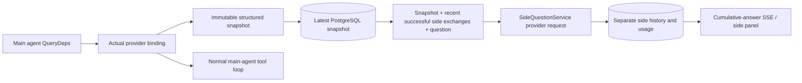

# ScopeWeaver `/btw`

[English](../../../sidequestion/README.md) · [한국어](../../ko/sidequestion/README.md) · [简体中文](../../zh-Hans/sidequestion/README.md) · [繁體中文](../../zh-Hant/sidequestion/README.md) · [日本語](../../ja/sidequestion/README.md) · Español

El chat normal, MainAgent de una tarea y sus trabajadores admiten preguntas paralelas independientes. Introduce `/btw question` en la entrada principal para enviar; `/btw` vacío o el botón abre el historial. Escritorio usa barra lateral redimensionable; móvil un panel deslizante.

Las respuestas usan la instantánea del contexto al enviar y admiten transmisión, seguimientos, parada y borrado. Cerrar panel, actualizar o desconectar SSE no cancela la solicitud. Detener solo afecta a la pregunta actual. Borrar la cancela y elimina el historial paralelo conservando la instantánea principal.

## Límites de implementación

La implementación original usó Go, norma v0.3.7, Next.js y componentes existentes Markdown / ResizablePanel / Drawer / AlertDialog, sin cambiar norma ni añadir dependencias paralelas. Quedaron fuera el planificador, trabajadores heredados y mejoras de subtareas de herramientas. Las versiones pueden haber avanzado desde entonces.

- `capture.go` marca solicitudes del bucle principal solo en `Options.Deps.CallModel / CallModelSync`. El decorador está dentro del modelo concreto tras el enrutamiento exterior, por lo que registra el seleccionado realmente. Las solicitudes de compresión/resumen no sobrescriben instantáneas.
- Las instantáneas se publican al iniciar solicitud, completar respuesta y finalizar ejecución. Se excluyen respuestas parciales. `MessagesForAPI` de norma conserva pares de herramientas; los resultados entran en la siguiente solicitud principal o estado final. Las transmisiones interrumpidas conservan el último límite válido.
- Las copias profundas JSON conservan mensajes estructurados, instrucciones, definiciones y parámetros. La inferencia no mantiene bloqueos de instantáneas ni transacciones.
- `SideQuestionService` llama al proveedor concreto y resume antes si hace falta. La respuesta final puede reducir contexto y reintentar una vez solo tras el primer desbordamiento y antes de cualquier texto/llamada. No crea sesión de agente ni conecta a ejecutor, transcripción principal, actividad, grafo o cadena de cambio de modelos. Las respuestas conservan definiciones por el contexto estructurado existente; los resúmenes las omiten. Las llamadas nuevas no tienen ruta de ejecución.
- Cada sesión principal permite una solicitud activa; cada proceso cuatro, con tiempo límite de 120 segundos. Las preguntas tienen contextos de cancelación independientes bajo el ciclo del servicio.
- Las solicitudes conservan referencia de perfil y resumen de identidad no sensible; las credenciales provienen del perfil actual al solicitar. Si se elimina o cambian modelo, protocolo o dirección, ejecuta el agente principal para actualizar la instantánea. Las pruebas no cambian el modelo predeterminado.

## Persistencia y recuperación

`db/schema.sql` crea `side_question_sessions` y `side_question_requests`. Las sesiones guardan recurso principal, última instantánea, ID de ejecución, versión y versión de borrado. Las solicitudes guardan pregunta, respuesta acumulada, estado, modelo, hora, uso, secuencia y ordinal de paginación.

Las claves principales usan ID de conversación o ID de tarea + exploración + intención. Los trabajadores no usan nombres reutilizables de hueco de ejecución.

Las escrituras se agrupan por principal y se vacían cada 250 ms. La BD compara `(run_id, version)` para rechazar escrituras obsoletas. La instantánea seleccionada se guarda otra vez antes de enviar la pregunta. Guardar correctamente libera la copia grande en memoria; los fallos conservan la versión pendiente. Las respuestas acumuladas se escriben como máximo cada 250 ms. Los estados finales se guardan inmediatamente con reintentos limitados ante errores de BD.

Al iniciar, las solicitudes `running` pendientes se marcan `interrupted`, conservando respuestas parciales y uso sin repetirlas. El último contexto guardado correctamente puede responder la siguiente pregunta. Sesiones antiguas sin instantánea requieren ejecutar primero el agente principal; no se reconstruye desde registros de interfaz.

Borrar incrementa su versión y elimina solicitudes; actualizaciones condicionales rechazan callbacks tardíos. La eliminación física usa cascadas FK. La lógica de trabajador quita datos paralelos en la misma transacción y rechaza instantáneas posteriores. Archivar bloquea solicitudes nuevas, espera parada principal, cancela paralelas y espera persistencia. Archivo v3 también admite v1/v2 sin tablas paralelas.

Todo el historial se conserva y pagina por ordinal, hasta 20 registros por página. El modelo repite como máximo 20 intercambios recientes correctos, limitados por tokens. Los antiguos tienen resumen continuo separado. Si el contexto principal es grande, solo se resume la parte antigua de la copia, conservando pares estructurados recientes. Resúmenes, preparación y uso comparten concurrencia, cancelación y tiempo de 120 segundos. Consulta [presupuestos y referencias originales](CONTEXT_BUDGET.md).

## Contrato HTTP

Estas rutas autenticadas existentes con comprobación de recurso actúan como `{parent}`:

- `/api/conversations/{id}`
- `/api/tasks/{id}/chat`
- `/api/tasks/{id}/intents/{iid}`

| Solicitud | Respuesta y comportamiento |
| --- | --- |
| `GET {parent}/side-questions?before={ordinal}` | `items` recientes primero, `current` activo separado, metadatos `snapshot`, `next_cursor`; 0 significa página reciente / sin siguiente |
| `POST {parent}/side-questions` | JSON `{ "question": "…", "client_request_id": "UUID" }`; nuevas devuelven 202 y objeto; ID/pregunta idénticos devuelven existente con 200 |
| `DELETE {parent}/side-questions` | Cancelar y borrar preguntas paralelas de este principal |
| `GET /api/side-questions/{requestID}/events` | Eventos SSE `snapshot`: secuencia creciente `id`, objeto acumulado completo en `data`; borrar envía `cleared` |
| `POST /api/side-questions/{requestID}/cancel` | Cancelación explícita; leer estado final por historial o SSE |

Preguntas limitadas a 4000 caracteres. Instantáneas ausentes, perfiles cambiados, principales ocupados e ID de idempotencia en conflicto devuelven 409; límite global 429. Cada conexión SSE empieza con estado acumulado, sin depender de fragmentos previos. El frontend combina por ID + secuencia y descarta callbacks antiguos al cambiar de principal o borrar.

## Verificación y referencias

[VALIDATION.md](VALIDATION.md) registra comprobaciones originales, uso real de modelos y límites conocidos. No son resultados recientes de ScopeWeaver.

Las solicitudes independientes referencian [side-question.ts de Grok CLI en commit fijo](https://github.com/superagent-ai/grok-cli/blob/fb97af83f06dca873281d60168430f06c8de6324/src/utils/side-question.ts); el aislamiento referencia [OpenCode en commit fijo](https://github.com/anomalyco/opencode/tree/b3f1a96c6dd7adeb28b36dd11add1998fc84d67b). ARTEX usó mensajes estructurados norma en vez de reconstruir texto de registros frontend; ScopeWeaver conserva esa implementación.
