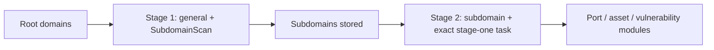

# Guía MCP de ScopeSentry

[English](../../../skills/scopesentry/SKILL.md) · [한국어](../../ko/skills/scopesentry.md) · [简体中文](../../zh-Hans/skills/scopesentry.md) · [繁體中文](../../zh-Hant/skills/scopesentry.md) · [日本語](../../ja/skills/scopesentry.md) · Español

Guía para una instancia ScopeSentry ya desplegada. Conecta con Cursor u otro cliente MCP; no necesitas código local. La referencia coreana está [aquí](../../ko/skills/scopesentry.md).

## 1. Preparación

### 1.1 Comprobar acceso

- Interfaz web predeterminada: `http://<host>`
- Endpoint MCP: `http://<host>/mcp`. Usa la dirección `/mcp` real si hay proxy inverso/frontend.

### 1.2 Crear clave API

1. Inicia sesión en la interfaz ScopeSentry.
2. Crea una clave en gestión de claves API o mediante API proporcionada por administrador.
3. Guarda `ssk_...` devuelto; solo se muestra una vez.

### 1.3 Configurar MCP en Cursor

En Cursor abre Settings → MCP → Add server:

```json
{
  "mcpServers": {
    "scopesentry": {
      "url": "http://<your-host>:8082/mcp",
      "headers": {"X-API-Key": "ssk_your-key"}
    }
  }
}
```

También funciona `Authorization: Bearer ssk_your-key`. Reinicia MCP o recarga Cursor y confirma herramientas como `list_projects` y `list_assets`.

## 2. Herramientas

| Herramienta | Finalidad |
| --- | --- |
| `list_projects` | Árbol de proyectos por etiquetas, con ID |
| `list_projects_data` | Proyectos paginados, búsqueda por nombre |
| `get_project` | Detalles del proyecto |
| `create_project` | Crear proyecto |
| `list_tasks` | Tareas de escaneo |
| `get_task` | Detalles de tarea |
| `list_scan_templates` | Plantillas de escaneo |
| `get_scan_template` | Detalles de plantilla |
| `list_plugin_modules` | Nombres de módulos del flujo de escaneo |
| `list_plugins` | Plugins disponibles, hashes y parámetros predeterminados |
| `create_scan_template` | Crear plantilla de escaneo |
| `create_scan_task` | Crear tarea de escaneo |
| `list_assets` | Consultas paginadas de activos |
| `count_assets` | Recuentos (`/api/assets/common/total`) |
| `get_asset_detail` | Detalles de activo o vulnerabilidad |
| `add_asset_tag` | Añadir etiqueta a activo |
| `list_nodes` | Nodos de escaneo |

El esquema MCP es la autoridad para parámetros. `list_assets` y `count_assets` comparten sintaxis de búsqueda/filtros; lee la descripción de `list_assets` antes de consultar. Para totales usa `count_assets`, API de total de paginación web, en vez de recorrer todos los activos.

## 3. Flujos habituales

### 3.1 Consultar por proyecto

Si usuario o contexto especifican proyecto, incluye `filter.project` para evitar búsquedas lentas entre proyectos. Sin proyecto conocido no es obligatorio.

1. Usa `list_projects` o `list_projects_data` para obtener ObjectID (`id` / `children[].value`).
2. Pasa ese ID, nunca el nombre visible, en `list_assets.filter.project`.

```json
{
  "asset_type": "asset",
  "pageIndex": 1,
  "pageSize": 20,
  "search": "domain=^example.com",
  "filter": {"project": ["<project-ObjectID>"]}
}
```

### 3.2 Crear tarea de escaneo

1. Obtén nombres de nodos conectados con `list_nodes`.
2. Obtén ObjectID de plantilla con `list_scan_templates` o `create_scan_template`.
3. `create_scan_task` requiere `name` y `node`; `template` es el ID, nunca el nombre.

`targetSource` coincide con la interfaz web:

| targetSource | Origen | Parámetros requeridos |
| --- | --- | --- |
| `general` | Entrada directa | `target` |
| `project` | Objetivos del proyecto | `project` (matriz ObjectID) |
| `asset` | Búsqueda en BD de activos web | `search`; opcionales `project`, `filter`, `targetNumber` |
| `RootDomain` | Búsqueda en BD de dominios raíz | `search`; opcionales `project`, `filter`, `targetNumber` |
| `subdomain` | Búsqueda en BD de subdominios | `search`; opcionales `project`, `filter`, `targetNumber` |
| `UrlScan` | Búsqueda de resultados URL | `search`; opcionales `project`, `filter`, `targetNumber` |
| `*Source`, p. ej., `subdomainSource` | Selección/búsqueda de página de activos | `search` para `targetTp=search`; `targetIds` para `targetTp=select` |

Escaneo directo de dominio raíz:

```json
{
  "name": "example-subdomain-discovery",
  "node": ["node-1"],
  "template": "<template-ObjectID>",
  "targetSource": "general",
  "target": "example.com\nfoo.com",
  "project": ["<project-ObjectID>"]
}
```

Continuar desde subdominios seleccionados por nombre de tarea anterior:

```json
{
  "name": "example-ports-and-findings",
  "node": ["node-1"],
  "template": "<follow-up-template-ObjectID>",
  "targetSource": "subdomain",
  "search": "task==\"example-subdomain-discovery\"",
  "project": ["<project-ObjectID>"]
}
```

### 3.3 Descubrimiento completo de dominio raíz en dos etapas

Para descubrimiento completo, usa dos escaneos en vez de un flujo entero. Las tareas distribuidas asignan objetivos individuales a nodos. Si no, un dominio raíz y todos sus subdominios ejecutan módulos posteriores en un nodo, causando carga desigual, lentitud y errores.

1. Primera etapa, solo subdominios: usa `targetSource=general`, todos los dominios en `target` multilínea y plantilla solo con `SubdomainScan` y `SubdomainSecurity` (descubrimiento y apropiación). Espera con `get_task`.
2. Segunda etapa, módulos posteriores: usa `targetSource=subdomain`, `search=task=="<stage-one-task-name>"` exacto y `project` opcional. Usa plantilla de puertos, mapeo, vulnerabilidades, etc.; puede omitir `SubdomainScan`. Los subdominios se distribuyen independientemente.

Equivalente web: filtrar página Subdomain por tarea y elegir «Crear tarea desde subdominios».



### 3.4 Crear plantilla

1. `list_plugin_modules` devuelve nombres de módulos.
2. `list_plugins`, filtrado opcionalmente por `module`, devuelve `hash` y `parameter` de cada plugin.
3. En `create_scan_template`, establece `modules` como nombre de módulo → matriz de hashes.

## 4. Consultas de activos (`list_assets` / `count_assets`)

Ambos usan `asset_type`, `search` y `filter` iguales. `count_assets` devuelve `{"total": N}`, como `/api/assets/common/total` en web.

```json
{
  "asset_type": "subdomain",
  "search": "task==\"task-name\"",
  "filter": {"project": ["<project-ObjectID>"]}
}
```

En ambas herramientas limita por `filter.project` si lo conoces. Prefiere igualdad indexada `==` o prefijo `^` ([4.3](#43-expresiones-de-búsqueda)) a regex amplia `=`. Sin contexto no hay filtro obligatorio de proyecto. Los tipos compatibles están en [4.4](#44-filtros-exactos).

### 4.1 Tipos de activo

`asset`, `RootDomain`, `subdomain`, `app`, `mp`, `UrlScan`, `SensitiveResult`, `DirScanResult`, `crawler`, `vulnerability`, `PageMonitoring`, `IPAsset`, `SubdomainTakerResult`.

Alias de ejemplo: `web` → `asset`, `vuln` → `vulnerability`, `ip` → `IPAsset`, `url` → `UrlScan`.

### 4.2 Parámetros

| Parámetro | Significado |
| --- | --- |
| `pageIndex` / `pageSize` | Paginación, valores 1 / 20 por defecto |
| `search` | Expresión siguiente |
| `filter` | JSON de filtros exactos siguiente |
| `sort` | Solo UrlScan y DirScanResult permiten ordenar por `length` |
| `sid` | Solo SensitiveResult: nombre de regla sensible |

Se pueden combinar `search` y `filter`.

### 4.3 Expresiones de búsqueda

Es un DSL personalizado, no SQL.

| Operador | Significado | Índice | Ejemplo |
| --- | --- | --- | --- |
| `=` | Coincidencia regex | No | `domain=example` |
| `==` | Igualdad exacta | Sí | `port==443` |
| `!=` | Excluir | N/D | `port!="80"` |
| `&&` | AND | N/D | `domain==example.com && port==443` |
| `\|\|` | OR | N/D | `title=admin \|\| body=login` |

Campos como `domain`, `ip`, `port` y `title` están indexados. Solo `==` exacto o un valor que empiece por `^` (p. ej., `domain=^example.com`) usa índice. `=` general se convierte en regex y puede ser lento con muchos datos.

Todos los tipos admiten `tag`, `task` (nombre) y `rootDomain`. No pongas `project` en `search`: no es válido o falla con `&&`. Usa `filter.project`.

| asset_type | Campos habituales |
| --- | --- |
| asset | domain, ip, port, service, app, title, statuscode, icon, banner, type, body, header |
| RootDomain | domain, icp, company |
| subdomain | domain, ip, type, value |
| app | name, icp, company, category, description, url, apk |
| mp | name, icp, company, category, description, url |
| UrlScan | url, input, source, resultId, type |
| SensitiveResult | url, sname, body, info, md5 |
| DirScanResult | url, statuscode, redirect, length |
| vulnerability | url, vulname, matched, request, response, level |
| crawler | url, method, body, resultId |
| PageMonitoring | url, hash, diff, response |
| IPAsset | ip, domain, port, service, webServer, app |
| SubdomainTakerResult | domain, value, type, response |

Ejemplos:

- `domain==www.example.com && port==443`: igualdad indexada.
- `domain=^example.com`: prefijo indexado.
- `ip==192.168.1.1`
- `task=="task-name"`
- `level==high` para vulnerability.
- `statuscode==200` para DirScanResult.

Usa `=` solo para subcadenas/regex, p. ej., `title=admin`. No usa índice; limita por proyecto u otras condiciones.

### 4.4 Filtros exactos

`filter` es un objeto JSON: valores de la misma clave se unen con OR; claves distintas con AND. Si conoces proyecto y el tipo lo admite, incluye `project`; en otro caso es opcional.

| Clave | Significado | Valores |
| --- | --- | --- |
| `project` | Proyecto propietario | ObjectID de `list_projects` / `list_projects_data` |
| `task` | Tarea de origen | Nombre de `list_tasks.name` |
| `port` | Puerto | p. ej., `"443"` |
| `service` | Servicio/protocolo | p. ej., `"https"` |
| `app` | Huella de aplicación | p. ej., `"Nginx"` |
| `icon` | Hash de icono | |
| `statuscode` | Estado HTTP | Principalmente asset |
| `status` | Estado | Código HTTP UrlScan/DirScan; resolución de hallazgo/datos sensibles |
| `level` | Gravedad de hallazgo | critical / high / medium / low / info |
| `type` | Tipo | p. ej., registros A / CNAME de subdominio |
| `color` | Color de regla sensible | SensitiveResult |
| `sname` | Nombre de regla sensible | SensitiveResult |
| `tags` | Etiquetas | |

| asset_type | Claves de filtro admitidas |
| --- | --- |
| asset | project, port, service, app, icon, statuscode, type, task, tags |
| RootDomain | project, tags |
| subdomain | project, type, task, tags |
| app / mp | project, tags |
| UrlScan | status, tags |
| DirScanResult | status, tags |
| SensitiveResult | status, color, sname, tags |
| crawler | project, task, tags |
| vulnerability | project, level, status, task, tags |
| PageMonitoring / SubdomainTakerResult | tags |
| IPAsset | project, port, service, app |

Ejemplo de filtro:

```json
{"project": ["<project-ObjectID>"], "port": ["443"]}
```

Consulta combinada:

```json
{
  "asset_type": "asset",
  "search": "domain=^baidu && port==443",
  "filter": {"project": ["<project-ObjectID>"]},
  "pageIndex": 1,
  "pageSize": 10
}
```

Recuerda:

- Incluye `filter.project` cuando se conozca y admita; no inventes contexto de proyecto.
- Nunca pongas el nombre visible en `filter.project`.
- Usa `==` para valores conocidos y `^` para prefijos; evita `=` amplio en tablas grandes.
- El estado HTTP UrlScan usa `filter.status`; DirScanResult puede usar `statuscode==200` en búsqueda.
- Las reglas SensitiveResult usan `sname=rule-name` en búsqueda o `filter.sname`.

### 4.5 Orden

Solo UrlScan y DirScanResult admiten:

```json
{"length": "ascending"}
```

Otros tipos ignoran `sort` y usan orden temporal predeterminado.

## 5. Módulos de plantillas de escaneo

`TargetHandler`, `SubdomainScan`, `SubdomainSecurity`, `PortScanPreparation`, `PortScan`, `PortFingerprint`, `AssetMapping`, `AssetHandle`, `URLScan`, `WebCrawler`, `URLSecurity`, `DirScan`, `VulnerabilityScan`, `PassiveScan`.

## 6. Diagnóstico de problemas

| Síntoma | Acción |
| --- | --- |
| Sin herramientas MCP | Comprobar URL, clave API y servicio ScopeSentry activo |
| 401 / 403 | Recrear o sustituir clave API |
| Activos no encontrados | Comprobar ObjectID; no poner proyecto en search |
| Falla crear plantilla/tarea | `template` debe ser ObjectID; `node`, nombre de nodo conectado |
| Consultas lentas/bloqueadas | Añadir proyecto conocido, usar `==` o `^` indexados, limitar `=`, reducir `pageSize` |
