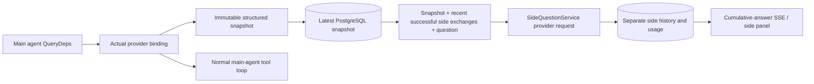

[English](../../../sidequestion/README.md) | [한국어](../../ko/sidequestion/README.md) | [简体中文](../../zh-Hans/sidequestion/README.md) | [繁體中文](../../zh-Hant/sidequestion/README.md) | [日本語](README.md) | [Español](../../es/sidequestion/README.md)

# ScopeWeaver `/btw`

通常のチャット、タスクの MainAgent、現在のタスクに属するワーカーで、独立した補足の質問を利用できます。メイン入力に `/btw question` と入力して送信し、空の `/btw` または補足の質問ボタンで履歴を開きます。デスクトップはサイズ変更できるサイドバー、モバイルは Drawer を使用します。

回答は送信時のエージェントのコンテキストスナップショットを使い、ストリーミング、追加質問、停止、消去に対応します。パネルを閉じる、更新する、SSE を切断する操作では、モデルのリクエストを中止しません。停止は現在の補足の質問にのみ作用します。消去は回答を中止して補足の質問の履歴を削除しますが、メインコンテキストのスナップショットは保持します。

## 実装の境界

上流の実装は、norma のソースを変えず、補足の質問用の依存関係を追加せず、Go、norma v0.3.7、Next.js、既存の Markdown / ResizablePanel / Drawer / AlertDialog コンポーネントを使用しました。プランナーの対応、他のタスクから継承したワーカー、ツールのサブタスクの更新は対象外でした。その実装以後、依存関係のバージョンが進んでいる場合があります。

- `capture.go` は `Options.Deps.CallModel / CallModelSync` 内でのみメインループの要求を識別します。プロバイダーのデコレーターは外側のプールルーティング後、具体的なモデルの内側にあるため、実際に選択したモデルを記録します。圧縮と要約の要求はスナップショットを上書きしません。
- スナップショットは、要求開始時、モデル応答の完了時、実行の最終状態で公開します。部分的な応答は除外します。norma の `MessagesForAPI` がツール呼び出しと結果の対を保ち、結果は次のメインモデルの要求時または最終状態でスナップショットに入ります。中断したストリームは、最後の有効な境界を保持します。
- JSON の深いコピーで、構造化メッセージ、システム指示、ツール定義、生成パラメーターを保持します。モデルの推論中は、スナップショットのロックも DB トランザクションも保持しません。
- `SideQuestionService` は具体的なプロバイダーを呼び、必要なら先に要約します。最終回答は、最初のコンテキスト超過エラー後、かつテキスト・ツール呼び出しの出力前に限り、コンテキストを縮小して 1 回再試行できます。エージェントセッションを作らず、ツール実行器、メイン会話記録、アクティビティストリーム、タスクグラフ、タスクのモデル切り替えチェーンに接続しません。回答の要求は既存の構造化ツールコンテキストのためツール定義を保持し、要約の要求はツールを省きます。新しいツール呼び出しには実行経路がありません。
- 親セッションごとに 1 件、サービスのプロセスごとに 4 件を同時実行でき、要求は 120 秒でタイムアウトします。補足の質問は、サービスのライフサイクル下に独立した中止コンテキストを持ちます。
- 要求はモデルのプロファイル参照と機密情報を含まない識別ダイジェストを保持し、認証情報は要求時の現在のプロファイルから取得します。プロファイルの削除や、モデル、プロトコル、アドレスなどの識別フィールドの変更後は、メインエージェントを実行してスナップショットを更新してください。テストは製品の既定モデルを変更しません。

## 永続化と復旧

`db/schema.sql` が `side_question_sessions` と `side_question_requests` を作成します。セッションは親リソース、最新のスナップショット、実行 ID、バージョン、消去バージョンを保存します。要求は質問、累積回答、状態、モデル、スナップショット時刻、使用量、イベントの連番、ページ送りの序数を保存します。

親キーは会話 ID、またはタスク ID + 探索 ID + 探索方針 ID です。ワーカーには再利用される実行枠名を使いません。

スナップショットの書き込みは親ごとにまとめ、250 ms ごとに反映します。DB は `(run_id, version)` を比較して古い書き込みを拒否します。補足の質問の送信前に、選択したスナップショットを再保存します。保存成功で大きなメモリー上のスナップショットを解放し、失敗時は保留中のバージョンを保持します。累積ストリーミング回答の書き込みは最短 250 ms 間隔で、最終状態は DB エラー時の回数制限付き再試行を伴って即座に保存します。

起動時は、残存する `running` 要求を `interrupted` にし、保存済みの部分回答と使用量を保持して、要求は再実行しません。最後に保存成功したコンテキストで、次の質問に直接答えられます。スナップショットのない古いセッションでは、先にメインエージェントを実行する必要があります。UI のアクティビティログからコンテキストは再構成しません。

消去は消去バージョンを増やして要求を削除し、条件付き更新が遅れて届くコールバックを拒否します。親の物理削除は外部キーで連鎖します。ワーカーの論理削除は同じトランザクションで補足データを削除し、後続のスナップショットを拒否します。タスクのアーカイブは、まず新しい要求をブロックし、メインの処理の停止を待ち、補足の要求を中止して永続化を待ちます。アーカイブ v3 は、補足の質問テーブルのない v1/v2 にも対応します。

全履歴は保持し、序数でページ分割して 1 ページ最大 20 件を取得します。モデルの要求は、トークン予算内で最近の成功したやり取りを最大 20 件再生します。それ以前のやり取りは、独立した更新式の要約を持ちます。メインコンテキストが大きすぎる場合、補足用コピーの古い部分のみを要約し、最近の構造化ツール呼び出し・結果を保持します。要約、準備、使用量は、補足の質問の同時実行枠、中止、120 秒のタイムアウトを共有します。[コンテキスト予算と上流の参照](CONTEXT_BUDGET.md)を参照してください。

## HTTP の契約

以下の既存の認証・リソース検査付きのパスを `{parent}` として使います:

- `/api/conversations/{id}`
- `/api/tasks/{id}/chat`
- `/api/tasks/{id}/intents/{iid}`

| リクエスト | レスポンスと動作 |
| --- | --- |
| `GET {parent}/side-questions?before={ordinal}` | 新しい順の `items`、実行中を分けた `current`、`snapshot` メタデータ、`next_cursor`。0 は最新ページ / 次のページなし |
| `POST {parent}/side-questions` | JSON `{ "question": "…", "client_request_id": "UUID" }`。新しい要求は 202 と要求オブジェクトを返し、同じ ID・質問は 200 と既存のオブジェクトを返す |
| `DELETE {parent}/side-questions` | この親の補足の質問を中止・消去 |
| `GET /api/side-questions/{requestID}/events` | `snapshot` SSE イベント: 増加する連番 `id`、`data` に完全な累積要求オブジェクト。消去は `cleared` を送信 |
| `POST /api/side-questions/{requestID}/cancel` | 明示的な中止。最終状態は履歴か SSE で読む |

質問は 4000 文字までです。スナップショットなし、プロファイル変更、親の処理中、冪等 ID の競合は 409、全体の同時実行上限は 429 を返します。各 SSE 接続は、受信済み断片に依存せず累積状態から開始します。フロントエンドは要求 ID + 連番で統合し、親の切り替えや消去時に古いコールバックを破棄します。

## 検証と参照

[VALIDATION.md](VALIDATION.md) は、上流の自動検査、実際のモデル使用、既知の制限を記録しています。過去の記録であり、新しい ScopeWeaver のテスト結果ではありません。

独立した要求は[固定コミットの Grok CLI side-question.ts](https://github.com/superagent-ai/grok-cli/blob/fb97af83f06dca873281d60168430f06c8de6324/src/utils/side-question.ts)、実行の隔離は[固定コミットの OpenCode](https://github.com/anomalyco/opencode/tree/b3f1a96c6dd7adeb28b36dd11add1998fc84d67b)を参照しています。ARTEX はフロントエンドのログからテキストを再構成せず、norma の構造化メッセージを使いました。ScopeWeaver はその実装を保持しています。
