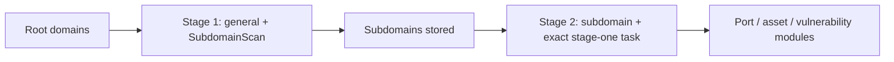

[English](../../../skills/scopesentry/SKILL.md) | [한국어](../../ko/skills/scopesentry.md) | [简体中文](../../zh-Hans/skills/scopesentry.md) | [繁體中文](../../zh-Hant/skills/scopesentry.md) | [日本語](scopesentry.md) | [Español](../../es/skills/scopesentry.md)

---
name: scopesentry-mcp
description: 配置済みの ScopeSentry セキュリティスキャン基盤を MCP 経由で管理します（プロジェクト、タスク、テンプレート、資産、ノード）。ScopeSentry、その MCP/API キー、スキャンタスク、資産の照会に言及された場合に使います。
---

<a id="scopesentry-mcp-guide"></a>
# ScopeSentry MCP ガイド


このガイドは配置済みの ScopeSentry インスタンス向けです。Cursor などの MCP クライアントで接続し、ローカルのソースコードは不要です。韓国語の参照資料は[こちら](../../ko/skills/scopesentry.md)です。

<a id="1-preparation"></a>
## 1. 準備

<a id="11-check-service-access"></a>
### 1.1 サービスへの接続を確認

- 既定のウェブ画面: `http://<host>`
- MCP エンドポイント: `http://<host>/mcp`。リバースプロキシ・フロントエンドプロキシがある場合、実際の `/mcp` アドレスを使用してください。

<a id="12-create-an-api-key"></a>
### 1.2 API キーを作成

1. ScopeSentry のウェブ画面にサインインします。
2. API Key 管理ページ、または管理者が用意する API でキーを作成します。
3. 返された `ssk_...` 文字列を保存してください。表示は 1 回だけです。

<a id="13-configure-cursor-mcp"></a>
### 1.3 Cursor の MCP を設定

Cursor の Settings → MCP → Add server を開きます:

```json
{
  "mcpServers": {
    "scopesentry": {
      "url": "http://<your-host>:8082/mcp",
      "headers": {"X-API-Key": "ssk_your-key"}
    }
  }
}
```

`Authorization: Bearer ssk_your-key` も使えます。MCP を再起動するか Cursor を再読み込みし、`list_projects`、`list_assets` などのツールが現れることを確認してください。

<a id="2-tools"></a>
## 2. ツール

| ツール | 目的 |
| --- | --- |
| `list_projects` | ID を含む、タグで分類したプロジェクトツリー |
| `list_projects_data` | 名前で検索できる、ページ単位のプロジェクト取得 |
| `get_project` | プロジェクトの詳細 |
| `create_project` | プロジェクトを作成 |
| `list_tasks` | スキャンタスク |
| `get_task` | タスクの詳細 |
| `list_scan_templates` | スキャンテンプレート |
| `get_scan_template` | テンプレートの詳細 |
| `list_plugin_modules` | スキャン処理のモジュール名 |
| `list_plugins` | 利用可能なプラグイン、ハッシュ、既定のパラメーター |
| `create_scan_template` | スキャンテンプレートを作成 |
| `create_scan_task` | スキャンタスクを作成 |
| `list_assets` | 資産をページ単位で照会 |
| `count_assets` | 資産数（`/api/assets/common/total`）|
| `get_asset_detail` | 資産または脆弱性の詳細 |
| `add_asset_tag` | 資産のタグを追加 |
| `list_nodes` | スキャンノード |

パラメーターは MCP ツールのスキーマを正とします。`list_assets` と `count_assets` は同じ検索・絞り込み構文を使います。照会前に `list_assets` の説明を読んでください。合計数には、全資産をページごとに取得する代わりに、ウェブ画面のページ送りの合計数 API である `count_assets` を使います。

<a id="3-common-workflows"></a>
## 3. よく使う作業フロー

<a id="31-query-assets-by-project"></a>
### 3.1 プロジェクト別の資産照会

ユーザーや文脈がプロジェクトを指定した場合は、遅い横断検索を避けるため `filter.project` を含めます。不明な場合、プロジェクトの絞り込みは必須ではありません。

1. `list_projects` または `list_projects_data` でプロジェクトの ObjectID（`id` / `children[].value`）を取得します。
2. `list_assets.filter.project` には表示名ではなく、その ID を渡してください。

```json
{
  "asset_type": "asset",
  "pageIndex": 1,
  "pageSize": 20,
  "search": "domain=^example.com",
  "filter": {"project": ["<project-ObjectID>"]}
}
```

<a id="32-create-a-scan-task"></a>
### 3.2 スキャンタスクを作成

1. `list_nodes` でオンラインのノード名を取得します。
2. `list_scan_templates` または `create_scan_template` でテンプレートの ObjectID を取得します。
3. `create_scan_task` は `name` と `node` が必須です。`template` は名前ではなく ID です。

`targetSource` はウェブ画面と同じです:

| targetSource | 取得元 | 必須パラメーター |
| --- | --- | --- |
| `general` | 直接入力 | `target` |
| `project` | プロジェクトの対象 | `project`（ObjectID の配列）|
| `asset` | ウェブ資産 DB の検索 | `search`。任意で `project`、`filter`、`targetNumber` |
| `RootDomain` | ルートドメイン DB の検索 | `search`。任意で `project`、`filter`、`targetNumber` |
| `subdomain` | サブドメイン DB の検索 | `search`。任意で `project`、`filter`、`targetNumber` |
| `UrlScan` | URL スキャン結果の検索 | `search`。任意で `project`、`filter`、`targetNumber` |
| `*Source`（例: `subdomainSource`）| 資産ページの選択・検索 | `targetTp=search` では `search`、`targetTp=select` では `targetIds` |

ルートドメインを直接スキャン:

```json
{
  "name": "example-subdomain-discovery",
  "node": ["node-1"],
  "template": "<template-ObjectID>",
  "targetSource": "general",
  "target": "example.com\nfoo.com",
  "project": ["<project-ObjectID>"]
}
```

前のタスク名で選択したサブドメインから続行:

```json
{
  "name": "example-ports-and-findings",
  "node": ["node-1"],
  "template": "<follow-up-template-ObjectID>",
  "targetSource": "subdomain",
  "search": "task==\"example-subdomain-discovery\"",
  "project": ["<project-ObjectID>"]
}
```

<a id="33-full-root-domain-discovery-in-two-stages"></a>
### 3.3 2 段階での完全なルートドメイン検出

ルートドメインから完全に検出するには、全処理を 1 回行う代わりに、2 回のスキャンを使います。分散タスクは対象を個別にノードへ割り当てます。そうしないと、ルートドメインとそこから見つかる全サブドメインが 1 ノードで後続モジュールを実行し、負荷の偏り、実行の遅延、エラー増加を招きます。

1. 第 1 段階はサブドメイン検出のみ: `targetSource=general`、全ルートドメインを改行区切りの `target` とし、`SubdomainScan` と `SubdomainSecurity`（検出と乗っ取り確認）だけのテンプレートを使います。`get_task` で完了を待ちます。
2. 第 2 段階は後続モジュール: `targetSource=subdomain`、完全一致の `search=task=="<stage-one-task-name>"`、任意の `project` を使用します。ポートスキャン、資産の対応付け、脆弱性スキャンなどのテンプレートを使い、`SubdomainScan` は省略できます。サブドメインが独立した対象として各ノードに分散されます。

ウェブ画面では、Subdomain 資産ページをタスク名で絞り、「サブドメインからタスクを作成」を選ぶ操作に相当します。



<a id="34-create-a-scan-template"></a>
### 3.4 スキャンテンプレートを作成

1. `list_plugin_modules` はモジュール名を返します。
2. `list_plugins` は、任意で `module` による絞り込みを指定し、各プラグインの `hash` と既定の `parameter` を返します。
3. `create_scan_template` で、`modules` にモジュール名 → プラグインハッシュの配列を設定します。

<a id="4-asset-queries-list_assets--count_assets"></a>
## 4. 資産の照会（`list_assets` / `count_assets`）

両者は同じ `asset_type`、`search`、`filter` を使います。`count_assets` は、ウェブ画面の `/api/assets/common/total` と同じ `{"total": N}` を返します。

```json
{
  "asset_type": "subdomain",
  "search": "task==\"task-name\"",
  "filter": {"project": ["<project-ObjectID>"]}
}
```

どちらのツールも、既知なら `filter.project` で絞ります。広い `=` の正規表現検索より、インデックスを使う `==` の完全一致や `^` の前方一致（[4.3](#43-search-expressions)）を優先してください。プロジェクトの文脈がなければ必須ではありません。対応するプロジェクトフィルターの種類は [4.4](#44-exact-filters) にあります。

<a id="41-asset-types"></a>
### 4.1 資産の種類

`asset`, `RootDomain`, `subdomain`, `app`, `mp`, `UrlScan`, `SensitiveResult`, `DirScanResult`, `crawler`, `vulnerability`, `PageMonitoring`, `IPAsset`, `SubdomainTakerResult`.

別名の例: `web` → `asset`、`vuln` → `vulnerability`、`ip` → `IPAsset`、`url` → `UrlScan`。

<a id="42-parameters"></a>
### 4.2 パラメーター

| パラメーター | 意味 |
| --- | --- |
| `pageIndex` / `pageSize` | ページ送り。既定値 1 / 20 |
| `search` | 下記の検索式 |
| `filter` | 下記の完全一致フィルター JSON |
| `sort` | UrlScan と DirScanResult のみが `length` による並べ替えに対応 |
| `sid` | SensitiveResult のみ。機密情報ルールの名前 |

`search` と `filter` は組み合わせられます。

<a id="43-search-expressions"></a>
### 4.3 検索式

独自の DSL であり、SQL ではありません。

| 演算子 | 意味 | インデックス | 例 |
| --- | --- | --- | --- |
| `=` | 正規表現の一致 | 不可 | `domain=example` |
| `==` | 完全一致 | 可 | `port==443` |
| `!=` | 除外 | 該当なし | `port!="80"` |
| `&&` | AND | 該当なし | `domain==example.com && port==443` |
| `\|\|` | OR | 該当なし | `title=admin \|\| body=login` |

`domain`、`ip`、`port`、`title` などのフィールドはインデックス化されています。インデックスを使うのは、完全一致 `==` または `^` で始まる値（例: `domain=^example.com`）のみです。通常の `=` は正規表現となり、大きなデータセットでは遅くなる場合があります。

すべての種類で `tag`、`task`（タスク名）、`rootDomain` を使えます。`project` を `search` に入れないでください。無効、または `&&` と組み合わせるとエラーになります。`filter.project` を使用してください。

| asset_type | 主な検索フィールド |
| --- | --- |
| asset | domain, ip, port, service, app, title, statuscode, icon, banner, type, body, header |
| RootDomain | domain, icp, company |
| subdomain | domain, ip, type, value |
| app | name, icp, company, category, description, url, apk |
| mp | name, icp, company, category, description, url |
| UrlScan | url, input, source, resultId, type |
| SensitiveResult | url, sname, body, info, md5 |
| DirScanResult | url, statuscode, redirect, length |
| vulnerability | url, vulname, matched, request, response, level |
| crawler | url, method, body, resultId |
| PageMonitoring | url, hash, diff, response |
| IPAsset | ip, domain, port, service, webServer, app |
| SubdomainTakerResult | domain, value, type, response |

例:

- `domain==www.example.com && port==443`: インデックスを使う完全一致。
- `domain=^example.com`: インデックスを使う前方一致。
- `ip==192.168.1.1`
- `task=="task-name"`
- vulnerability では `level==high`。
- DirScanResult では `statuscode==200`。

`=` は、`title=admin` など部分文字列・正規表現の一致が必要な場合のみ使ってください。インデックスを使わないため、プロジェクトや他の条件で絞ります。

<a id="44-exact-filters"></a>
### 4.4 完全一致フィルター

`filter` は JSON オブジェクトです。同じキー内の値は OR、異なるキーは AND です。プロジェクトが既知で、その種類が対応するなら `project` を含めます。それ以外は任意です。

| フィルターのキー | 意味 | 値 |
| --- | --- | --- |
| `project` | 所有するプロジェクト | `list_projects` / `list_projects_data` の ObjectID |
| `task` | 元のタスク | `list_tasks.name` のタスク名 |
| `port` | ポート | 例: `"443"` |
| `service` | サービス・プロトコル | 例: `"https"` |
| `app` | アプリケーションのフィンガープリント | 例: `"Nginx"` |
| `icon` | アイコンのハッシュ | |
| `statuscode` | HTTP ステータス | 主に asset |
| `status` | 状態 | UrlScan/DirScan の HTTP コード、検出事項・機密データの処置状態 |
| `level` | 検出事項の深刻度 | critical / high / medium / low / info |
| `type` | 種類 | 例: サブドメインの A / CNAME レコード |
| `color` | 機密情報ルールの色 | SensitiveResult |
| `sname` | 機密情報ルールの名前 | SensitiveResult |
| `tags` | タグ | |

| asset_type | 対応するフィルターのキー |
| --- | --- |
| asset | project, port, service, app, icon, statuscode, type, task, tags |
| RootDomain | project, tags |
| subdomain | project, type, task, tags |
| app / mp | project, tags |
| UrlScan | status, tags |
| DirScanResult | status, tags |
| SensitiveResult | status, color, sname, tags |
| crawler | project, task, tags |
| vulnerability | project, level, status, task, tags |
| PageMonitoring / SubdomainTakerResult | tags |
| IPAsset | project, port, service, app |

フィルターの例:

```json
{"project": ["<project-ObjectID>"], "port": ["443"]}
```

組み合わせた照会:

```json
{
  "asset_type": "asset",
  "search": "domain=^baidu && port==443",
  "filter": {"project": ["<project-ObjectID>"]},
  "pageIndex": 1,
  "pageSize": 10
}
```

注意点:

- 既知で対応している場合は `filter.project` を含めます。プロジェクトの文脈を創作しないでください。
- `filter.project` にプロジェクトの表示名を入れてはいけません。
- 既知の値には `==`、接頭辞には `^` を使い、大きなテーブルで広い `=` を避けてください。
- UrlScan の HTTP ステータスは `filter.status` を使います。DirScanResult は search の `statuscode==200` を使えます。
- SensitiveResult のルール名は search の `sname=rule-name` または `filter.sname` を使います。

<a id="45-sort"></a>
### 4.5 並べ替え

対応するのは UrlScan と DirScanResult のみです:

```json
{"length": "ascending"}
```

他の種類は `sort` を無視し、既定の時刻順を使います。

<a id="5-scan-template-modules"></a>
## 5. スキャンテンプレートのモジュール

`TargetHandler`, `SubdomainScan`, `SubdomainSecurity`, `PortScanPreparation`, `PortScan`, `PortFingerprint`, `AssetMapping`, `AssetHandle`, `URLScan`, `WebCrawler`, `URLSecurity`, `DirScan`, `VulnerabilityScan`, `PassiveScan`.

<a id="6-troubleshooting"></a>
## 6. 問題の解決

| 症状 | 対応 |
| --- | --- |
| MCP ツールがない | URL、API キー、実行中の ScopeSentry サービスを確認 |
| 401 / 403 | API キーを再作成・置換 |
| 資産が見つからない | プロジェクトの ObjectID を確認。project は search に入れない |
| テンプレート・タスクを作成できない | `template` は ObjectID、`node` はオンラインのノード名にする |
| 照会が遅い・停止する | 既知のプロジェクトで絞り、インデックスを使う `==` / `^` を使い、`=` を制限し、`pageSize` を減らす |
