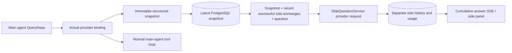

[English](../../../sidequestion/README.md) · [한국어](../../ko/sidequestion/README.md) · 简体中文 · [繁體中文](../../zh-Hant/sidequestion/README.md) · [日本語](../../ja/sidequestion/README.md) · [Español](../../es/sidequestion/README.md)

# ScopeWeaver `/btw`

各语言版本请见本页上方导览。

一般对话、任务 MainAgent 与目前任务的 Worker 支持独立侧问。在主输入栏输入 `/btw question` 提交；空白 `/btw` 或侧问按钮会开启历史。桌面使用可调整宽度的侧栏，移动版使用 Drawer。

回答使用提交时的智能体上下文快照，支持流式、追问、停止与清除。关闭面板、刷新或断开 SSE 不会取消模型请求。停止仅影响目前侧问；清除会取消侧问并删除侧问历史，但保留主要上下文快照。

## 实作边界

上游实作使用 Go、norma v0.3.7、Next.js 与既有 Markdown／ResizablePanel／Drawer／AlertDialog 元件，未修改 norma 源代码或新增侧问依赖包。不涵盖 Planner、继承自其他任务的 Worker 或工具子任务升级。依赖版本可能已更新。

- `capture.go` 仅在 `Options.Deps.CallModel / CallModelSync` 标记主循环请求。供应商 decorator 位于外层池路由之后的具体模型内，因此记录实际选取模型。压缩与摘要请求不覆写快照。
- 请求开始、完整模型响应及运行终止状态时发布快照，排除部分响应。norma 的 `MessagesForAPI` 保持工具呼叫配对；结果于下次主要模型请求或终止状态进入快照。中断流式保留最后有效边界。
- JSON 深层复制保留结构化消息、系统指示、工具定义与生成参数。模型推论不持有快照锁或数据库交易。
- `SideQuestionService` 呼叫具体供应商，必要时先摘要。最终回答仅可在首次上下文溢位且尚无文字／工具呼叫输出时，缩减上下文并重试一次。它不创建智能体会话，也不连接工具运行器、主要对话记录、活动流式、任务图或任务模型切换链。回答请求保留工具定义以支持既有结构化工具上下文；摘要请求不含工具。新工具呼叫没有运行路径。
- 每个父会话允许一个运行中请求，每个服务进程允许四个，请求逾时 120 秒。侧问在服务生命周期内具有独立取消上下文。
- 请求保留模型配置参照与不含敏感信息的身分摘要；请求时从目前配置取得凭证。若配置被删除，或模型、协定、地址等身分字段改变，请运行主要智能体以更新快照。测试不变更产品默认模型。

## 持久化与回滚

`db/schema.sql` 创建 `side_question_sessions` 与 `side_question_requests`。会话保存父资源、最新快照、run ID、版本与清除版本。请求保存问题、累计回答、状态、模型、快照时间、用量、事件序号与分页序位。

父键使用对话 ID，或任务 ID + 探索 ID + 意图 ID。Worker 不使用可重用的运行槽名称。

快照写入依父资源合并，每 250 ms 刷新。数据库比较 `(run_id, version)` 拒绝过期写入。提交侧问前会再次保存选定快照；成功后释放大型内存快照，失败则保留待写版本。流式累计回答最多每 250 ms 写入一次。终止状态立即保存，数据库错误采有界重试。

启动时将残留 `running` 请求标记为 `interrupted`，保留已保存部分回答与用量，不重放请求。最新成功保存上下文可直接回答下一问题。无快照的旧会话需先运行主要智能体，不从界面活动记录重建上下文。

清除会增加清除版本并删除请求；条件更新拒绝延迟回呼。实体父资源删除使用外键串连。逻辑删除 Worker 时在同一交易移除侧问数据并拒绝后续快照。任务封存先阻止新请求、等待主流程停止、取消侧问，再等待持久化。封存 v3 亦支持不含侧问表格的 v1／v2。

保留完整历史，依序位分页，每页最多 20 笔。模型请求最多重放最近 20 次成功交换，并受 token 预算进一步限制。更旧交换另存滚动摘要。主要上下文过大时，仅摘要侧问副本中的旧部分，保留最近结构化工具呼叫／结果。摘要、准备与用量共用侧问并行数、取消与 120 秒逾时。详见[上下文预算与上游参考](CONTEXT_BUDGET.md)。

## HTTP 契约

以下既有且经验证、资源检查的路径可作为 `{parent}`：

- `/api/conversations/{id}`
- `/api/tasks/{id}/chat`
- `/api/tasks/{id}/intents/{iid}`

| 请求 | 响应与行为 |
| --- | --- |
| `GET {parent}/side-questions?before={ordinal}` | 最新优先 `items`、独立运行中的 `current`、`snapshot` 元数据、`next_cursor`；0 表示最新页／无下一页 |
| `POST {parent}/side-questions` | JSON `{ "question": "…", "client_request_id": "UUID" }`；新请求传回 202 与请求对象；相同 ID／问题传回既有对象与 200 |
| `DELETE {parent}/side-questions` | 取消并清除此父资源侧问 |
| `GET /api/side-questions/{requestID}/events` | `snapshot` SSE 事件：递增序号 `id`、`data` 中完整累计请求对象；清除传送 `cleared` |
| `POST /api/side-questions/{requestID}/cancel` | 明确取消；通过历史或 SSE 读取终止状态 |

问题上限 4000 字符。缺少快照、配置变更、父资源忙碌或幂等 ID 冲突传回 409；全域并行上限传回 429。每个 SSE 连接以累计状态开始，不依赖已收到片段。前端以请求 ID + 序号合并，切换父资源或清除时丢弃旧回呼。

## 验证与参考

[VALIDATION.md](VALIDATION.md) 记录上游自动检查、实际模型使用及已知限制。这些历史收据并非最新 ScopeWeaver 测试结果。

独立请求参考[固定提交的 Grok CLI side-question.ts](https://github.com/superagent-ai/grok-cli/blob/fb97af83f06dca873281d60168430f06c8de6324/src/utils/side-question.ts)；运行隔离参考[固定提交的 OpenCode](https://github.com/anomalyco/opencode/tree/b3f1a96c6dd7adeb28b36dd11add1998fc84d67b)。ARTEX 使用 norma 结构化消息，而非从前端记录重建文字；ScopeWeaver 保留此实作。
