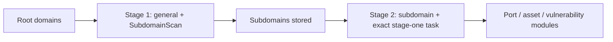

[English](../../../skills/scopesentry/SKILL.md) · [한국어](../../ko/skills/scopesentry.md) · 简体中文 · [繁體中文](../../zh-Hant/skills/scopesentry.md) · [日本語](../../ja/skills/scopesentry.md) · [Español](../../es/skills/scopesentry.md)

---
name: scopesentry-mcp
description: 通过 MCP 管理已部署的 ScopeSentry 安全扫描平台（专案、任务、模板、资产、节点）；适用于 ScopeSentry、MCP／API 密钥、扫描任务或资产查询。
---

<a id="scopesentry-mcp-guide"></a>

# ScopeSentry MCP 指南

各语言版本请见本页上方导览。

本指南适用于已部署的 ScopeSentry 运行个体。使用 Cursor 或其他 MCP 客户端连接，无须本地源代码。[韩文参考](../../ko/skills/scopesentry.md)。

<a id="1-preparation"></a>

## 1. 准备

<a id="11-check-service-access"></a>

### 1.1 检查服务存取

- 默认网页界面：`http://<host>`
- MCP 端点：`http://<host>/mcp`。存在反向／前端代理时，请使用实际 `/mcp` 地址。

<a id="12-create-an-api-key"></a>

### 1.2 创建 API 密钥

1. 登录 ScopeSentry 网页界面。
2. 在 API Key 管理页或管理员提供的 API 创建密钥。
3. 保存返回的 `ssk_...` 字串；仅显示一次。

<a id="13-configure-cursor-mcp"></a>

### 1.3 配置 Cursor MCP

在 Cursor 开启 Settings → MCP → Add server：


```json
{
  "mcpServers": {
    "scopesentry": {
      "url": "http://<your-host>:8082/mcp",
      "headers": {"X-API-Key": "ssk_your-key"}
    }
  }
}
```


亦可使用 `Authorization: Bearer ssk_your-key`。重启 MCP 或重新加载 Cursor，确认出现 `list_projects`、`list_assets` 等工具。

<a id="2-tools"></a>

## 2. 工具

| 工具 | 用途 |
| --- | --- |
| `list_projects` | 依标签分组的专案树，含 ID |
| `list_projects_data` | 可依名称搜寻的分页专案 |
| `get_project` | 专案详情 |
| `create_project` | 创建专案 |
| `list_tasks` | 扫描任务 |
| `get_task` | 任务详情 |
| `list_scan_templates` | 扫描模板 |
| `get_scan_template` | 模板详情 |
| `list_plugin_modules` | 扫描流程模组名称 |
| `list_plugins` | 可用外挂、哈希及默认参数 |
| `create_scan_template` | 创建扫描模板 |
| `create_scan_task` | 创建扫描任务 |
| `list_assets` | 分页资产查询 |
| `count_assets` | 资产数量（`/api/assets/common/total`） |
| `get_asset_detail` | 资产或漏洞详情 |
| `add_asset_tag` | 新增资产标签 |
| `list_nodes` | 扫描节点 |

参数以 MCP 工具结构为准。`list_assets` 与 `count_assets` 共用搜寻／筛选语法；查询前先读 `list_assets` 描述。总数请用网页分页总数 API 对应的 `count_assets`，不要逐页读取全部资产。

<a id="3-common-workflows"></a>

## 3. 常见工作流

<a id="31-query-assets-by-project"></a>

### 3.1 依专案查询资产

用户或上下文指定专案时，加入 `filter.project`，避免缓慢的跨专案结果。未知专案时不强制筛选。

1. 以 `list_projects` 或 `list_projects_data` 取得专案 ObjectID（`id`／`children[].value`）。
2. 将 ID 而非显示名称传入 `list_assets.filter.project`。


```json
{
  "asset_type": "asset",
  "pageIndex": 1,
  "pageSize": 20,
  "search": "domain=^example.com",
  "filter": {"project": ["<project-ObjectID>"]}
}
```


<a id="32-create-a-scan-task"></a>

### 3.2 创建扫描任务

1. 以 `list_nodes` 取得线上节点名称。
2. 以 `list_scan_templates` 或 `create_scan_template` 取得模板 ObjectID。
3. `create_scan_task` 必填 `name` 与 `node`；`template` 必须为 ID，不是名称。

`targetSource` 与网页界面一致：

| targetSource | 来源 | 必填参数 |
| --- | --- | --- |
| `general` | 直接输入 | `target` |
| `project` | 专案目标 | `project`（ObjectID 阵列） |
| `asset` | 网页资产数据库搜寻 | `search`；选填 `project`、`filter`、`targetNumber` |
| `RootDomain` | 根网域数据库搜寻 | `search`；选填 `project`、`filter`、`targetNumber` |
| `subdomain` | 子网域数据库搜寻 | `search`；选填 `project`、`filter`、`targetNumber` |
| `UrlScan` | URL 扫描结果搜寻 | `search`；选填 `project`、`filter`、`targetNumber` |
| `*Source`，如 `subdomainSource` | 资产页选取／搜寻 | `targetTp=search` 需 `search`；`targetTp=select` 需 `targetIds` |

直接扫描根网域：


```json
{
  "name": "example-subdomain-discovery",
  "node": ["node-1"],
  "template": "<template-ObjectID>",
  "targetSource": "general",
  "target": "example.com\nfoo.com",
  "project": ["<project-ObjectID>"]
}
```


依先前任务名称选取子网域后继续：


```json
{
  "name": "example-ports-and-findings",
  "node": ["node-1"],
  "template": "<follow-up-template-ObjectID>",
  "targetSource": "subdomain",
  "search": "task==\"example-subdomain-discovery\"",
  "project": ["<project-ObjectID>"]
}
```


<a id="33-full-root-domain-discovery-in-two-stages"></a>

### 3.3 两阶段完整根网域探索

从根网域完整探索时，请分两次扫描，不要一次运行完整流程。分散式任务会将个别目标指派至节点；否则根网域及其全部子网域的后续模组都在同一节点运行，造成负载不均、较慢与较多错误。

1. 第一阶段仅探索子网域：使用 `targetSource=general`，将全部根网域作为多行 `target`；模板只含 `SubdomainScan` 与 `SubdomainSecurity`（探索与接管检查）。用 `get_task` 等待完成。
2. 第二阶段运行后续模组：使用 `targetSource=subdomain`、精确 `search=task=="<stage-one-task-name>"`，并可指定 `project`。模板包含连接埠扫描、资产对应、漏洞扫描等，可省略 `SubdomainScan`。子网域现在作为独立目标分散至节点。

等效网页操作为在 Subdomain 资产页依任务名称筛选，再选「从子网域创建任务」。





<a id="34-create-a-scan-template"></a>

### 3.4 创建扫描模板

1. `list_plugin_modules` 传回模组名称。
2. `list_plugins` 可依 `module` 筛选，传回各外挂 `hash` 与默认 `parameter`。
3. 在 `create_scan_template` 将 `modules` 设为「模组名称 → 外挂哈希阵列」。

<a id="4-asset-queries-list_assets--count_assets"></a>

## 4. 资产查询（`list_assets`／`count_assets`）

两者使用相同 `asset_type`、`search`、`filter`。`count_assets` 传回 `{"total": N}`，与网页 `/api/assets/common/total` 一致。


```json
{
  "asset_type": "subdomain",
  "search": "task==\"task-name\"",
  "filter": {"project": ["<project-ObjectID>"]}
}
```


两种工具在已知专案时均以 `filter.project` 缩小范围。优先采用可用索引的 `==` 精确比对或 `^` 前缀（[4.3](#43-search-expressions)），避免广泛 `=` 规则运算式搜寻。无专案上下文时不强制筛选。支持专案筛选的类型见 [4.4](#44-exact-filters)。

<a id="41-asset-types"></a>

### 4.1 资产类型

`asset`, `RootDomain`, `subdomain`, `app`, `mp`, `UrlScan`, `SensitiveResult`, `DirScanResult`, `crawler`, `vulnerability`, `PageMonitoring`, `IPAsset`, `SubdomainTakerResult`.

别名示例：`web` → `asset`、`vuln` → `vulnerability`、`ip` → `IPAsset`、`url` → `UrlScan`。

<a id="42-parameters"></a>

### 4.2 参数

| 参数 | 含义 |
| --- | --- |
| `pageIndex` / `pageSize` | 分页，默认 1／20 |
| `search` | 下列搜寻运算式 |
| `filter` | 下列精确筛选 JSON |
| `sort` | 仅 UrlScan 与 DirScanResult 支持依 `length` 排序 |
| `sid` | 仅 SensitiveResult：敏感规则名称 |

`search` 与 `filter` 可合用。

<a id="43-search-expressions"></a>

### 4.3 搜寻运算式

这是自定义 DSL，并非 SQL。

| 运算子 | 含义 | 索引 | 示例 |
| --- | --- | --- | --- |
| `=` | 规则运算式比对 | 否 | `domain=example` |
| `==` | 精确相等 | 是 | `port==443` |
| `!=` | 排除 | 不适用 | `port!="80"` |
| `&&` | AND | 不适用 | `domain==example.com && port==443` |
| `\|\|` | OR | 不适用 | `title=admin \|\| body=login` |

`domain`、`ip`、`port`、`title` 等字段具有索引。只有精确 `==` 或以 `^` 开头的值（如 `domain=^example.com`）会用索引。一般 `=` 会变成规则运算式，在大型数据集可能很慢。

全部类型支持 `tag`、`task`（任务名称）与 `rootDomain`。勿将 `project` 放入 `search`；它无效或与 `&&` 合用时出错。请用 `filter.project`。

| asset_type | 常见搜寻字段 |
| --- | --- |
| asset | domain, ip, port, service, app, title, statuscode, icon, banner, type, body, header |
| RootDomain | domain, icp, company |
| subdomain | domain, ip, type, value |
| app | name, icp, company, category, description, url, apk |
| mp | name, icp, company, category, description, url |
| UrlScan | url, input, source, resultId, type |
| SensitiveResult | url, sname, body, info, md5 |
| DirScanResult | url, statuscode, redirect, length |
| vulnerability | url, vulname, matched, request, response, level |
| crawler | url, method, body, resultId |
| PageMonitoring | url, hash, diff, response |
| IPAsset | ip, domain, port, service, webServer, app |
| SubdomainTakerResult | domain, value, type, response |

示例：

- `domain==www.example.com && port==443`：索引精确比对。
- `domain=^example.com`：索引前缀。
- `ip==192.168.1.1`
- `task=="task-name"`
- 漏洞使用 `level==high`。
- DirScanResult 使用 `statuscode==200`。

仅在需要子字串／规则运算式时使用 `=`，如 `title=admin`。它不使用索引，请以专案或其他条件缩小范围。

<a id="44-exact-filters"></a>

### 4.4 精确筛选

`filter` 为 JSON 对象：同键下的值为 OR，不同键为 AND。已知专案且类型支持时加入 `project`；否则选填。

| 筛选键 | 含义 | 值 |
| --- | --- | --- |
| `project` | 所属专案 | `list_projects`／`list_projects_data` 的 ObjectID |
| `task` | 来源任务 | `list_tasks.name` 的任务名称 |
| `port` | 连接埠 | 如 `"443"` |
| `service` | 服务／协定 | 如 `"https"` |
| `app` | 应用程序指纹 | 如 `"Nginx"` |
| `icon` | 图示哈希 | |
| `statuscode` | HTTP 状态 | 主要为 asset |
| `status` | 状态 | UrlScan／DirScan HTTP 代码；发现／敏感数据处置 |
| `level` | 发现严重度 | critical / high / medium / low / info |
| `type` | 类型 | 如 A／CNAME 子网域记录 |
| `color` | 敏感规则颜色 | SensitiveResult |
| `sname` | 敏感规则名称 | SensitiveResult |
| `tags` | 标签 | |

| asset_type | 支持的筛选键 |
| --- | --- |
| asset | project, port, service, app, icon, statuscode, type, task, tags |
| RootDomain | project, tags |
| subdomain | project, type, task, tags |
| app / mp | project, tags |
| UrlScan | status, tags |
| DirScanResult | status, tags |
| SensitiveResult | status, color, sname, tags |
| crawler | project, task, tags |
| vulnerability | project, level, status, task, tags |
| PageMonitoring / SubdomainTakerResult | tags |
| IPAsset | project, port, service, app |

筛选示例：


```json
{"project": ["<project-ObjectID>"], "port": ["443"]}
```


组合查询：


```json
{
  "asset_type": "asset",
  "search": "domain=^baidu && port==443",
  "filter": {"project": ["<project-ObjectID>"]},
  "pageIndex": 1,
  "pageSize": 10
}
```


请记住：

- 已知且支持时加入 `filter.project`，不得虚构专案上下文。
- `filter.project` 绝不可使用专案显示名称。
- 已知值用 `==`，前缀用 `^`；大型表格避免广泛 `=`。
- UrlScan HTTP 状态使用 `filter.status`；DirScanResult 可在搜寻使用 `statuscode==200`。
- SensitiveResult 规则名使用搜寻 `sname=rule-name` 或 `filter.sname`。

<a id="45-sort"></a>

### 4.5 排序

仅 UrlScan 与 DirScanResult 支持：


```json
{"length": "ascending"}
```


其他类型忽略 `sort`，采默认时间排序。

<a id="5-scan-template-modules"></a>

## 5. 扫描模板模组

`TargetHandler`, `SubdomainScan`, `SubdomainSecurity`, `PortScanPreparation`, `PortScan`, `PortFingerprint`, `AssetMapping`, `AssetHandle`, `URLScan`, `WebCrawler`, `URLSecurity`, `DirScan`, `VulnerabilityScan`, `PassiveScan`.

<a id="6-troubleshooting"></a>

## 6. 疑难排解

| 症状 | 处理 |
| --- | --- |
| 无 MCP 工具 | 检查 URL、API 密钥与 ScopeSentry 服务是否运行 |
| 401 / 403 | 重建或替换 API 密钥 |
| 找不到资产 | 检查专案 ObjectID；勿将 project 放入 search |
| 创建模板／任务失败 | `template` 必须为 ObjectID；`node` 必须为线上节点名称 |
| 查询缓慢／卡住 | 加入已知专案筛选、采索引 `==`／`^`、限制 `=`、减小 `pageSize` |
