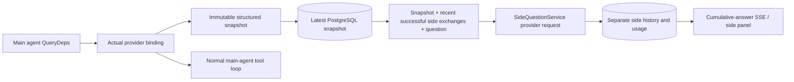

[English](../../../sidequestion/README.md) · [한국어](../../ko/sidequestion/README.md) · [简体中文](../../zh-Hans/sidequestion/README.md) · 繁體中文 · [日本語](../../ja/sidequestion/README.md) · [Español](../../es/sidequestion/README.md)

# ScopeWeaver `/btw`

各語言版本請見本頁上方導覽。

一般對話、任務 MainAgent 與目前任務的 Worker 支援獨立側問。在主輸入欄輸入 `/btw question` 提交；空白 `/btw` 或側問按鈕會開啟歷史。桌面使用可調整寬度的側欄，行動版使用 Drawer。

回答使用提交時的代理程式上下文快照，支援串流、追問、停止與清除。關閉面板、重新整理或斷開 SSE 不會取消模型請求。停止僅影響目前側問；清除會取消側問並刪除側問歷史，但保留主要上下文快照。

## 實作邊界

上游實作使用 Go、norma v0.3.7、Next.js 與既有 Markdown／ResizablePanel／Drawer／AlertDialog 元件，未修改 norma 原始碼或新增側問相依套件。不涵蓋 Planner、繼承自其他任務的 Worker 或工具子任務升級。相依版本可能已更新。

- `capture.go` 僅在 `Options.Deps.CallModel / CallModelSync` 標記主迴圈請求。供應商 decorator 位於外層池路由之後的具體模型內，因此記錄實際選取模型。壓縮與摘要請求不覆寫快照。
- 請求開始、完整模型回應及執行終止狀態時發布快照，排除部分回應。norma 的 `MessagesForAPI` 保持工具呼叫配對；結果於下次主要模型請求或終止狀態進入快照。中斷串流保留最後有效邊界。
- JSON 深層複製保留結構化訊息、系統指示、工具定義與生成參數。模型推論不持有快照鎖或資料庫交易。
- `SideQuestionService` 呼叫具體供應商，必要時先摘要。最終回答僅可在首次上下文溢位且尚無文字／工具呼叫輸出時，縮減上下文並重試一次。它不建立代理程式工作階段，也不連接工具執行器、主要對話記錄、活動串流、任務圖或任務模型切換鏈。回答請求保留工具定義以支援既有結構化工具上下文；摘要請求不含工具。新工具呼叫沒有執行路徑。
- 每個父工作階段允許一個執行中請求，每個服務處理程序允許四個，請求逾時 120 秒。側問在服務生命週期內具有獨立取消上下文。
- 請求保留模型設定檔參照與不含敏感資訊的身分摘要；請求時從目前設定檔取得憑證。若設定檔被刪除，或模型、協定、位址等身分欄位改變，請執行主要代理程式以更新快照。測試不變更產品預設模型。

## 持久化與復原

`db/schema.sql` 建立 `side_question_sessions` 與 `side_question_requests`。工作階段儲存父資源、最新快照、run ID、版本與清除版本。請求儲存問題、累計回答、狀態、模型、快照時間、用量、事件序號與分頁序位。

父鍵使用對話 ID，或任務 ID + 探索 ID + 意圖 ID。Worker 不使用可重用的執行槽名稱。

快照寫入依父資源合併，每 250 ms 刷新。資料庫比較 `(run_id, version)` 拒絕過期寫入。提交側問前會再次儲存選定快照；成功後釋放大型記憶體快照，失敗則保留待寫版本。串流累計回答最多每 250 ms 寫入一次。終止狀態立即儲存，資料庫錯誤採有界重試。

啟動時將殘留 `running` 請求標記為 `interrupted`，保留已儲存部分回答與用量，不重播請求。最新成功儲存上下文可直接回答下一問題。無快照的舊工作階段需先執行主要代理程式，不從介面活動記錄重建上下文。

清除會增加清除版本並刪除請求；條件更新拒絕延遲回呼。實體父資源刪除使用外鍵串連。邏輯刪除 Worker 時在同一交易移除側問資料並拒絕後續快照。任務封存先阻止新請求、等待主流程停止、取消側問，再等待持久化。封存 v3 亦支援不含側問表格的 v1／v2。

保留完整歷史，依序位分頁，每頁最多 20 筆。模型請求最多重播最近 20 次成功交換，並受 token 預算進一步限制。更舊交換另存滾動摘要。主要上下文過大時，僅摘要側問副本中的舊部分，保留最近結構化工具呼叫／結果。摘要、準備與用量共用側問並行數、取消與 120 秒逾時。詳見[上下文預算與上游參考](CONTEXT_BUDGET.md)。

## HTTP 契約

以下既有且經驗證、資源檢查的路徑可作為 `{parent}`：

- `/api/conversations/{id}`
- `/api/tasks/{id}/chat`
- `/api/tasks/{id}/intents/{iid}`

| 請求 | 回應與行為 |
| --- | --- |
| `GET {parent}/side-questions?before={ordinal}` | 最新優先 `items`、獨立執行中的 `current`、`snapshot` 中繼資料、`next_cursor`；0 表示最新頁／無下一頁 |
| `POST {parent}/side-questions` | JSON `{ "question": "…", "client_request_id": "UUID" }`；新請求傳回 202 與請求物件；相同 ID／問題傳回既有物件與 200 |
| `DELETE {parent}/side-questions` | 取消並清除此父資源側問 |
| `GET /api/side-questions/{requestID}/events` | `snapshot` SSE 事件：遞增序號 `id`、`data` 中完整累計請求物件；清除傳送 `cleared` |
| `POST /api/side-questions/{requestID}/cancel` | 明確取消；透過歷史或 SSE 讀取終止狀態 |

問題上限 4000 字元。缺少快照、設定檔變更、父資源忙碌或冪等 ID 衝突傳回 409；全域並行上限傳回 429。每個 SSE 連線以累計狀態開始，不依賴已收到片段。前端以請求 ID + 序號合併，切換父資源或清除時丟棄舊回呼。

## 驗證與參考

[VALIDATION.md](VALIDATION.md) 記錄上游自動檢查、實際模型使用及已知限制。這些歷史收據並非最新 ScopeWeaver 測試結果。

獨立請求參考[固定提交的 Grok CLI side-question.ts](https://github.com/superagent-ai/grok-cli/blob/fb97af83f06dca873281d60168430f06c8de6324/src/utils/side-question.ts)；執行隔離參考[固定提交的 OpenCode](https://github.com/anomalyco/opencode/tree/b3f1a96c6dd7adeb28b36dd11add1998fc84d67b)。ARTEX 使用 norma 結構化訊息，而非從前端記錄重建文字；ScopeWeaver 保留此實作。
