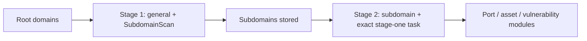

[English](../../../skills/scopesentry/SKILL.md) · [한국어](../../ko/skills/scopesentry.md) · [简体中文](../../zh-Hans/skills/scopesentry.md) · 繁體中文 · [日本語](../../ja/skills/scopesentry.md) · [Español](../../es/skills/scopesentry.md)

---
name: scopesentry-mcp
description: 透過 MCP 管理已部署的 ScopeSentry 安全掃描平台（專案、任務、範本、資產、節點）；適用於 ScopeSentry、MCP／API 金鑰、掃描任務或資產查詢。
---

<a id="scopesentry-mcp-guide"></a>

# ScopeSentry MCP 指南

各語言版本請見本頁上方導覽。

本指南適用於已部署的 ScopeSentry 執行個體。使用 Cursor 或其他 MCP 用戶端連接，無須本機原始碼。[韓文參考](../../ko/skills/scopesentry.md)。

<a id="1-preparation"></a>

## 1. 準備

<a id="11-check-service-access"></a>

### 1.1 檢查服務存取

- 預設網頁介面：`http://<host>`
- MCP 端點：`http://<host>/mcp`。存在反向／前端代理時，請使用實際 `/mcp` 位址。

<a id="12-create-an-api-key"></a>

### 1.2 建立 API 金鑰

1. 登入 ScopeSentry 網頁介面。
2. 在 API Key 管理頁或管理員提供的 API 建立金鑰。
3. 儲存回傳的 `ssk_...` 字串；僅顯示一次。

<a id="13-configure-cursor-mcp"></a>

### 1.3 設定 Cursor MCP

在 Cursor 開啟 Settings → MCP → Add server：


```json
{
  "mcpServers": {
    "scopesentry": {
      "url": "http://<your-host>:8082/mcp",
      "headers": {"X-API-Key": "ssk_your-key"}
    }
  }
}
```


亦可使用 `Authorization: Bearer ssk_your-key`。重新啟動 MCP 或重新載入 Cursor，確認出現 `list_projects`、`list_assets` 等工具。

<a id="2-tools"></a>

## 2. 工具

| 工具 | 用途 |
| --- | --- |
| `list_projects` | 依標籤分組的專案樹，含 ID |
| `list_projects_data` | 可依名稱搜尋的分頁專案 |
| `get_project` | 專案詳情 |
| `create_project` | 建立專案 |
| `list_tasks` | 掃描任務 |
| `get_task` | 任務詳情 |
| `list_scan_templates` | 掃描範本 |
| `get_scan_template` | 範本詳情 |
| `list_plugin_modules` | 掃描流程模組名稱 |
| `list_plugins` | 可用外掛、雜湊及預設參數 |
| `create_scan_template` | 建立掃描範本 |
| `create_scan_task` | 建立掃描任務 |
| `list_assets` | 分頁資產查詢 |
| `count_assets` | 資產數量（`/api/assets/common/total`） |
| `get_asset_detail` | 資產或漏洞詳情 |
| `add_asset_tag` | 新增資產標籤 |
| `list_nodes` | 掃描節點 |

參數以 MCP 工具結構為準。`list_assets` 與 `count_assets` 共用搜尋／篩選語法；查詢前先讀 `list_assets` 描述。總數請用網頁分頁總數 API 對應的 `count_assets`，不要逐頁讀取全部資產。

<a id="3-common-workflows"></a>

## 3. 常見工作流程

<a id="31-query-assets-by-project"></a>

### 3.1 依專案查詢資產

使用者或上下文指定專案時，加入 `filter.project`，避免緩慢的跨專案結果。未知專案時不強制篩選。

1. 以 `list_projects` 或 `list_projects_data` 取得專案 ObjectID（`id`／`children[].value`）。
2. 將 ID 而非顯示名稱傳入 `list_assets.filter.project`。


```json
{
  "asset_type": "asset",
  "pageIndex": 1,
  "pageSize": 20,
  "search": "domain=^example.com",
  "filter": {"project": ["<project-ObjectID>"]}
}
```


<a id="32-create-a-scan-task"></a>

### 3.2 建立掃描任務

1. 以 `list_nodes` 取得線上節點名稱。
2. 以 `list_scan_templates` 或 `create_scan_template` 取得範本 ObjectID。
3. `create_scan_task` 必填 `name` 與 `node`；`template` 必須為 ID，不是名稱。

`targetSource` 與網頁介面一致：

| targetSource | 來源 | 必填參數 |
| --- | --- | --- |
| `general` | 直接輸入 | `target` |
| `project` | 專案目標 | `project`（ObjectID 陣列） |
| `asset` | 網頁資產資料庫搜尋 | `search`；選填 `project`、`filter`、`targetNumber` |
| `RootDomain` | 根網域資料庫搜尋 | `search`；選填 `project`、`filter`、`targetNumber` |
| `subdomain` | 子網域資料庫搜尋 | `search`；選填 `project`、`filter`、`targetNumber` |
| `UrlScan` | URL 掃描結果搜尋 | `search`；選填 `project`、`filter`、`targetNumber` |
| `*Source`，如 `subdomainSource` | 資產頁選取／搜尋 | `targetTp=search` 需 `search`；`targetTp=select` 需 `targetIds` |

直接掃描根網域：


```json
{
  "name": "example-subdomain-discovery",
  "node": ["node-1"],
  "template": "<template-ObjectID>",
  "targetSource": "general",
  "target": "example.com\nfoo.com",
  "project": ["<project-ObjectID>"]
}
```


依先前任務名稱選取子網域後繼續：


```json
{
  "name": "example-ports-and-findings",
  "node": ["node-1"],
  "template": "<follow-up-template-ObjectID>",
  "targetSource": "subdomain",
  "search": "task==\"example-subdomain-discovery\"",
  "project": ["<project-ObjectID>"]
}
```


<a id="33-full-root-domain-discovery-in-two-stages"></a>

### 3.3 兩階段完整根網域探索

從根網域完整探索時，請分兩次掃描，不要一次執行完整流程。分散式任務會將個別目標指派至節點；否則根網域及其全部子網域的後續模組都在同一節點執行，造成負載不均、較慢與較多錯誤。

1. 第一階段僅探索子網域：使用 `targetSource=general`，將全部根網域作為多行 `target`；範本只含 `SubdomainScan` 與 `SubdomainSecurity`（探索與接管檢查）。用 `get_task` 等待完成。
2. 第二階段執行後續模組：使用 `targetSource=subdomain`、精確 `search=task=="<stage-one-task-name>"`，並可指定 `project`。範本包含連接埠掃描、資產對應、漏洞掃描等，可省略 `SubdomainScan`。子網域現在作為獨立目標分散至節點。

等效網頁操作為在 Subdomain 資產頁依任務名稱篩選，再選「從子網域建立任務」。





<a id="34-create-a-scan-template"></a>

### 3.4 建立掃描範本

1. `list_plugin_modules` 傳回模組名稱。
2. `list_plugins` 可依 `module` 篩選，傳回各外掛 `hash` 與預設 `parameter`。
3. 在 `create_scan_template` 將 `modules` 設為「模組名稱 → 外掛雜湊陣列」。

<a id="4-asset-queries-list_assets--count_assets"></a>

## 4. 資產查詢（`list_assets`／`count_assets`）

兩者使用相同 `asset_type`、`search`、`filter`。`count_assets` 傳回 `{"total": N}`，與網頁 `/api/assets/common/total` 一致。


```json
{
  "asset_type": "subdomain",
  "search": "task==\"task-name\"",
  "filter": {"project": ["<project-ObjectID>"]}
}
```


兩種工具在已知專案時均以 `filter.project` 縮小範圍。優先採用可用索引的 `==` 精確比對或 `^` 前綴（[4.3](#43-search-expressions)），避免廣泛 `=` 規則運算式搜尋。無專案上下文時不強制篩選。支援專案篩選的類型見 [4.4](#44-exact-filters)。

<a id="41-asset-types"></a>

### 4.1 資產類型

`asset`, `RootDomain`, `subdomain`, `app`, `mp`, `UrlScan`, `SensitiveResult`, `DirScanResult`, `crawler`, `vulnerability`, `PageMonitoring`, `IPAsset`, `SubdomainTakerResult`.

別名範例：`web` → `asset`、`vuln` → `vulnerability`、`ip` → `IPAsset`、`url` → `UrlScan`。

<a id="42-parameters"></a>

### 4.2 參數

| 參數 | 含義 |
| --- | --- |
| `pageIndex` / `pageSize` | 分頁，預設 1／20 |
| `search` | 下列搜尋運算式 |
| `filter` | 下列精確篩選 JSON |
| `sort` | 僅 UrlScan 與 DirScanResult 支援依 `length` 排序 |
| `sid` | 僅 SensitiveResult：敏感規則名稱 |

`search` 與 `filter` 可合用。

<a id="43-search-expressions"></a>

### 4.3 搜尋運算式

這是自訂 DSL，並非 SQL。

| 運算子 | 含義 | 索引 | 範例 |
| --- | --- | --- | --- |
| `=` | 規則運算式比對 | 否 | `domain=example` |
| `==` | 精確相等 | 是 | `port==443` |
| `!=` | 排除 | 不適用 | `port!="80"` |
| `&&` | AND | 不適用 | `domain==example.com && port==443` |
| `\|\|` | OR | 不適用 | `title=admin \|\| body=login` |

`domain`、`ip`、`port`、`title` 等欄位具有索引。只有精確 `==` 或以 `^` 開頭的值（如 `domain=^example.com`）會用索引。一般 `=` 會變成規則運算式，在大型資料集可能很慢。

全部類型支援 `tag`、`task`（任務名稱）與 `rootDomain`。勿將 `project` 放入 `search`；它無效或與 `&&` 合用時出錯。請用 `filter.project`。

| asset_type | 常見搜尋欄位 |
| --- | --- |
| asset | domain, ip, port, service, app, title, statuscode, icon, banner, type, body, header |
| RootDomain | domain, icp, company |
| subdomain | domain, ip, type, value |
| app | name, icp, company, category, description, url, apk |
| mp | name, icp, company, category, description, url |
| UrlScan | url, input, source, resultId, type |
| SensitiveResult | url, sname, body, info, md5 |
| DirScanResult | url, statuscode, redirect, length |
| vulnerability | url, vulname, matched, request, response, level |
| crawler | url, method, body, resultId |
| PageMonitoring | url, hash, diff, response |
| IPAsset | ip, domain, port, service, webServer, app |
| SubdomainTakerResult | domain, value, type, response |

範例：

- `domain==www.example.com && port==443`：索引精確比對。
- `domain=^example.com`：索引前綴。
- `ip==192.168.1.1`
- `task=="task-name"`
- 漏洞使用 `level==high`。
- DirScanResult 使用 `statuscode==200`。

僅在需要子字串／規則運算式時使用 `=`，如 `title=admin`。它不使用索引，請以專案或其他條件縮小範圍。

<a id="44-exact-filters"></a>

### 4.4 精確篩選

`filter` 為 JSON 物件：同鍵下的值為 OR，不同鍵為 AND。已知專案且類型支援時加入 `project`；否則選填。

| 篩選鍵 | 含義 | 值 |
| --- | --- | --- |
| `project` | 所屬專案 | `list_projects`／`list_projects_data` 的 ObjectID |
| `task` | 來源任務 | `list_tasks.name` 的任務名稱 |
| `port` | 連接埠 | 如 `"443"` |
| `service` | 服務／協定 | 如 `"https"` |
| `app` | 應用程式指紋 | 如 `"Nginx"` |
| `icon` | 圖示雜湊 | |
| `statuscode` | HTTP 狀態 | 主要為 asset |
| `status` | 狀態 | UrlScan／DirScan HTTP 代碼；發現／敏感資料處置 |
| `level` | 發現嚴重度 | critical / high / medium / low / info |
| `type` | 類型 | 如 A／CNAME 子網域記錄 |
| `color` | 敏感規則顏色 | SensitiveResult |
| `sname` | 敏感規則名稱 | SensitiveResult |
| `tags` | 標籤 | |

| asset_type | 支援的篩選鍵 |
| --- | --- |
| asset | project, port, service, app, icon, statuscode, type, task, tags |
| RootDomain | project, tags |
| subdomain | project, type, task, tags |
| app / mp | project, tags |
| UrlScan | status, tags |
| DirScanResult | status, tags |
| SensitiveResult | status, color, sname, tags |
| crawler | project, task, tags |
| vulnerability | project, level, status, task, tags |
| PageMonitoring / SubdomainTakerResult | tags |
| IPAsset | project, port, service, app |

篩選範例：


```json
{"project": ["<project-ObjectID>"], "port": ["443"]}
```


組合查詢：


```json
{
  "asset_type": "asset",
  "search": "domain=^baidu && port==443",
  "filter": {"project": ["<project-ObjectID>"]},
  "pageIndex": 1,
  "pageSize": 10
}
```


請記住：

- 已知且支援時加入 `filter.project`，不得虛構專案上下文。
- `filter.project` 絕不可使用專案顯示名稱。
- 已知值用 `==`，前綴用 `^`；大型表格避免廣泛 `=`。
- UrlScan HTTP 狀態使用 `filter.status`；DirScanResult 可在搜尋使用 `statuscode==200`。
- SensitiveResult 規則名使用搜尋 `sname=rule-name` 或 `filter.sname`。

<a id="45-sort"></a>

### 4.5 排序

僅 UrlScan 與 DirScanResult 支援：


```json
{"length": "ascending"}
```


其他類型忽略 `sort`，採預設時間排序。

<a id="5-scan-template-modules"></a>

## 5. 掃描範本模組

`TargetHandler`, `SubdomainScan`, `SubdomainSecurity`, `PortScanPreparation`, `PortScan`, `PortFingerprint`, `AssetMapping`, `AssetHandle`, `URLScan`, `WebCrawler`, `URLSecurity`, `DirScan`, `VulnerabilityScan`, `PassiveScan`.

<a id="6-troubleshooting"></a>

## 6. 疑難排解

| 症狀 | 處理 |
| --- | --- |
| 無 MCP 工具 | 檢查 URL、API 金鑰與 ScopeSentry 服務是否執行 |
| 401 / 403 | 重建或替換 API 金鑰 |
| 找不到資產 | 檢查專案 ObjectID；勿將 project 放入 search |
| 建立範本／任務失敗 | `template` 必須為 ObjectID；`node` 必須為線上節點名稱 |
| 查詢緩慢／卡住 | 加入已知專案篩選、採索引 `==`／`^`、限制 `=`、減小 `pageSize` |
